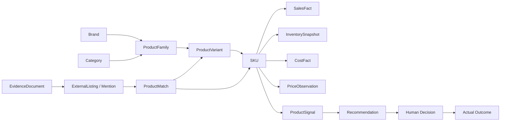
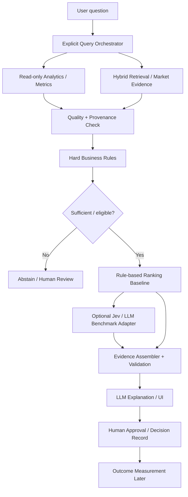
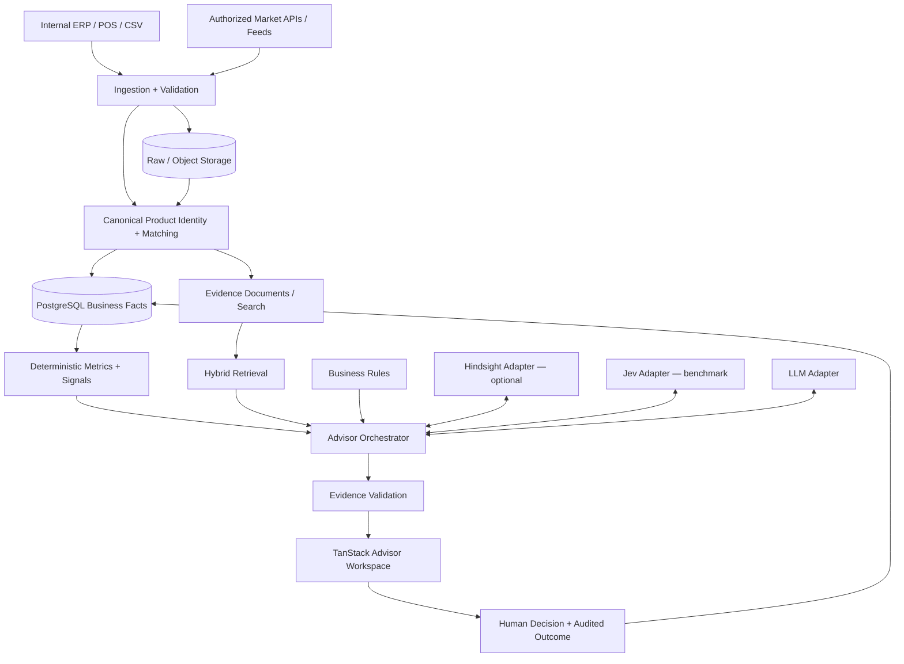

# AI Product Intelligence Advisor — STEP 0: Product Blueprint

> **Version:** Blueprint v0.2 — Baseline Candidate (gap-closure revision)  
> **Date:** 10 October 2026 (Asia/Bangkok)  
> **Document type:** Product Blueprint / Pre-implementation alignment  
> **Status:** **Declared complete by the user (10 Oct 2026).** Open owner decisions (DEC-001…016) and S1-DEC-11 (§8.3) remain open; no business policy is implied.  
> **Method:** Adapted from `THE-PERFECT-PROMPT-PATTERN.txt`: **Context → Goal → Constraints → Output → Verify**

**Changelog**

| Version | Change |
|---|---|
| Blueprint v0.1 | Initial synthesis of the five text sources. |
| Blueprint v0.2 | Integrated the STEP 0 concept image (§11.5) and reconciled it with the invariants; corrected stale placement and source-count statements (§4, §18); added unregistered open questions from the source documents (DEC-012–DEC-016); published the STEP 1 / PROMPT 01 hand-off text (`STEP_1_Prompt_01.md`); updated the review checklist (§17). No decision was approved by this revision. |

---

## 0. How to Read This Blueprint

This blueprint synthesizes the project documents listed in §18; **it does not replace or silently approve the architecture proposals** contained in those documents.

| Marker | Meaning |
|---|---|
| **[ESTABLISHED]** | Explicit product intent / principle already recorded in the source documents. |
| **[PROPOSED]** | Recommendation for the pilot or implementation, subject to review. |
| **[OPEN]** | Decision requiring the product owner, business owner, or technical owner. |
| **[LATER]** | Intentionally deferred beyond the relevant initial milestone. |

**Evidence rule:** Product and engineering decisions in this document are distinct from verified market or business facts. No real customer data, SKU metrics, margin levels, vendor prices, or real-time market data were provided. Any example is illustrative, never a claim about an actual business.

**Priority among sources when resolving future discrepancies:** explicit new project decisions / ADRs → this blueprint once approved → `research-draft_v2.md` (Architecture/Implementation v0.2 proposed baseline) → `AI_Product_Intelligence_Advisor_Architecture.md` (v0.1 draft) → research reports for external case studies. This priority rule is **[PROPOSED]**, not an existing approved governance policy.

**Version naming:** a bare "v0.1" / "v0.2" in this document means the architecture drafts (`AI_Product_Intelligence_Advisor_Architecture.md` = v0.1, `research-draft_v2.md` = v0.2). This document's own version is always written "Blueprint v0.x".

---

# PART A — CONTEXT: What Are We Building?

## 1. Product Charter

**Name:** AI Product Intelligence Advisor  
**Type:** Evidence-first AI Product Decision Intelligence Platform  
**One-line vision [ESTABLISHED]:** Combine trusted internal product/business facts with permitted external market intelligence so users can make explainable, auditable, measurable product and promotion decisions.

### 1.1 The business problem

Analysts must currently reconcile product identity, sales, stock, cost, news, reviews, competitor offers, and business constraints before proposing commercial actions. A generic dashboard may show the numbers, and a generic chatbot may describe documents, but neither inherently delivers a traceable recommendation tied to the same canonical SKU and an actual later outcome.

### 1.2 Our promise [ESTABLISHED]

The system must help answer:

- What is happening to our products and the market?
- Which exact products/SKUs does the evidence concern?
- Which products deserve attention now, and why?
- What should the business do: discount, bundle, advertise without discount, or hold?
- What facts, assumptions, risks, policy checks, and competing options support that recommendation?
- Who decided, what was done, and what measurable outcome followed?

**Core operating loop:**  
`Product Identity → Trusted Data → Market Signals → Business Analysis → Recommendation → Human Decision → Outcome Measurement`

### 1.3 Non-goals [ESTABLISHED]

This is **not** a replacement ERP, POS, e-commerce platform, generic web crawler, or fully autonomous ad buyer. A language model does **not** become the system of record for money, stock, sales, or source evidence.

### 1.4 Differentiation / why build [PROPOSED synthesis from research]

- Own the canonical product identity and business definitions.
- Treat provenance, freshness, and uncertainty as part of the *data contract*, not decorative citation links.
- Join structured SQL facts with unstructured external documents to support business judgments.
- Enforce hard policies before ranking and again before presenting/actioning a candidate.
- Close the decision loop with human approval and actual outcome records.
- Reuse OSS infrastructure where advantageous; do not fork an unrelated AI monolith as the whole product.

## 2. Who Is It For?

The source architecture specifies capabilities, not validated user interviews. These personas are **[PROPOSED]** starting hypotheses, to validate during the pilot:

| Role | Job to be done | Needs from the Advisor |
|---|---|---|
| Category / Merchandising Manager | Select which SKU needs action and which tactic is viable | Ranked choices, margin/stock guardrails, alternatives |
| Business / Commercial Analyst | Verify performance and market evidence | Reproducible metrics, source links, filters, as-of times |
| Marketing / Campaign Planner | Understand promotional rationale | Audience/channel assumptions, options, approval requirements |
| Data Steward / Product Ops | Resolve ambiguous matches and faulty feeds | Review queue, match method, quality status, lineage |
| Business Approver / Admin | Approve, reject, and audit recommendations | Policy history, permissions, recorded rationale, immutable trail |

**[OPEN]** Confirm whether the first pilot has these roles, whether they are distinct users, and who owns the business policies.

## 3. Pilot Boundary and Operating Assumptions

The v0.2 architecture proposes a single organization and TV/electronics as a sample pilot, not a finalized choice.

| Dimension | Working baseline | Status |
|---|---|---|
| Organization | Single organization for MVP | **[PROPOSED]** |
| Product category | TVs / consumer electronics | **[PROPOSED]** |
| Market | Thailand-first | **[PROPOSED]**, verify business need |
| Language | Thai-first user experience; preserve Thai/English SKU aliases | **[PROPOSED]** |
| Seed data | Clearly labeled synthetic CSV data until authorized facts are available | **[PROPOSED]** |
| Internal sources | CSV first; approved ERP/POS/DB/API connections later | **[PROPOSED]** |
| External sources | Licensed/authorized feeds and APIs only | **[ESTABLISHED]** constraint |
| Currency/time | Store explicit currency and time zone; never assume equivalence | **[ESTABLISHED]** principle |
| KPI/targets | Must be selected with business owner and baseline | **[OPEN]** |
| Models/providers | Provider-independent adapters; evaluate rather than pre-commit | **[ESTABLISHED]** intent |

The system must still give a transparent **internal-data-only** answer when authorized external data are unavailable; it must not invent competitor prices, sentiment, or market signals.

---

# PART B — GOAL: What Must STEP 0 Achieve?

## 4. Specific Output of STEP 0

**Goal:** Establish an implementation-ready *candidate* shared understanding of the first vertical slice, product boundaries, domain vocabulary, data trust rules, user journey, reference architecture, verification criteria, and unresolved decisions — **without implementing code**.

**Deliverables:**

1. This Markdown blueprint at `docs/product/STEP_0_Product_Blueprint.md`.
2. The concept image `docs/concept/AI Product Intelligence Dashboard.png` (the prompt pattern's literal STEP 0 artifact), reviewed in §11.5.
3. The scoped first coding prompt `docs/product/STEP_1_Prompt_01.md` (§16.1) — since superseded by the implemented STEP 1 record.

### STEP 0 is successful when

1. A developer can explain the user, business question, and expected answer without inventing requirements.
2. The first end-to-end workflow has explicit inputs, outputs, verification gates, and fallback states.
3. The distinction between observed facts, computed metrics, inferred signals, recommendations, and real outcomes is explicit.
4. UX priorities and non-goals are concrete enough for an initial interface sketch.
5. Engineering can start domain contracts without picking a final external vendor, model, or orchestration framework.
6. Decisions not approved are clearly marked **[OPEN]** or **[PROPOSED]**.

## 5. First Vertical Slice (North-Star Task)

**User question [ESTABLISHED]:**

> “ทีวีรุ่นไหนในสต็อกที่ควรทำโปรโมชั่นในเดือนนี้ และควรใช้โปรโมชั่นแบบใด?”

**Objective:** Produce an evidence-backed, policy-compliant shortlist of product/SKU promotion candidates, not merely a conversational opinion.

### 5.1 Required workflow

| Step | Input/action | Output or guard |
|---|---|---|
| 1. Interpret | User question; intended business objective; time window | Normalized request; request clarification only if essential |
| 2. Resolve products | Category + canonical identity | Eligible SKUs, aliases, unresolved entities flagged |
| 3. Load facts | Sales, stock, price, cost, applicable promotion records | Time-scoped trusted facts with source IDs |
| 4. Compute | Deterministic metric definitions | Growth, margin, stock pressure; formula version |
| 5. Enrich (if available) | Permitted market/review/competitor evidence | Fresh, deduplicated, matched evidence; missing-data flags |
| 6. Validate | Data rights, freshness, quality, product-match status | Block, abstain, or route to review when unsafe |
| 7. Enforce policy | Minimum margin, stock, budget, exclusions, vendor restrictions | No prohibited candidate progresses |
| 8. Rank/compare | Rule-based baseline; optional model experiments | Ranked candidates and rationale; compare alternatives |
| 9. Explain | Facts + limitations + source references | Recommendation, alternate options, risks, assumptions |
| 10. Capture choice | Human approve/reject/request more data | Auditable decision with versions and evidence snapshot |
| 11. Measure later | Actual campaign and comparison/baseline data | Outcome record, clearly separated from forecasts |

Steps 1–9 are the **first functioning advisor slice**; steps 10–11 complete the longer-term decision/outcome loop. Data preparation must come first.

### 5.2 Minimum response anatomy

```text
Answer / Recommendation
  - Candidate SKU(s) / resolved product identity
  - Business objective and time window
  - Recommended action: discount | bundle | advertise_only | hold
  - Recommendation status: recommended | insufficient_data | review_required

Trusted Business Facts
  - Sales metric + period + source + formula version
  - Stock metric + as-of time
  - Price / cost / margin, gated by permission

Why / Trade-offs
  - Supporting reasons
  - Alternative options and why not selected
  - Hard-constraint results
  - Assumptions, contradictory evidence, risks, missing information

Evidence and Confidence
  - Source ID / reference / published, observed, fetched, as-of times
  - SKU match and review status
  - Separate dimensions for data quality, match, retrieval, model confidence

Decision Record (when actioned)
  - Recommendation / policy / model / prompt versions
  - Approve | Reject | Request more data
  - Human approver and recorded rationale
  - Actual outcome (later, never fabricated)
```

### 5.3 Safe output rules

- If cost/margin data are missing or unauthorized, do not state profit-based viability as certain.
- If product matches are ambiguous, do not attach an external price/review to an exact SKU without review.
- If external evidence is absent, label the recommendation as based on **internal data only**.
- If a hard rule is violated, exclude or clearly block the candidate regardless of AI score.
- If evidence is inadequate, return `insufficient_data` or `review_required` with the missing fields and a useful next step.
- If asked about actual impact before a campaign occurs, say the outcome is not yet measurable.

---

# PART C — CONSTRAINTS: What Must Not Be Violated?

## 6. Product Principles and Invariants

| ID | Invariant | Enforcement concept |
|---|---|---|
| INV-01 | LLM is never the financial/stock source of truth | Use read-only governed analytics, validated calculators |
| INV-02 | Every critical business claim is traceable | Evidence IDs, source refs, time, versions |
| INV-03 | Product family / variant / SKU are not interchangeable | Canonical identity and explicit match review |
| INV-04 | External text is untrusted data, not tool instructions | Prompt injection isolation + policy-limited tools |
| INV-05 | Hard constraints cannot be overridden by model preference | Deterministic policy validation before/after scoring |
| INV-06 | Recommendation is not the same as approval or execution | Human-controlled approval and separated integrations |
| INV-07 | Forecast or scenario is not proven causal promotion lift | Label assumptions; measure outcomes against baseline/control |
| INV-08 | Data rights/privacy govern access and retention | Source registry, permissions, data classification |
| INV-09 | Missing/stale evidence must be visible | Explicit abstention, freshness and coverage flags |
| INV-10 | Model confidence is not business-success probability | Display calibrated dimensions separately, if available |

**MVP prohibited actions [ESTABLISHED]:** Autonomous price changes, campaign execution/ad buying without approval, unrestricted write SQL, cross-tenant exposure, and fictional business metrics.

## 7. Scope & Priorities

### 7.1 Included in the full MVP — drawn from v0.2 architecture [ESTABLISHED as draft scope]

- Product catalog + internal business-fact imports; canonical identity + human review.
- Internal business analytics and deterministic metric definitions.
- Authorized news/market ingestion and evidence provenance.
- Hybrid structured/unstructured retrieval with cited answers.
- Conversational AI workspace.
- Business rules + product signal/opportunity ranking + recommendation explanation.
- Decision history and minimum evaluation/monitoring.

### 7.2 Sequenced rather than built at once [PROPOSED]

| Build layer | First usable capability | Dependency |
|---|---|---|
| Foundation | Local project, contracts, migrations, basic observability | — |
| Trusted data | Import test products/facts, match identity, verify metrics | Foundation |
| Evidence-first analyst | Answer constrained questions with SQL/evidence | Trusted data |
| Opportunity advisor | Rank viable promotion candidates | Metrics + sources + rules |
| Decision loop | Record review/approval; connect outcomes later | Reliable recommendations |

### 7.3 Deferred or out of initial MVP [ESTABLISHED / LATER]

- Fully autonomous campaign execution and price changes.
- Rebuilding ERP or the commerce platform.
- Broad multi-tenant SaaS and distributed microservice infrastructure.
- Training a foundation model or advanced forecasting before trustworthy training data exist.
- Sophisticated what-if modeling, proactive alerts, or integrations without a validated use case.

## 8. Trusted Data & Canonical Product Ontology

### 8.1 Domain entities



The graph is **conceptual**: cardinalities, normalized table keys, and nullable fields are STEP 1 design work. External evidence may resolve only to a product family or variant; never imply exact SKU resolution when evidence does not support it.

### 8.2 Source and time metadata for facts

All relevant facts require source lineage; meaningful times include:

- `event_time` / `effective_at`: when an event or business value applies.
- `observed_at`: when an observation was made.
- `published_at`: when source content was published.
- `fetched_at`: when we retrieved source content.
- `ingested_at`: when it entered the system.
- `data_as_of`: point in time represented by the answer.

Only include times applicable to a given record; timestamp semantics must be explicit, and queries must preserve time zone and currency.

### 8.3 ProductMatch record [PROPOSED contract]

```text
external_entity_id
canonical_product_id
sku_id?                         # only when the evidence supports exact SKU identity
match_method                    # exact ID / alias / probabilistic / semantic / manual
match_confidence                # must be calibrated or labeled appropriately
matcher_version
review_status                   # matched / pending_review / rejected / unresolved
supporting_evidence_ids[]
valid_from / valid_to           # temporal match validity
```

Identity priority **[PROPOSED]**: strong identifiers → validated aliases/attributes → probabilistic candidates → human review for ambiguous/high-risk matches. Compare Splink/Zingg using the same labeled data before adoption.

### 8.4 Separation of knowledge classes

| Class | Example | Authority |
|---|---|---|
| Observed fact | SKU price on a specified date | Authorized original record and metadata |
| Deterministic metric | Gross margin over defined period | Versioned formula over trusted facts |
| Market signal | Change in mention frequency | Versioned computation + source coverage |
| AI inference | A plausible reason for sentiment change | Labeled interpretation with evidence |
| Proposed action | Bundle rather than discount | Rules + ranked criteria + supporting facts |
| Actual outcome | Incremental sales after approved promotion | Measured business records + methodology |
| Agent memory | Analyst preference or previous decision rationale | Hindsight is supplemental, not transactional authority |

## 9. Decision and Model Boundaries



- **Rules/code/SQL**: financial arithmetic, metric definitions, constraints, audit contracts.
- **LLM**: natural-language intent, synthesis, explanation, carefully scoped tool calls.
- **Jev**: optional typed classification/choice/score experiment; deploy only if it beats a measured baseline on relevant tasks; not a calculator.
- **Hindsight**: optional decision/preferences/lessons memory; never current stock, price, or actual transactions.
- **Orchestration**: explicit, observable workflow first; LangGraph only when durable branching/resume is justified.
- **Evidence Assembler**: must block unsupported material claims even if LLM text is fluent.

### 9.1 Confidence dimensions

Do **not** conflate: `entity_match_confidence`, `data_quality_confidence`, `retrieval/evidence_confidence`, `decision_model_confidence`. Neither a confidence score nor a rank is a validated estimate of promotion success.

### 9.2 Example recommendation decision set

`discount | bundle | advertise_only | hold` is the initial comparison vocabulary. Real eligibility, margins, budget limits, minimum stock, campaign calendar, and vendor restrictions require owner-supplied policies. Do not invent default percentages or scores.

## 10. Data Sources and Market-Rights Policy

**Internal:** CSV/ERP/POS/product catalog, sales, inventory, price, cost, approved promotion history.  
**External:** Licensed or otherwise authorized news, review, marketplace, social, competitor, and vendor feeds.

Each external source should have a registry record for access permissions, geographic/category coverage, permitted storage/excerpts, attribution, retention, refresh cadence, last fetch, and reliability. Collectors need deduplication, backfill, retry, failure visibility, and a way to mark expired/unlicensed evidence. No general-purpose unauthorized scraping is authorized by this blueprint.

---

# PART D — OUTPUT: What Should Users See?

## 11. Chat-First UX Concept (Textual Wireframe)

The original Perfect Prompt Pattern uses a concept image before coding. For **this product**, STEP 0 has two design artifacts: the **textual UX concept** below (normative for structure and behavior) and the **concept image** reviewed in §11.5 (illustrative look-and-feel only). Where they disagree, the textual concept and the invariants in §6 win. Neither is a final UI or fixed visual brand; real mockups remain a follow-on task.

### 11.1 Primary workspace [PROPOSED]

```text
┌───────────────────────────────────────────────────────────────────────────────┐
│ AI Product Intelligence Advisor   Organization ▾  Category ▾  As-of ▾  User │
├───────────────────┬────────────────────────────────────┬──────────────────────┤
│ Navigator         │ Conversation / Analyst Workspace   │ Evidence & Quality   │
│                   │                                    │                      │
│ • Ask Advisor     │ User: ทีวีรุ่นไหนควรทำโปรโมชั่น?     │ Sources              │
│ • Product Explorer│                                    │  • internal records  │
│ • Data Health     │ AI: Candidate shortlist + why       │  • market references │
│ • Match Review    │                                    │  • publish/as-of time│
│ • Decision History│ [SKU] [Stock] [Margin*] [Signal]    │                      │
│                   │                                    │ Match status         │
│                   │ Recommended: bundle                │ Quality / freshness  │
│                   │ Alternatives: discount / hold      │ Missing / conflicts  │
│                   │ Constraints ✓ / review required    │ Calculation details  │
│                   │                                    │                      │
│                   │ [Approve*] [Reject] [More data]     │                      │
│                   │ ─────────────────────────────────  │                      │
│                   │ Ask follow-up...                   │                      │
└───────────────────┴────────────────────────────────────┴──────────────────────┘
 * Sensitive margin and approvals are visible/actions only with correct permissions.
```

**Design intent:** Users ask questions first, but must be able to inspect actual SKU records, calculation periods, evidence links, alternative promotions, and limitations without forcing another chat prompt.

### 11.2 Primary surfaces

| Surface | Main purpose | Initial slice behavior |
|---|---|---|
| Advisor Workspace | Conversational answer + structured recommendation | Chat, ranked candidates, evidence drawer |
| Product Explorer | Inspect exact SKU identity, price/stock/sales time scope | Linked SKU context from answer |
| Data Health / Match Review | Resolve poor data quality and ambiguous identity | Queue with source and review status |
| Decision History | Review decisions and later outcomes | Event timeline with versions and rationale |

MVP may deliver these as routes, tabs, or panels. **[OPEN]** Actual navigation and responsive design conventions require UX review.

### 11.3 Essential UX states

1. **Ready:** Sufficient verified data and policy-compliant recommendation.
2. **Limited evidence:** Internal-only or stale/partial external coverage explicitly labeled.
3. **Review required:** Ambiguous SKU mapping, doubtful provenance, or missing owner policy.
4. **Insufficient data:** Explain what is missing and which import or verification would help.
5. **Blocked:** Hard business rule or permission fails; do not offer a misleading action.
6. **Decision pending/completed:** Show approval status separately from AI suggestion.

Never display invented KPI values, source references, or vendor numbers in production placeholders.

### 11.4 UX quality criteria [PROPOSED]

- A user can distinguish fact vs inference vs recommendation vs actual outcome at a glance.
- Important source links open a verifiable record or clear reference.
- Source freshness and date windows are visible next to metrics and claims.
- Sensitive price/cost/margin views honor authorization before the API responds.
- Error, loading, empty, review, and policy-blocked states have distinct explanations.
- The interface supports Thai business questions and multilingual product naming.
- Keyboard navigation, readable contrast, and narrow-screen behavior are part of review; target breakpoints are not yet locked.

### 11.5 Concept Image Review [PROPOSED]

**Artifact:** `docs/concept/AI Product Intelligence Dashboard.png` (16:9, dated 9 Oct 2026 in-image). Every number, brand, product, competitor, and source shown in it is **illustrative placeholder content, not data**. Attach it to coding prompts as a visual reference only.

**Adopt (consistent with this blueprint):**

| Element in image | Why it fits |
|---|---|
| Three-zone layout: left navigator, central product/analysis workspace, right advisor chat | Matches §11.1/§11.2 surfaces; chat-first but inspectable without another prompt |
| Navigator items (Chat & Advisor, Product Intelligence, Market Signals, Business Analytics, Promotion Planner, Decision History, Data Sources, Product Catalog, Monitoring) | Superset of §11.2; Match Review / Data Health must still be added (see below) |
| Data-freshness panel per source class (internal, news, competitor prices, social) | INV-09; per-source freshness, not one global threshold (DEC-009) |
| Dated, numbered source list attached to the advisor answer | INV-02; evidence-first answer anatomy (§5.2) |
| Alternative action cards (discount / bundle / advertise-only) | §9.2 vocabulary; `hold` must be shown too |
| "Why this recommendation" + "Key Risks" sections | §5.2 Why / Trade-offs |
| Thai question + Thai follow-up chips (similar products, compare competitors, what-if, risks) | Thai-first UX (§3) |
| Organization/market selector, as-of time in header | §11.1 header; explicit time zone |
| Dark theme with amber accent | Acceptable direction; contrast must pass §11.4 review |

**Must change before any implementation copies the image:**

| # | Image shows | Conflict | Required treatment |
|---|---|---|---|
| CI-1 | Hard-coded KPI cards (total products, ฿ sales, gross margin %, stock-at-risk, mentions) and trend deltas | §11.3 "never display invented KPI values"; INV-01 | Render only computed metrics with period, source, formula version, as-of; otherwise an empty/insufficient-data state |
| CI-2 | "High Potential — Score 82/100" | INV-10, §9.1: a rank/score is not a success probability | Show rank + recommendation status; show the four confidence dimensions separately; no single "potential" score |
| CI-3 | "Discount 10–15% (7–14 days)" | §9.2: do not invent percentages; policy values are owner-supplied (DEC-005) | Parameters come only from owner policy or labeled scenario assumptions |
| CI-4 | "Similar models performed well with 10–15% discount"; "if we cut 10%, how much more will we sell?" chip | INV-07: scenario ≠ measured lift | Label as scenario/assumption; cite measured outcomes only when they exist |
| CI-5 | Competitor price −5%, social sentiment 78%, news +120% without match or coverage status | INV-03, INV-09, §5.3 | Each external signal shows match status (exact SKU / variant / family / pending review), source coverage, freshness; absent sources → "internal data only" |
| CI-6 | Margin 24.5% visible on the product card for every viewer | INV-08, DEC-008 | Cost/margin gated by permission before the API responds (§11.4) |
| CI-7 | No recommendation status, no Approve / Reject / Request-more-data controls | §5.2, §11.1, INV-06 | Add status (`recommended` / `insufficient_data` / `review_required`) and permission-gated decision controls |
| CI-8 | No Match Review / Data Health surface | §11.2 | Add as navigator entry or panel |
| CI-9 | No `hold` option | §9.2 | Always compare all four actions, including `hold` |
| CI-10 | Real brand/model names and "Competitor A/B" | Illustrative only; no real-market claim | Use clearly synthetic names in fixtures and demos |
| CI-11 | Chat question asks about the TV group generally ("…ตอนนี้ และเพราะอะไร?") | Differs from north-star question in §5 | Demo and golden tests use the §5 question verbatim |
| CI-12 | Separate "Fact / Inference / Recommendation" distinction not visible | §11.4 first criterion | Visually distinguish knowledge classes (§8.4) |

**Verdict:** The image is accepted as the STEP 0 **look-and-feel reference**, subject to CI-1…CI-12. It is not a requirement source for data, metrics, or behavior.

## 12. Suggested Screen-to-Domain Flow


---

# PART E — REFERENCE ARCHITECTURE & DELIVERY

## 13. Reference Architecture (Proposed, Not Locked)

The v0.2 architecture recommends a modular monolith with separate background workers. This diagram captures logical boundaries, **not** a mandate for one deployable service per box.



### 13.1 Candidate stack from v0.2 (all selections remain proposals)

| Boundary | Preferred candidate | Decision posture |
|---|---|---|
| Web | TanStack Start / React / Tailwind | Preferred; verify versions/deployment |
| API | Fastify + TypeScript + runtime validation (Zod) | Preferred |
| Operational DB | PostgreSQL | Preferred |
| Hybrid retrieval | PostgreSQL FTS + pgvector initially | Benchmark with Onyx patterns |
| Historical analytics | Parquet + DuckDB | Use when workload needs it |
| Raw/object store | MinIO / S3-compatible | Preferred |
| Workers | Redis + BullMQ; Python if needed for specialized data/ML | Conditional |
| AI providers | Adapters / LiteLLM evaluation | Avoid lock-in |
| Memory | Hindsight adapter | Planned, not authority |
| Structured decision model | Jev adapter | Benchmark before adoption |
| Orchestration | Explicit code first; LangGraph if needed | Conditional |
| Deployment | Docker Compose for MVP | Preferred |
| Traces/tests | Structured logging, OpenTelemetry/LLM eval | Incrementally required |

### 13.2 Study, reuse, or benchmark [from project research]

| Component / case study | Why it matters | Starting position |
|---|---|---|
| Onyx | Hybrid RAG, citation, indexing/query separation | Study + retrieval POC, not wholesale fork |
| Splink / Zingg | Product/entity resolution with match evaluation | Benchmark against deterministic matching |
| Airbyte | Source connectivity and ingestion | Use only needed, permitted connectors |
| Hindsight | Decision preference/rationale memory | Adapter, evaluated for reliability/cost |
| Jev | Typed choice/classification | Optional benchmark, not finance calculator |
| MindsDB / DataHub | Semantic query and provenance/governance patterns | Optional later POC/reference |
| DataWeave / CommerceIQ / Stackline | Product matching and decision workflow | Commercial case studies, not assumed integrations |
| Wisesight / aCommerce | Thailand/SEA market coverage examples | Vendor coverage, rights, and pricing evaluation |
| Hello Retail / PromotionLens / Circana / NIQ | SKU ranking, scenarios, promotion measurement | API/UX/methodology reference, not baseline truth |

**License and provider note:** OSS/open-core capabilities and vendor claims vary by edition. Review licenses, data rights, actual Thai coverage, support, and prices before integration. Research documents are historical snapshots dated 9 October 2026, not live vendor guarantees.

## 14. Proposed Initial Interfaces (Conceptual Only)

Do **not** implement these as production contracts until STEP 1 schemas and ADR review.

- `ProductCatalogImport`: ingest authorized source records; return import run and validation report.
- `ProductIdentityResolver`: resolve source entity → family / variant / SKU + evidence + review status.
- `BusinessMetricsReader`: expose governed read-only metrics by SKU, period, currency, time zone, source.
- `MarketEvidenceRetriever`: retrieve authorized snippets/records with matching and freshness metadata.
- `BusinessPolicyEvaluator`: return pass/fail/unknown per candidate with policy version.
- `RecommendationBuilder`: produce structured candidate alternatives and reasons, or abstain.
- `DecisionRecorder`: persist approval, rejection, rationale, evidence snapshot, versions.

All outward-facing contracts should carry correlation IDs, validation/error states, and authorization. Numerical values require deterministic backing facts or explicitly labeled simulation assumptions.

## 15. Evaluation Strategy (Required Before AI Scaling)

### 15.1 Quality gates

| Area | Proposed acceptance principle | Numeric threshold |
|---|---|---|
| Fact/SQL correctness | Reproduce golden metric answers exactly under defined formulas | **0 known mismatches** in gold set |
| Unsupported critical claims | Block fabricated critical sales/price/cost/revenue claims | **0** in evaluated critical cases |
| Business constraints | No returned actionable candidate violates hard constraints | **0 violations** |
| Identity | No unsafe auto-link of ambiguous SKU cases | Threshold set after labeling gold data |
| Evidence | Material claims link to source + correct time and match | Coverage target set with gold questions |
| Freshness | Required freshness declared per source/metric | **[OPEN]** source-specific SLA |
| Retrieval | Relevant documents/records support claimed findings | **[OPEN]** benchmark target |
| Abstention | Safely report missing/stale/conflicted facts | Evaluate explicit negative cases |
| Model choice | Jev/LLM added only if better than simpler baseline | **[OPEN]** agreed benefit/cost bar |
| Business outcomes | Evaluate decision benefit vs defined baseline/control | Not measurable until pilot outcomes exist |

**Proposed starter evaluation corpus:** 20–30 realistic golden business questions; a labeled entity-resolution set with same-family variants, Thai/English aliases, bundles, year/size differences, stale news, duplicate articles, unknown price/cost, low stock, and violated campaign constraints. Targets other than zero critical violations are **not yet approved**.

### 15.2 Examples of must-pass negative tests

- Similar product names but different display sizes must not merge automatically without sufficient identifiers.
- A recently fetched old article must not appear as a newly published trend event.
- A user who cannot access cost/margin must not see sensitive figures through the Advisor answer.
- An external review containing instructions to the AI must remain untrusted evidence, not an executable command.
- A high-model-score product that fails margin/stock restrictions must be excluded.
- A question requiring current competitor prices must not be answered with unsupported current prices.
- A what-if estimate must not be presented as observed incremental lift.

## 16. Phased Implementation Plan (Aligned to v0.2)

| Milestone | Outcome | Exit condition |
|---|---|---|
| **STEP 0** Product Blueprint | Agreed task, boundaries, trust rules, first slice | Blueprint reviewed; blocking decisions owned |
| **M0** Engineering Foundation | Repo, CI, local services, contracts, migration baseline | Tests/migrations run with synthetic fixture |
| **M1** Trusted Product Data | Catalog, business facts, identity, governed metrics | Data and metric results trace to sources |
| **M2** Evidence-first Analyst | SQL + retrieval + chat + evidence | Golden-question accuracy, real citations, no fake facts |
| **M3** Opportunity Advisor | Signals, constraints, ranking, model POC | Constraint-safe, explainable, abstains appropriately |
| **M4** Decision & Outcome Loop | Human decisions, memory, scenarios/outcomes | Real decision-to-outcome linkage and evaluation method |

**No dates or staffing estimates are committed.** Milestone duration depends on actual team capacity and data readiness. The v0.2 architecture's backlog IDs should be maintained in the engineering project plan, not duplicated as different commitments here.

### 16.1 First handoff after STEP 0

**STEP 1 / PROMPT 01 — Data Model only:** Build framework-independent TypeScript domain types, Zod runtime validation, synthetic fixtures, and automated tests for Brand, Category, ProductFamily, ProductVariant, SKU, ProductAlias, SalesFact, InventorySnapshot, CostFact, PriceObservation, DataSource, SourceReference, and ProductMatch.

**Do not** implement UI, LLM orchestration, RAG, migrations, or real vendor integrations in that prompt. First inspect the actual repository and approved decisions. This mirrors the original prompt pattern's strict `Goal`, `Constraints`, `Output`, and `Verify` sections.

**Status (10 Oct 2026):** STEP 1 is complete (declared by the user) and STEP 2 (internal CSV import, [`STEP_2_Internal_CSV_Import.md`](STEP_2_Internal_CSV_Import.md)) is implemented on synthetic data. STEP 1 is at the repository root; see [`STEP_1_Data_Domain_Foundation.md`](STEP_1_Data_Domain_Foundation.md). Its decision S1-DEC-11 proposes replacing §8.3 `canonical_product_id` + `sku_id` with a tagged `family | variant | sku` target; §8.3 is not amended until that is approved. The earlier prompt draft [`STEP_1_Prompt_01.md`](STEP_1_Prompt_01.md) is superseded.

---

# PART F — VERIFY: Readiness, Decisions, and Traceability

## 17. STEP 0 Review Checklist

### Completed by drafting this blueprint

- [x] Product vision, primary task, and differentiation described.
- [x] Roles and pilot assumptions explicitly labeled provisional.
- [x] First user workflow and safe fallback paths defined.
- [x] Initial UX concept captured in a textual wireframe.
- [x] Trusted data/entity/evidence/policy boundaries described.
- [x] Architecture and reuse/benchmark strategy recorded without final vendor lock-in.
- [x] Evaluation approach and handoff to STEP 1 specified.
- [x] Concept image produced and reconciled with invariants (§11.5).
- [x] Source citations in §18 spot-checked against the source documents (Blueprint v0.2 revision).
- [x] Open questions from the source documents registered in §19 (no answers assumed).
- [x] STEP 1 / PROMPT 01 written in Context → Goal → Constraints → Output → Verify form.

### Pending approval or external input

- [ ] Confirm product category, target organization, language/country coverage.
- [ ] Identify real data sources and legal rights for external market information.
- [ ] Name who owns metric definitions, policy, and final campaign approval.
- [ ] Select primary pilot KPI and establish a baseline.
- [ ] Approve source-specific freshness rules and sensitive-data access policy.
- [ ] Review initial UX with actual intended user(s).
- [ ] Approve STEP 0 as an implementation baseline and record decisions/ADRs.

**Current review verdict:** **Documentation prepared; approval pending.** STEP 1 contract prototyping with synthetic data is possible, but production integrations and actual financial recommendations are blocked by missing business inputs and approvals.

## 18. Source Traceability

This blueprint draws directly from the five text files and one concept image in `docs/`. Note: `docs/research/THE-PERFECT-PROMPT-PATTERN.md` is a byte-identical copy of `AI_Product_Intelligence_Competitive_Research.md` (likely misnamed); the prompt pattern itself is the `.txt` file.

| Source file | Main referenced material | How used |
|---|---|---|
| `THE-PERFECT-PROMPT-PATTERN.txt` | Lines 1–6, 8–27 | Context/Goal/Constraints/Output/Verify; stage gate; one scope at a time |
| `research-draft_v2.md` | §§1–6, 8–13, 16–19 | Product vision, MVP scope, modules, vertical slice, constraints, milestones, architecture |
| `AI_Product_Intelligence_Advisor_Architecture.md` | §§1–7, 10–12, 14 | Original chat-first product intent, AI/Jev/Hindsight boundaries, data model, risks |
| `AI_Product_Intelligence_Competitive_Research.md` | Executive Summary; OSS/Commercial cases; Build vs Buy; Evaluation | Reuse vs build, market-rights checks, measurement cautions |
| `deep-research-report.md` | Executive Summary; Architecture Patterns; Case Studies; Roadmap | Onyx, Splink/Zingg, Hindsight, Jev, product-identity and evidence-first lessons |
| `docs/concept/AI Product Intelligence Dashboard.png` | Whole image | Look-and-feel reference and conflicts CI-1…CI-12 (§11.5) |

**No new web-based verification has been performed specifically for this blueprint.** Vendor offerings, licenses, version maturity, market coverage, and prices must be rechecked when they become actionable implementation decisions.

## 19. Decision Register — Prioritized

| ID | Open question | Working recommendation | Owner (to assign) | Blocks |
|---|---|---|---|---|
| DEC-001 | Which category? | One TV/electronics category | Product/Business | Real catalog pilot |
| DEC-002 | Who is the first real organization / user? | Single org | Product | Permissions and use cases |
| DEC-003 | Which actual internal sources are accessible? | CSV first for contracts | Data/Engineering | Real business-fact verification |
| DEC-004 | Which metric definitions are authoritative? | Define with finance/commercial owner | Business/Data | Promotion economics |
| DEC-005 | Which hard policies apply? | Margin floor, stock, budget, vendor limits | Commercial Owner | Actionable recommendations |
| DEC-006 | What market data rights do we hold? | Licensed/authorized sources only | Legal/Data | External ingestion |
| DEC-007 | What pilot KPI defines usefulness? | Choose margin, revenue, inventory, or time saved | Product/Business | Outcome success criteria |
| DEC-008 | Who can view cost and approve action? | RBAC and human approval | Security/Business | Production rollout |
| DEC-009 | Freshness windows, source coverage, SLA? | Per-source, not one global threshold | Data/Business | Confidence in current answers |
| DEC-010 | Which adapters/providers merit POC? | Benchmark OSS/AI before locking | Engineering | Choice of optional infrastructure |
| DEC-011 | Confirm Thai-only vs multilingual or SEA footprint? | Thai UX + bilingual identifiers initially | Product | Localization/data source coverage |
| DEC-012 | Is real cost/margin data available and permitted for AI use? (research-draft_v2 Q4) | Gate margin-based logic until confirmed | Finance/Security | Profit-based viability claims |
| DEC-013 | How much promotion history and outcome data exists? (research-draft_v2 Q5; Architecture v0.1 Q3) | Start rules-only; collect outcomes going forward | Business/Data | Ranking models, outcome baselines |
| DEC-014 | Budget ceiling for hosted AI and data vendors? (research-draft_v2 Q8; Architecture v0.1 Q6/Q9) | Set before vendor POCs | Product/Finance | ADR-010, provider POCs |
| DEC-015 | Jev / Hindsight: cloud or self-host; what may be retained? (research-draft_v2 Q9; Architecture v0.1 Q7/Q8) | Defer until benchmark need is shown | Engineering/Security | ADR-008, ADR-009 |
| DEC-016 | Team size and skills? (research-draft_v2 Q11) | Needed for milestone sizing | Product/Engineering | M0 planning |

### ADRs to link, not prematurely close

From v0.2: ADR-001 (Modular Monolith), 002 (TanStack/Fastify), 003 (Postgres/pgvector/DuckDB), 004 (Product Identity), 005 (Splink vs Zingg), 006 (Onyx-style Retrieval), 007 (Workflow), 008 (Jev), 009 (Hindsight), 010 (Market Data), 011 (Tenancy), 012 (Promotion Outcomes). Their source-document statuses remain proposed/open/benchmark-required; this blueprint does not mark them accepted.

## 20. Hand-off Contract for the Coding Agent

At the start of **every subsequent scoped implementation task**, provide exactly:

1. **Context** — Reference approved blueprint version + specific relevant ADR/docs and current repo state.
2. **Goal** — One narrow deliverable, one module or vertical slice.
3. **Constraints** — Allowed files, prohibited changes, security/data invariants, dependencies.
4. **Output** — Expected files, schemas, tests, docs and change summary.
5. **Verify** — Commands actually run, test cases, acceptance status, limitations, next dependency.

Agent must preserve previously verified behavior, report deviations before changing architecture, never fabricate data or test execution, and commit only after agreed checks pass. Do not claim an approval from the user merely because the blueprint exists.

---

## STEP 0 Final Summary

**What is ready now:** Product narrative, candidate users, one explicit north-star workflow, UX concept, trust and domain boundaries, suggested stack, evaluation matrix, and a scoped first coding prompt.

**What is not yet established:** Real dataset access, policy values, user research, external-data rights, operational SLAs, vendor contracts, confirmed pricing, and business outcome baseline.

**Next controlled action:** Supply the owner policies (STEP 4 §8, STEP 5 §8, STEP 6 §7). Until then, real SKUs are `review_required`. Review the STEP 2–7 contracts and definitions, and decide the clearance model (DEC-008). Assign owners to `DEC-001`–`DEC-008`. The first advisor slice (§5.1 steps 1–10) now runs end-to-end in the Advisor Workspace on synthetic data. The next build step is not yet defined; candidates are the M0 foundation (git, CI, database, auth) or the remaining §11.2 surfaces. Source authorized pilot data in parallel.
