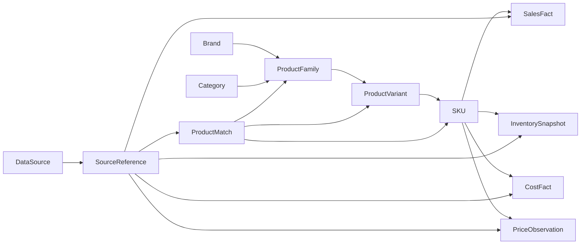

# STEP 1 — Data Domain Foundation

**Project:** AI Product Intelligence Advisor  
**Date:** 10 October 2026  
**Artifact:** TypeScript domain package integrated at the `oracle-advisor` repository root (origin: `alternative/ai-product-intelligence-step1/`, kept unchanged as the original candidate)  
**Status:** **COMPLETE: declared complete by the user on 10 Oct 2026.** S1-DEC-11 (blueprint §8.3 amendment) is still open.  
**Basis:** `STEP_0_Product_Blueprint.md` (Blueprint v0.2, DRAFT) §8, §10, §15, §16.1, §20
**Prompt standard:** Context → Goal → Constraints → Output → Verify

## 1. Context

STEP 0 §16.1 explicitly scopes the first coding step to framework-independent domain models, runtime schemas, synthetic fixtures, and tests. Source-of-truth boundaries require: canonical product family/variant/SKU separation; typed business facts from authorized records; differentiated timestamps; source provenance; uncertain external matches pending review; no artificial “real” metrics. The STEP 0 document is a **Baseline Candidate** and not yet officially approved.

## 2. Goal

Provide a portable domain-model candidate for the 13 specified entity types:

| Domain | Entities |
|---|---|
| Product | Brand, Category, ProductFamily, ProductVariant, SKU, ProductAlias |
| Business | SalesFact, InventorySnapshot, CostFact, PriceObservation |
| Provenance | DataSource, SourceReference |
| Identity resolution | ProductMatch |

A `DomainDataset` aggregates all entities for deterministic fixture testing. `checkDatasetIntegrity()` validates cross-record references and duplicate identifiers, and `acceptedTarget()` prevents pending candidates from becoming accepted links, and `publishedWithin()` tests evidence publication time (never fetch time) against a window. `parseDomainDataset()` runs Zod parsing plus integrity checks, once dependencies are installed.

## 3. Constraints applied

- No UI, API, migrations, external data, LLM/RAG/agent, or background workers.
- Framework-independent domain contracts: `packages/domain` has no Zod imports.
- Runtime Zod v4 schemas are isolated in `packages/contracts`.
- All synthetic identifiers, brands, prices, costs and market mentions are fake and visibly labeled; no real business facts are claimed.
- `ProductVariant` carries differentiating attributes; an external mention can resolve at family, variant **or** SKU level.
- Separate `eventAt`, `observedAt`, `effectiveFrom`/`effectiveTo`, `ingestedAt` for applicable record types; `SourceReference` carries `publishedAt` and `fetchedAt` (blueprint §8.2). `fetchedAt` is required for external source kinds, `publishedAt` may be `null` (unknown) but is never replaced by fetch time, and publication after fetch is rejected.
- `DataSource` is a source-registry record (blueprint §10): coverage (countries, categories), permitted use (full content / excerpts / attribution), retention, refresh cadence (ISO 8601 duration), last fetch, reliability. `null` / `unknown` means "not yet defined by the owner", never a default policy.
- An accepted (`matched`) ProductMatch may rely only on `authorized` sources (`unauthorized_source` integrity issue otherwise), and `CostFact` must reference a `confidential` or `restricted` source (INV-08). These are structural guards, not RBAC.
- Currency is required and amounts are represented in minor units to avoid unsafe floating-point financial amounts. This **does not define gross margin or promotion revenue formulas**.
- `reviewStatus: pending_review` is not an accepted SKU match. Score kind must be specified (`heuristic_score` vs `calibrated_probability`) when a match score exists.
- Manual/other non-identifier accepted matches require reviewer metadata; exact-identifier acceptance remains a candidate rule subject to policy.
- Zod rejects unexpected input keys. Authentication, source authorization and data-access enforcement are **not** implemented here.

## 4. Model relations

ProductMatch arrows denote **optional, resolution-specific** links; a match cannot imply every level at once. Source references are stable IDs that can be linked to original records. Cardinality, tenant boundaries and canonical identifier conventions remain proposals.

## 5. Proposed contract decisions (not approved ADRs)

| ID | Design choice | Rationale / caveat |
|---|---|---|
| S1-DEC-01 | IDs are opaque strings | Mapping to DB UUID/ULID needs ADR |
| S1-DEC-02 | Explicit `ProductFamily → ProductVariant → SKU` hierarchy | Prevent merge across screen sizes and product variants |
| S1-DEC-03 | Quantity is nonnegative safe integer | Returns/backorders need a separate business contract |
| S1-DEC-04 | Monetary values are integer minor units + ISO code format | Precision baseline; real minor-unit scale and currencies must be configured |
| S1-DEC-05 | Times are offset-aware ISO strings | Business calendar/time-zone conversion policy remains open |
| S1-DEC-06 | Match target is a tagged union (`family`, `variant`, `sku`) | A family or variant link is not permission to assert SKU identity |
| S1-DEC-07 | `matchConfidence` is nullable and is never assumed calibrated | Avoid implying business-success probabilities |
| S1-DEC-08 | Cross-record integrity is separate from per-record Zod parsing | Referential correctness requires access to the full dataset |
| S1-DEC-09 | No automatic use of unverified sources | Source rights enforcement will require business/legal rules |
| S1-DEC-10 | `gtin` format is checked, but not checksum validity | Add GTIN checksum and verified alias policies during matching implementation |
| S1-DEC-11 | ProductMatch uses a tagged `target` instead of §8.3 `canonical_product_id` + optional `sku_id` | Deliberate deviation; stricter (one explicit resolution level). Amend §8.3 when approved |
| S1-DEC-12 | `publishedWithin()` returns `null` for unknown publication time | Callers must treat unknown as "not a new event"; prevents stale-article trends (§15.2) |
| S1-DEC-13 | Rights/sensitivity checks live in `checkDatasetIntegrity()` | Data-level guard only; real access control arrives with RBAC (DEC-008) |
| S1-DEC-14 | Test runner is `node:test` with native TS type stripping; no test framework dependency | Revisit if coverage reporting or watch mode is needed |

### Open questions preventing production sign-off

1. Authorized source systems, real source/reference identifiers, classification and data-retention policy.
2. Canonical SKU hierarchy and whether merchant SKU is unique per organization/channel.
3. Return, cancellation, discount, tax and net-revenue conventions; location-level inventory and backorder policy.
4. Currency conversion, decimal minor-unit policy, cross-currency reporting and cost accounting basis.
5. Exact vs probabilistic match acceptance, review ownership, score calibration, versioning and validity rules.
6. Multi-organization isolation and which user roles can view cost/margin fields.
7. `reservedQuantity <= onHandQuantity` is enforced **for this candidate**; approve or replace if backorder/oversell must be supported.
8. Rejected matches must have `target: null`, so the rejected candidate link is not retained. This weakens the audit trail (INV-02) and lets a matcher re-propose the same wrong link. Decide whether to add a `proposedTarget` field (or a separate review-event log) before matching is implemented.

## 6. Output files

| File | Responsibility |
|---|---|
| `packages/domain/src/models.ts` | 13 entity contracts and dataset interface |
| `packages/domain/src/integrity.ts` | Referential integrity, duplicate ID, temporal/status, source-rights and cost-sensitivity checks |
| `packages/domain/src/evidence.ts` | `publishedWithin()` — publication-time window test for evidence |
| `packages/domain/src/index.ts` | Domain exports |
| `packages/contracts/src/schemas.ts` | Zod schemas, parse helper and integrity error |
| `packages/contracts/src/index.ts` | Contract exports |
| `tests/fixtures/synthetic.ts` | Explicitly synthetic records: 2 brands, 3 families, 5 variants (size/year), 5 SKUs, Thai/English aliases, 150 daily sales facts, stock/cost/price per SKU, 4 sources (authorized internal, licensed feed, unverified social), recent + stale articles, matches in all four review states |
| `tests/domain.test.ts` | Framework-independent structural and trust-boundary tests |
| `tests/contracts.test.ts` | Zod schema, invalid input, accepted-match tests |
| `package.json`, `package-lock.json`, `tsconfig*.json` | Development commands, pinned dependency lockfile, TS compiler settings |

## 7. Verify — observed results in the repository

Environment: Node 22.23.1, npm, zod 4.6.5, typescript 5.9.3, @types/node 22.20.5 (pinned in `package-lock.json`). Run at the `oracle-advisor` repository root on 10 October 2026.

| Check | Command | Result |
|---|---|---|
| Full typecheck | `npm run typecheck` | **PASS** (exit 0) |
| Domain-only typecheck | `npm run typecheck:domain` | **PASS** (exit 0) |
| All tests | `npm test` | **PASS** — 30/30 (exit 0) |
| Domain tests | `npm run test:domain` | **PASS** — 18/18 (exit 0) |
| Runtime source integrations | Not in STEP 1 | **NOT IMPLEMENTED** (by scope) |
| CI | No CI and no git repository yet | **NOT CONFIGURED** — M0 task |

History: the original candidate verified only the domain checks (10/10) because the authoring environment could not reach the npm registry; the Zod tests were first executed in this integration.

### Negative coverage included

- Missing brand reference, missing evidence reference, duplicate SKU ID, orphaned evidence.
- Family-level match does not imply SKU identity; pending SKU candidate is not accepted; unresolved/rejected match cannot carry a target.
- Invalid temporal ranges; confidence without declared kind.
- Recently fetched old article is not a new event; unknown publication time stays unknown.
- External reference without `fetchedAt`; publication after fetch.
- Accepted match relying on an unverified or expired source.
- Cost fact from a non-confidential source.
- Zod: negative sales, fractional money, malformed GTIN, timezone-less timestamps, impossible reserves, invalid cost periods, unreviewed manual match, unknown input keys, empty input, missing foreign keys, malformed cadence/country/retention, missing explicit `publishedAt`, date-only `fetchedAt`.

## 8. Handoff / integration

- ~~Integrate into the real repository, pin dependencies, run checks there~~ — done (§7).
- Review all S1-DEC items (especially S1-DEC-11, which amends blueprint §8.3) before making migrations or business metrics.
- Initialize git and CI (M0) so that the §7 checks run automatically.
- Do not treat STEP 1 as an authorization for real market collection, financial recommendation or autonomous SKU linking.

**Next controlled step:** After dependency-level verification and contract review, STEP 2 may implement a minimal catalog/CSV import with source preservation and data-quality reporting. Database choices and import semantics still require separate scoped instructions.
