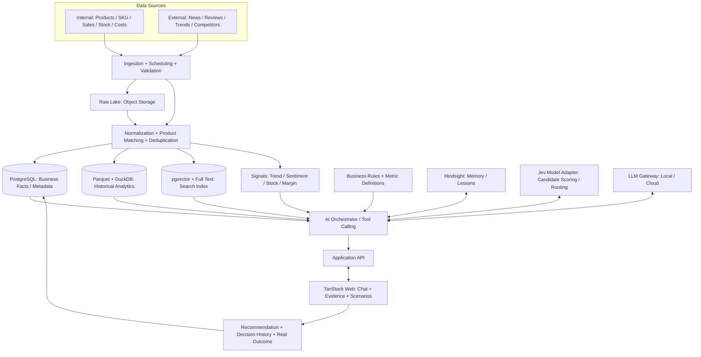

# AI Product Intelligence Advisor

> **เอกสารสรุป Concept และการวิเคราะห์สถาปัตยกรรมระบบ (Draft v0.1)**  
> วันที่: 9 ตุลาคม 2026  
> สถานะ: เอกสารแนวทางสำหรับเริ่มออกแบบและพัฒนา — **ยังไม่ใช่ข้อกำหนดที่ตกลงแล้วทั้งหมด**

## 1. Executive Summary

**AI Product Intelligence Advisor** คือแพลตฟอร์มผู้ช่วยวิเคราะห์สินค้าและให้คำแนะนำเชิงธุรกิจแบบ **Chat-first** โดยผสมข้อมูลภายในกิจการเข้ากับข้อมูลตลาดปัจจุบัน เช่น ข่าวสินค้า กระแสความนิยม ความเห็นผู้ใช้ และสถานการณ์คู่แข่ง

เป้าหมายหลักไม่ใช่เพียงค้นหาข้อมูล แต่ต้องช่วยตอบคำถามเชิงตัดสินใจ เช่น

- ตอนนี้สินค้าและแบรนด์ใดกำลังได้รับความนิยม เพราะอะไร?
- สินค้าใดที่เรามีอยู่ควรนำมาจัดโปรโมชั่น?
- ควรทำโปรโมชั่นแบบลดราคา, Bundle, ของแถม หรือเน้นโฆษณาโดยไม่ลดราคา?
- ควรโปรโมตผ่านช่องทางใด และด้วยข้อความสื่อสารแบบไหน?
- คำแนะนำอ้างอิงจากอะไร ข้อมูลอัปเดตล่าสุดเมื่อไร และมีความเสี่ยงอะไร?
- การตัดสินใจหรือโปรโมชั่นครั้งก่อนให้ผลลัพธ์จริงเป็นอย่างไร?

**หลักการออกแบบ:** Data-first · Evidence-first · Decision-first · Measurable Outcomes

### สิ่งที่ตกลงเป็นแนวคิดแล้ว

1. มีฐานข้อมูลและ Data Lake ของสินค้า
2. ติดตามข่าวและข้อมูลตลาด โดยให้ความสำคัญกับสินค้าที่มีอยู่ในระบบก่อน
3. รองรับการวิเคราะห์ร่วมระหว่างข้อมูลภายในและข้อมูลล่าสุดจากภายนอก
4. เน้นการใช้งานผ่านการถาม–ตอบเป็นหลัก
5. มี Web UI; สนใจ TanStack
6. รองรับ AI ทั้ง Local และ Cloud
7. ต้องมี **Hindsight** และ **Jev** (Jev เป็น **AI model** ไม่ใช่ระบบ memory)
8. เปิดทางขยายฟีเจอร์ใหม่ในอนาคต

### สิ่งที่เสนอ แต่ยังต้องทดสอบ/ตัดสินใจ

- Modular Monolith พร้อม Worker แยกประเภทงาน แทนการเริ่มด้วย Microservices จำนวนมาก
- PostgreSQL + pgvector สำหรับข้อมูลธุรกิจและ semantic retrieval
- Object Storage (เช่น MinIO) + Parquet + DuckDB สำหรับ Data Lake และการวิเคราะห์
- Fastify/TypeScript เป็น API และ Python เป็นทางเลือกสำหรับ AI/data worker
- LiteLLM หรือ gateway ที่เทียบเท่าสำหรับ Local/Cloud routing
- Jev เป็นหนึ่งในตัวเลือกของโมดูล classification / scoring / decision routing **โดยต้อง benchmark กับ rule-based และ LLM ก่อนใช้งานจริง**

---

## 2. System Vision และขอบเขต

### 2.1 บทบาทที่ระบบควรทำได้

| บทบาท | ความสามารถ |
|---|---|
| Product Knowledge | ค้นหา เปรียบเทียบ และอธิบายคุณสมบัติ/ข้อมูลสินค้า |
| Market Intelligence | เก็บและสรุปข่าว รีวิว ความนิยม แนวโน้มราคา และข้อมูลคู่แข่ง |
| Business Analytics | วิเคราะห์ยอดขาย ต้นทุน กำไร สต็อก และผลโปรโมชั่นย้อนหลัง |
| Decision Advisor | จัดอันดับโอกาสทางธุรกิจและเสนอแนวทางการทำโปรโมชั่น |
| Conversational Analyst | ตอบคำถามและถามต่อเนื่องโดยรักษาบริบทของการสนทนา |
| Continuous Learning | ติดตามผลหลังลงมือจริง เพื่อประเมินว่าคำแนะนำมีประสิทธิภาพหรือไม่ |

### 2.2 ข้อควรแยกให้ชัด

**สินค้ากำลังเป็นกระแส (Popularity) ไม่เท่ากับสินค้าที่ควรทำโปรโมชั่น (Promotion Opportunity)**

สินค้าที่คนสนใจมากอาจไม่เหมาะทำโปรโมชั่น เช่น กำไรต่ำ สต็อกน้อย ต้องกันสินค้าไว้สำหรับช่องทางสำคัญ หรือเกิดกระแสเชิงลบ การแนะนำจึงต้องคำนึงถึงข้อจำกัดทางธุรกิจ ไม่ใช่ดู sentiment/trend เพียงอย่างเดียว

### 2.3 Scope เริ่มต้น

- **In scope:** Import product catalog, matching ข่าวกับสินค้า, ติดตามข่าวตามรอบ, Chat Q&A, structured analytics, citations, คำแนะนำโปรโมชั่นแบบมีเหตุผล
- **Later:** Scenario simulation ที่ผ่านการสอบเทียบ, proactive alerts, closed-loop performance tracking, automatic campaign proposal approval flow
- **Not initially:** ระบบสั่งซื้อสินค้าอัตโนมัติ, การเปลี่ยนราคาจริงโดย AI, full autonomous ad buying, self-host cluster ขนาดใหญ่, fine-tune โมเดลเองทันที

---

## 3. ภาพรวม Architecture ที่เสนอ



**หมายเหตุ:** นี่เป็น logical architecture ไม่ได้บังคับว่าแต่ละกล่องต้องเป็น deployment/service แยกกัน

### 3.1 แนวคิด Deployment

เริ่มจากแอปหลักหนึ่งชุด แยกโมดูลตาม domain และมี workers สำหรับงาน scheduled/background:

- `web`: UI/Chat
- `api`: authentication, product domain, questions, recommendations, evidence
- `worker-ingestion`: ดึงข้อมูลตามรอบและจัดการ retry
- `worker-intelligence`: matching, enrichment, scoring, embeddings
- `postgres`, `object-storage`, `redis`: infrastructure พื้นฐาน
- `ai-gateway`, `hindsight`: integrations ที่แยกความรับผิดชอบชัดเจน

ค่อยแบ่งออกเป็น services เมื่อเกิดเหตุผลด้าน scaling, ownership, SLA หรือ security จริง

---

## 4. โมดูลที่ควรมี

### 4.1 Product Master Data / Product Identity

หน้าที่: สร้างตัวตนสินค้าที่ใช้เชื่อมทุกแหล่งข้อมูล

- Product, Brand, Category, Model, Variant, SKU, GTIN/EAN (หากมี)
- Alias และชื่อสินค้าหลายรูปแบบ (รวมภาษาไทย/อังกฤษ)
- ความสัมพันธ์รุ่นหลักกับรุ่นย่อย เช่น ขนาดจอ สี ความจุ รุ่นปี
- Source mapping และ confidence ของการจับคู่
- Human review queue สำหรับรายการจับคู่ที่ไม่แน่ใจ

**เหตุผล:** ข่าวอาจเรียกชื่อรุ่นต่างจาก SKU ใน ERP; ถ้าจับคู่ผิด ผลวิเคราะห์ทั้งหมดอาจผิด

### 4.2 Data Connectors & Ingestion

- Internal: ERP/POS/Excel/CSV/Database/REST API
- External: Official product feeds, RSS, News API, search APIs, social/review data ตามสิทธิ์เข้าถึง
- ต้องมี schedule, rate limiting, retry, dead-letter, deduplication, incremental sync และ backfill
- เคารพ ToS, robots, copyright, privacy และสิทธิ์การใช้ข้อมูล; หลีกเลี่ยงการนำบทความมีลิขสิทธิ์มาเก็บเต็มเรื่องโดยไม่มีสิทธิ์

### 4.3 Normalization & Intelligence Enrichment

แปลงข้อมูลดิบเป็นข้อมูลที่ใช้วิเคราะห์ได้:

1. Cleaning / Parsing / Language detection
2. Entity extraction (Brand/Model/Variant)
3. Product matching + deduplication
4. Sentiment / Topic / Claim extraction
5. Source quality & freshness scoring
6. Trend signals และ summary ที่ผูกกับช่วงเวลา
7. Embeddings และ indexing สำหรับการค้นหา

ข่าวเดิมที่เผยแพร่ซ้ำหลายแหล่งต้องไม่ถูกนับเป็นหลายหลักฐานอิสระโดยไม่ตรวจสอบ

### 4.4 Hybrid Retrieval / Analytics

- **SQL:** ตัวเลขจริง เช่น ยอดขาย ต้นทุน กำไร สต็อก
- **Full-text:** รุ่นสินค้า ชื่อแบรนด์ หรือคำเฉพาะ
- **Vector retrieval:** ความหมายของข่าว รีวิว และคำถามที่ใช้ภาษาธรรมชาติ
- **Live/current retrieval:** ข่าวล่าสุดในช่วงที่ข้อมูลภายในยังไม่ครอบคลุม
- **Hindsight recall:** ประสบการณ์ ความต้องการ และบทเรียนที่มีผลต่อการตัดสินใจ

RAG เพียงอย่างเดียวไม่เพียงพอสำหรับคำถามที่ต้องคำนวณเชิงธุรกิจ

### 4.5 Product Signal Engine

ตัวอย่างสัญญาณ:

| Signal | ประโยชน์ | ตัวอย่างแหล่งข้อมูล |
|---|---|---|
| Trend Momentum | ตรวจการเพิ่มขึ้นของความสนใจ | Search trends, articles, reviews |
| Sentiment / Complaints | ตรวจ feedback เชิงบวก/ลบ | Reviews, customer feedback |
| Demand Growth | ตรวจความต้องการหรือยอดขาย | Sales/POS |
| Inventory Pressure | ตรวจสินค้าค้างหรือใกล้หมด | Inventory |
| Margin Opportunity | ตรวจความสามารถในการจัดโปรโมชั่น | Cost/price/margin |
| Competitor Pressure | ตรวจความเสี่ยงการแข่งขัน | Competitor listings/prices |

ทุก signal ต้องมี `as_of`, `observation_window`, `source_count`, `coverage`, `confidence/quality` และข้อจำกัดการตีความ

### 4.6 Decision / Promotion Advisor

- รับ Objective จากผู้ใช้ เช่น เพิ่มยอดขาย, ลดสินค้าค้าง, รักษากำไร, เพิ่มลูกค้าใหม่
- ใช้ Business Rules คัดสินค้าที่ไม่ผ่านเงื่อนไขก่อน
- เปรียบเทียบ Candidate Products และ Promotion Strategies
- ประเมินต้นทุน ความเสี่ยง ข้อสมมติ และข้อมูลที่ยังขาด
- สร้างคำแนะนำแบบมีตัวเลือก ไม่บังคับฟันธงเพียงหนึ่งทาง
- ให้คนอนุมัติทุกการตัดสินใจที่มีผลต่อการเงินหรือการเผยแพร่จริง

### 4.7 Conversational Q&A

UI ควรเน้นการพูดคุยเป็นหลัก พร้อมแผง Evidence:

- Chat history และ context ต่อเนื่อง
- Tool activity แบบสรุปที่อ่านรู้เรื่อง
- Product cards พร้อมรายละเอียดที่เกี่ยวข้อง
- Source links + time of data
- Compare candidates / scenario analysis
- Export/share คำตอบหรือรายงาน (ภายหลัง)
- Clarification เฉพาะเมื่อขาดข้อมูลสำคัญจริง ๆ

---

## 5. AI Strategy: LLM + Jev + Hindsight

### 5.1 การแบ่งหน้าที่

| Component | หน้าที่ที่เหมาะสม | ไม่ควรใช้เป็น |
|---|---|---|
| Local/Cloud LLM | Intent understanding, reasoning, synthesis, language response, tool orchestration | แหล่งความจริงของตัวเลขธุรกิจ |
| Jev (AI model) | ทดลอง classification/scoring/routing และเลือกทางเลือกในกรอบที่กำหนด | ระบบคำนวณบัญชีหรือผู้ตัดสินสุดท้ายโดยไร้ rules |
| Hindsight | บริบทระยะยาว นโยบาย/ความชอบ บทเรียนจากการตัดสินใจ | ฐานข้อมูลธุรกรรมหรือความจริงสดของราคา/สต็อก |
| Rules + Deterministic Code | คำนวณกำไร ตรวจ constraint, validate output | เครื่องมือแทนการตีความข่าวหรือเหตุผลเชิงภาษา |

> **ข้อควรตรวจสอบ:** รายละเอียด API, รูปแบบ output, latency, ราคา, ความสามารถและเงื่อนไขการใช้งานของ **Jev** ต้องยืนยันจากเอกสารผู้ให้บริการก่อนลงมือ integrate โดยไม่สมมติว่าคะแนนโมเดลเท่ากับความน่าจะเป็นที่สอบเทียบแล้ว

### 5.2 Model Gateway

สร้าง abstraction กลาง แทนการให้ business logic เรียก provider โดยตรง:

- Route ตามประเภทงาน: extraction, embeddings, chat, synthesis, optional scoring
- รองรับ Local/Cloud fallback โดยไม่ละเมิด data classification policy
- Budget / token / latency monitoring
- Versioning ของ prompts และ model configs
- ตรวจ structured output/schema validity ก่อนนำไปใช้

### 5.3 Hindsight Memory Policy

**ควรจำ:** Business preferences, policies, decision rationale, outcomes/lessons, user-approved assumptions

**ไม่ควรใช้แทนฐานข้อมูลหลัก:** ราคา ณ นาทีนี้ สต็อก ณ ปัจจุบัน ยอดขายจริง transactional metrics และบันทึกหลักฐานภายนอก

เก็บ `memory_reference` เชื่อมกับ `decision_id`, `campaign_id` และหลักฐานในระบบ เพื่อให้ตรวจสอบย้อนกลับได้

### 5.4 Jev Evaluation ก่อน Production

ทดลองงานที่ขอบเขตชัด เช่น

- News relevancy: ข่าวนี้เกี่ยวกับสินค้าใน Catalog หรือไม่?
- Product opportunity categorization: high / medium / low (หลัง rule filtering)
- Promotion strategy choice: discount / bundle / advertise / hold
- Routing: คำถามนี้ควรใช้ SQL, RAG หรือ live lookup?

เทียบกับ baseline อย่างน้อย **Rule-based** และ **LLM structured output** โดยวัด accuracy/F1, calibration (ถ้ามี probability), latency, cost และความสม่ำเสมอ

---

## 6. ตัวอย่าง Question-to-Answer Workflow

**คำถาม:** “ตอนนี้ทีวียี่ห้อไหนน่านำมาจัดโปรโมชั่น และควรโปรโมตยังไง?”

1. **Interpret:** แยกวัตถุประสงค์ ช่วงเวลา หมวดสินค้า และ KPI
2. **Load Internal Facts:** รายการสินค้า, sales trend, stock, unit cost, selling price, history
3. **Retrieve Market Context:** ข่าว รีวิว เทรนด์ และข้อมูลคู่แข่งที่สัมพันธ์กับ SKU/Model
4. **Validate Freshness:** ตรวจว่าข้อมูลแต่ละชุดใหม่พอต่อการตัดสินใจหรือไม่
5. **Apply Rules:** เช่น จำกัดกำไรขั้นต่ำ การมีสินค้าพร้อมขาย และเพดานงบประมาณ
6. **Rank Candidates:** คะแนน/โมเดลช่วยจัดลำดับ โดยแยก fact ออกจาก inference
7. **Simulate:** เปรียบเทียบ discount, bundle, advertising-only หรือ hold ภายใต้สมมติฐานชัดเจน
8. **Explain:** แนะนำพร้อมเหตุผล แหล่งอ้างอิง ความไม่แน่นอน และสิ่งที่ควรทดลอง
9. **Record:** เก็บ decision + evidence snapshot + model/rule version
10. **Measure:** เมื่อมีโปรโมชั่นจริงจึงเก็บผลลัพธ์เพื่อประเมินคำแนะนำ

### รูปแบบ Output ที่เสนอ

```text
คำแนะนำหลัก: [สินค้า/รุ่น]
เหตุผล: [ยอดขาย สต็อก กำไร ข่าว รีวิว และคู่แข่ง]
รูปแบบโปรโมชั่น: [bundle/discount/advertising-only/...]
ช่องทาง/ข้อความการตลาด: [กลุ่มเป้าหมายและแนวคิด]
ตัวเลือกสำรอง: [ตัวเลือกที่ 2 และ trade-offs]
ข้อสมมติ/ความเสี่ยง: [...]
ข้อมูลที่ยังขาด: [...]
หลักฐาน: [source links / as-of timestamps / query references]
Next step: [A/B test, approval, collect data]
```

**ข้อห้าม:** ห้ามสร้างยอดขาย ราคา ต้นทุน หรือผลตอบแทนเชิงตัวเลขขึ้นมาเอง หากข้อมูลไม่พอให้ระบุชัดว่า “ยังประเมินไม่ได้” หรือใช้ตัวอย่างที่ติดป้ายว่า *สมมติ*

---

## 7. Tech Stack ที่เสนอ

| Layer | ทางเลือกเริ่มต้น | เหตุผล / หมายเหตุ |
|---|---|---|
| Frontend | TanStack Start + React + Tailwind | Chat-first web; ตรวจ maturity และตรึงเวอร์ชันก่อน production |
| Backend API | Fastify + TypeScript | API และ domain modules |
| AI/Data Workers | Python เมื่อจำเป็น | Data processing, ML, retrieval orchestration |
| Primary DB | PostgreSQL | Product catalog, business facts, audit trails |
| Search | PostgreSQL FTS + pgvector | Hybrid retrieval โดยไม่เพิ่ม DB ใหม่ทันที |
| Raw/Object Lake | MinIO หรือ S3-compatible storage | Raw files, snapshots, ingestion payloads |
| Columnar Analytics | Parquet + DuckDB | Query historical data แบบต้นทุนต่ำ |
| Queue/Schedule | Redis + BullMQ | Scheduled ingestion, retries, processing |
| AI Gateway | LiteLLM หรือ provider abstraction ที่เทียบเท่า | Routing Local/Cloud, cost control |
| Long-term Memory | Hindsight | Memory / experience layer |
| Decision Model | Jev ผ่าน adapter แยก | Optional task-specific scoring; evaluate first |
| AI Workflow | เริ่มแบบ explicit orchestration; พิจารณา LangGraph เมื่อซับซ้อน | ลด overengineering |
| Monitoring | OpenTelemetry; LLM tracing ภายหลัง | Observability, cost, quality |
| Runtime | Docker Compose สำหรับ dev/ต้นแบบ | ง่ายกว่าการเริ่มด้วย Kubernetes |

### สิ่งที่ยังไม่จำเป็นในวันแรก

Kubernetes, Kafka/Flink, dedicated vector database, graph database, agent swarm, model fine-tuning, autonomous price changes และ sophisticated forecasting ก่อนมีข้อมูลเพียงพอ

---

## 8. Data Model ฉบับร่าง

### Product & Business

- `brands`
- `categories`
- `products`
- `product_variants`
- `product_aliases`
- `product_source_mappings`
- `product_prices` (มี effective time)
- `inventory_snapshots`
- `sales_facts`
- `promotion_campaigns`
- `promotion_results`

### External Intelligence

- `data_sources`
- `ingestion_runs`
- `documents` (source URL, publication time, fetched time, license/rights)
- `document_product_links` (match method + confidence)
- `reviews`
- `product_signals` (signal type, window, value, quality)
- `embeddings` หรือ vector columns/indices ตาม design

### AI & Decision

- `conversations`
- `messages`
- `analysis_runs`
- `tool_executions`
- `recommendations`
- `recommendation_candidates`
- `recommendation_evidence`
- `decision_feedback`
- `model_registry` / `prompt_versions`
- `memory_references`
- `audit_logs`

### ฟิลด์กำกับคุณภาพที่ควรใช้ร่วมกัน

`tenant_id` (ถ้ารองรับหลายองค์กร), `source_id`, `source_url`, `observed_at`, `published_at`, `fetched_at`, `as_of`, `confidence`, `data_quality`, `created_at`, `updated_at`

ใช้ event time และ ingest time แยกกันเพื่อไม่ให้ “ข่าวเก่าเพิ่งถูกดึงมา” ถูกนับเป็นข่าวใหม่

---

## 9. Business Metrics / Rules ที่ต้องนิยามกลาง

- `gross_revenue`: ยอดขายก่อนส่วนลด/คืนสินค้า ตามนิยามที่ตกลง
- `net_revenue`: รายได้สุทธิหลังหักรายการที่กำหนด
- `gross_margin`: ต้องระบุว่าจะคำนวณจากต้นทุนใดและรวมค่าใช้จ่ายโปรโมชั่นอย่างไร
- `sell_through_rate`: จำนวนขายเทียบกับจำนวนที่พร้อมขายในช่วงเวลา
- `stock_cover_days`: วันที่สต็อกน่าจะรองรับได้โดยอิงอัตราการขาย
- `promotion_lift`: ผลต่างจาก baseline/control ที่กำหนด ไม่ใช่เพียงเทียบยอดก่อน/หลังโดยตรง

**สำคัญ:** ค่าทั้งหมดต้องมีสูตร ตัวกรองเวลา timezone currency และนโยบายจัดการข้อมูลที่ไม่ครบ เพื่อไม่ให้ AI สร้างนิยามใหม่เองในแต่ละครั้ง

---

## 10. Security, Trust และ Governance

1. **Read-only analytics tools:** AI ไม่ควรเข้าถึง Production DB ด้วยสิทธิ์เขียนหรือรันคำสั่ง unrestricted SQL
2. **Tenant isolation/RBAC:** แยกสิทธิ์เข้าถึงต้นทุน ยอดขาย และข้อมูลข้ามองค์กร
3. **Data classification:** ข้อมูลลับต้องถูกควบคุมก่อนส่งไป Cloud LLM/Jev
4. **Prompt injection defense:** ข่าว เว็บ รีวิว และไฟล์ภายนอกเป็น untrusted data ไม่ใช่คำสั่งให้ Agent
5. **Evidence lineage:** ทุกข้ออ้างที่สำคัญต้องย้อนกลับไปยังแหล่งและช่วงเวลา
6. **Output validation:** ตรวจ schema, constraints, numeric bounds, model version และ policy
7. **Auditability:** บันทึก query/tool, model, prompts version, evidence, ผู้อนุมัติ และคำแนะนำ
8. **Freshness alerts:** ถ้าสต็อก/ราคาเก่าเกินเกณฑ์ ห้ามเสนอคำแนะนำเหมือนข้อมูลยังใหม่
9. **Human approval:** ไม่สั่งเปลี่ยนราคาจริงหรือปล่อยแคมเปญโฆษณาโดย AI อัตโนมัติใน MVP
10. **Retention & compliance:** กำหนดอายุการเก็บ raw content, PII, credentials และสิทธิ์ใช้ข้อมูล

---

## 11. Evaluation และ Success Criteria

### MVP Acceptance (เป้าหมายร่าง)

- ทดสอบกับชุดคำถามเชิงธุรกิจ **20–30 ข้อ** ที่มีเกณฑ์ตรวจคำตอบชัดเจน
- ไม่สร้างตัวเลขธุรกิจขึ้นมาเองและระบุเมื่อข้อมูลไม่พอ
- ค้นหา SKU/รุ่นสินค้าตรงกับข่าวที่เกี่ยวข้องได้ในระดับยอมรับได้ (กำหนด threshold จากชุดทดสอบ)
- คำตอบที่มีข้ออ้างเชิงข้อมูลภายนอกมีหลักฐานและเวลาที่ตรวจสอบได้
- วิเคราะห์ SQL และ semantic evidence ร่วมกันได้อย่างถูกต้อง
- ตรวจสอบที่มาของ recommendation ย้อนหลังได้
- วัด latency, token cost, ingestion coverage, error rate และ data freshness

### Evaluation ที่ควรแยก

- **Retrieval:** precision/recall of matched products and sources
- **Analytical correctness:** คำตอบตัวเลขเทียบกับ SQL ground truth
- **Reasoning:** ข้อเสนอแนะสอดคล้องข้อจำกัดและหลักฐานหรือไม่
- **Calibration:** ความมั่นใจของโมเดลสอดคล้องความถูกต้องจริงหรือไม่
- **Operational:** pipeline reliability, time-to-refresh, cost per useful answer
- **Business outcome:** incremental margin/revenue uplift เมื่อมี controlled experiments

---

## 12. Roadmap

### Phase 1 — Foundation

**Deliverables:** Product catalog, CSV/ERP import, identity matching, DB + raw lake, ingestion jobs, data-quality checks

**Exit criteria:** สินค้าและแหล่งข้อมูลสำคัญเชื่อมโยงถูกต้อง และตรวจสอบ record ต้นทางได้

### Phase 2 — Chat-first MVP

**Deliverables:** TanStack web, question handling, safe SQL analytics, FTS/vector retrieval, current news lookup, source citations, LLM Gateway

**Exit criteria:** ตอบชุดคำถามทดสอบได้โดยมีตัวเลขและแหล่งที่มาตรวจสอบได้

### Phase 3 — Decision Intelligence

**Deliverables:** Product signals, ranking/rules, recommendation engine, Jev adapter + benchmarks, Hindsight memory, what-if scenarios เบื้องต้น

**Exit criteria:** คำแนะนำไม่ละเมิด business constraints และมี baseline เปรียบเทียบได้

### Phase 4 — Outcome Loop

**Deliverables:** Campaign outcomes, recommendation tracking, proactive alerts, A/B tests, quality/cost monitoring, incremental improvement

**Exit criteria:** วัดได้ว่าระบบช่วยตัดสินใจดีขึ้นจริง ไม่ใช่เพียงตอบได้ดีขึ้น

---

## 13. ความเสี่ยงหลักและวิธีลด

| ความเสี่ยง | วิธีลด |
|---|---|
| ข่าวซ้ำ/ข่าวเก่า/ข่าวลือ | Source reputation, publish vs fetch time, dedup, corroboration |
| จับคู่ SKU ผิด | Alias registry, exact IDs, confidence, human review |
| AI hallucination ตัวเลข | Deterministic SQL/calculators, numeric validation, evidence |
| คำแนะนำผิดธุรกิจ | Business rules, min-margin/stock guardrails, human approval |
| ข้อมูลลับรั่วผ่าน Cloud API | Data classification, gateway policy, least privilege |
| ระบบซับซ้อนเกินตั้งแต่ต้น | Modular architecture, staged rollout, defer optional components |
| Jev ไม่เหนือกว่าทางเลือกอื่น | Benchmark against rules/LLM and fallback adapters |
| ข่าว/รีวิวเข้าถึงไม่ได้ตามสิทธิ์ | Approved sources, licensed APIs, source inventory |
| คำแนะนำดูดีแต่ไม่มีผลจริง | Record decisions and run controlled outcome evaluation |

---

## 14. คำถามที่ต้องตัดสินใจใน Design Session ถัดไป

1. กลุ่มธุรกิจเริ่มต้นเป็น **สินค้าอิเล็กทรอนิกส์/ทีวี** หรือรองรับทุกหมวดตั้งแต่แรก?
2. แหล่งข้อมูลภายในคืออะไร (ERP, POS, CSV, DB) และ refresh ได้ถี่แค่ไหน?
3. มีข้อมูล **ต้นทุนจริง ยอดขาย สต็อก ประวัติโปรโมชั่น** พร้อมใช้งานหรือยัง?
4. ระบบเป็น **single organization** หรือ SaaS multi-tenant?
5. ต้องเน้นตลาดไทยอย่างเดียวหรือหลายประเทศ/หลายภาษา?
6. แหล่งข่าวและรีวิวใดที่มีสิทธิ์/API ให้เข้าถึง และงบประมาณของ data providers เท่าไร?
7. Jev API มีข้อจำกัดเรื่อง schema, latency, privacy และ usage/pricing อย่างไร?
8. Hindsight จะใช้ Cloud หรือ Self-host และข้อมูลใดอนุญาตให้ retain?
9. เพดานค่าใช้จ่าย AI ต่อเดือน และ SLA ของการตอบคำถามคือเท่าไร?
10. KPI สำคัญที่สุด: เพิ่มยอดขาย, เพิ่มกำไร, ลด dead stock หรือประหยัดเวลานักวิเคราะห์?

---

## 15. ข้อเสนอแนะสุดท้าย

**เริ่มจากระบบที่ให้คำตอบถูกต้อง ตรวจสอบได้ และมีประโยชน์จริงก่อนขยายจำนวน Agent/Model**

ลำดับความสำคัญที่เสนอคือ

1. **Product Identity** — รู้ว่าข้อมูลหลายแหล่งกำลังพูดถึงสินค้าตัวเดียวกันหรือไม่
2. **Data Quality + Freshness** — รู้ว่าตัวเลขและข่าวเชื่อถือได้เพียงใดและใหม่แค่ไหน
3. **Hybrid Retrieval/Analytics** — ผสาน SQL, search, RAG และข้อมูลปัจจุบันอย่างถูกวิธี
4. **Decision Logic** — เปลี่ยนข้อมูลให้เป็นข้อเสนอที่ถูกเงื่อนไขธุรกิจ
5. **Outcome Feedback** — วัดว่าคำแนะนำช่วยธุรกิจจริงหรือไม่

**Architectural principle:** ให้ Hindsight รับผิดชอบประสบการณ์, Jev เป็นโมเดลที่ทดสอบใช้ในงานตัดสินใจแบบมีโครงสร้าง, LLM รับผิดชอบการเข้าใจและสื่อสาร, ส่วน Database + Rules เป็นแหล่งความจริงของตัวเลขและข้อจำกัด

---

*เอกสารนี้สรุปจากการสนทนาและข้อเสนอเชิงออกแบบ ณ 9 ตุลาคม 2026; การเลือก framework/บริการที่อาจเปลี่ยนเวอร์ชันหรือราคาได้ ต้องตรวจสอบเอกสารทางการก่อนเริ่ม implementation*
