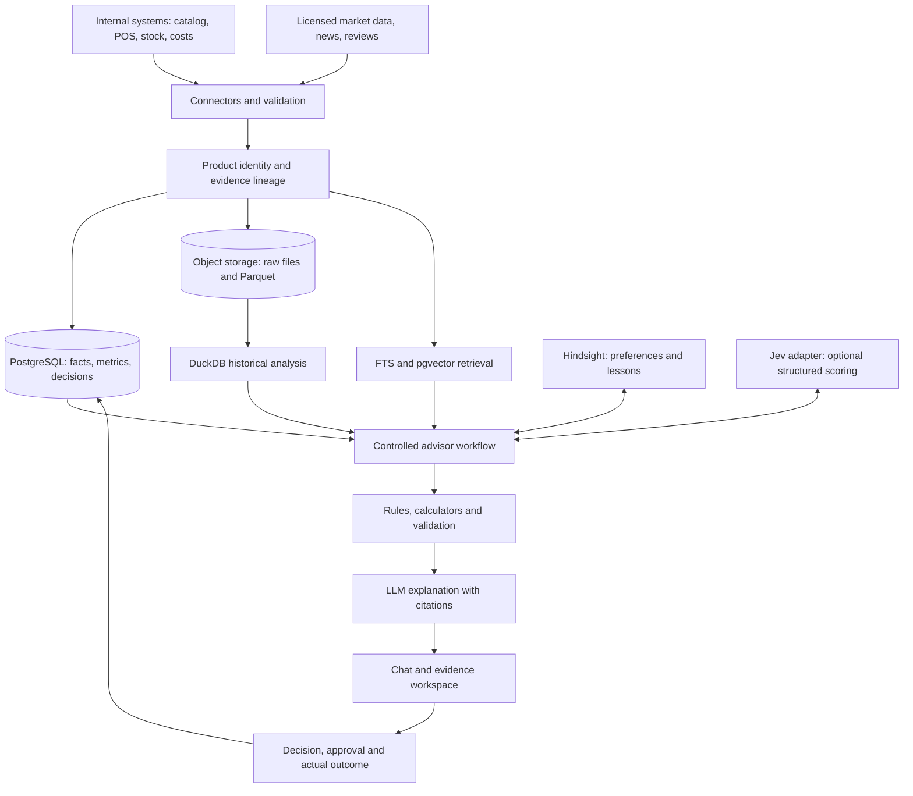

# AI Product Intelligence Advisor — Competitive Research

> **รายงานวิเคราะห์โปรเจกต์ Open Source และ Commercial ที่ใกล้กับแนวคิดระบบ**  
> วันที่ตรวจสอบ: 9 ตุลาคม 2026  
> สถานะ: เอกสารประกอบการศึกษาและตัดสินใจ ไม่ใช่การรับรองผู้ขายหรือการเลือกเทคโนโลยีขั้นสุดท้าย

## สรุปสำหรับตัดสินใจ

แนวคิดของ **AI Product Intelligence Advisor** คือรวมข้อมูลสินค้าและธุรกิจภายในกับสัญญาณตลาดภายนอก แล้วให้คำตอบหรือข้อเสนอโปรโมชั่นที่มีหลักฐาน ตรวจสอบย้อนกลับได้ และวัดผลจริงภายหลัง จากการตรวจสอบครั้งนี้พบว่า:

1. **ยังไม่พบโปรเจกต์ Open Source ตัวเดียวที่ครอบคลุมงานทั้งหมด** ตั้งแต่ product identity, internal sales/inventory/margin, ข่าวและคู่แข่ง, promotion what-if, chat with evidence ไปจนถึง feedback loop โครงการ Open Source ที่พบครอบคลุมเป็นส่วน ๆ จึงควรศึกษาและนำมาใช้เฉพาะส่วนที่เหมาะสม
2. **ตัวอย่าง Commercial ที่ใกล้กับโจทย์ที่สุดกระจายอยู่หลายผลิตภัณฑ์**: Hello Retail มี API จัดอันดับสินค้าสำหรับแคมเปญและส่วนลด; Circana และ NIQ ทำ promotion measurement/optimization; Stackline รวมข้อมูลและพฤติกรรมข้ามช่องทาง; Similarweb ให้สัญญาณ shopper/market; DataWeave เน้น product matching, ราคา และ digital shelf
3. **แนวทางที่เหมาะกับโครงการนี้คือ Build + Buy/Partner แบบเลือกส่วน**: สร้าง product identity, metric definitions, business rules, evidence pipeline, recommendation logic, chat UX และ outcome tracking เอง; ประเมินการซื้อหรือเชื่อม licensed external market data แทนการเริ่มจาก scraping ทุกแหล่ง
4. ใช้ PostgreSQL/pgvector และ Parquet/DuckDB เป็นฐานเริ่มต้นได้ตามแนวคิดเดิม; ใช้ Airbyte เมื่อ connector ที่ต้องการผ่านการตรวจสอบ; ใช้ LangGraph เมื่อ workflow ต้อง resumable หรือมี human approval; ใช้ Hindsight สำหรับ memory เท่านั้น; ทดสอบ Jev เป็น model adapter เพิ่มเติม ไม่ใช้แทนกฎธุรกิจหรือการคำนวณ
5. ก่อนตัดสินใจซื้อ ให้ทำ pilot กับข้อมูลจริงและตรวจ **coverage ในประเทศไทย/หมวดสินค้าที่เริ่มต้น**, product matching, ความสดของข้อมูล, API/การส่งออก, สิทธิการใช้ข้อมูล, ราคา และการเข้าถึงข้อมูลย้อนหลัง เพราะหน้า public ที่ตรวจส่วนใหญ่ไม่ได้แสดงราคาแพ็กเกจเชิงพาณิชย์

### ตัวเลือกที่ควรศึกษาเป็นพิเศษ

| ความต้องการ | ตัวอย่างที่ควรศึกษา | เหตุผล |
|---|---|---|
| จัดอันดับสินค้าเพื่อโปรโมต/เลือกส่วนลด | Hello Retail Product Intelligence API | ใกล้กับโจทย์การคัด SKU และ campaign targeting มากที่สุด แต่ API ยังเป็น beta และอาจเปลี่ยน schema/ราคา |
| วิเคราะห์และจำลองโปรโมชั่น | Circana Price & Promotion, NIQ Activate Promotion Effectiveness | มีตัวอย่างการวัดผล ย้ายงบ และปรับความลึกของส่วนลดจากข้อมูลจริง |
| รวมสัญญาณตลาด/พฤติกรรมหลายช่องทาง | Stackline, Similarweb Retail Intelligence | ศึกษาวิธีรวมยอดขาย คู่แข่ง การค้นหา รีวิว แนวโน้ม และ shopper behavior |
| จับคู่สินค้าข้าม retailer | DataWeave | เป็นตัวอย่างสำคัญของ product matching และการแยก “ความแม่นยำของคู่ที่จับได้” ออกจาก “สัดส่วนสินค้าที่จับคู่ได้” |
| สร้างระบบด้วย OSS | Medusa หรือ Saleor + PostgreSQL/pgvector + DuckDB + ingestion/workflow ที่จำเป็น | มี commerce primitives และเครื่องมือพื้นฐาน แต่ต้องสร้าง intelligence layer เอง |

## ขอบเขตและวิธีวิจัย

ใช้เอกสารทางการ, repository, developer docs, เอกสาร case study ของผู้ขาย และงานวิจัยที่เกี่ยวข้อง โดยอ้างอิงแหล่งข้อมูล ณ วันที่ 9 ตุลาคม 2026 ขอบเขตยึดจากเอกสาร Architecture ของโครงการ ได้แก่ product catalog, product identity, sales/stock/cost, ข่าว/รีวิว/แนวโน้ม, promotion recommendation, conversational Q&A, Jev และ Hindsight

ตัวเลขผลลัพธ์ใน case study ของ Stackline, Circana, NIQ และ DataWeave เป็น **ผลที่ผู้ขายหรือกรณีศึกษาของผู้ขายเผยแพร่เอง** ไม่ใช่การตรวจสอบอิสระ และไม่ควรใช้เป็นตัวคาดการณ์ผลลัพธ์ของธุรกิจเราโดยตรง ส่วนราคาและ market coverage ต้องขอข้อมูลตามประเทศ หมวดสินค้า และช่องทางที่จะใช้งานจริง

## แยกความสามารถที่ระบบเป้าหมายต้องมี

| ชั้นความสามารถ | ข้อมูลหรือผลลัพธ์ | เหตุผลที่สำคัญ |
|---|---|---|
| Product identity | Product/brand/model/variant/SKU และ alias จากหลายระบบ | ถ้าจับคู่ข่าวหรือราคาเข้ากับ SKU ผิด การวิเคราะห์ชั้นถัดไปก็ผิดตาม |
| Internal business facts | ยอดขาย ต้นทุน กำไร ราคา สต็อก และประวัติโปรโมชั่น | เป็นแหล่งความจริงของการคำนวณ ไม่ควรให้ LLM แต่งตัวเลข |
| External market signals | ข่าว รีวิว ราคา/โปรโมชั่นคู่แข่ง ความสนใจและแนวโน้ม | ใช้ระบุโอกาสและความเสี่ยง แต่ต้องมีแหล่งที่มาและเวลา |
| Analytics and decision | กฎธุรกิจ, score/ranking, what-if, ช่วงความไม่แน่นอน | แยกข้อเท็จจริงออกจากการคาดการณ์และข้อเสนอ |
| Conversational interface | ถามตอบต่อเนื่องพร้อม evidence และ scenario | ทำให้ผู้ใช้ตรวจที่มาของคำตอบและเปรียบเทียบทางเลือกได้ |
| Outcome loop | บันทึกคำแนะนำ การตัดสินใจ แคมเปญจริง และผลลัพธ์ | ใช้ประเมินว่าระบบช่วยเพิ่มกำไร/ยอดขายหรือไม่ |

ไม่มี dashboard หรือ LLM ตัวใดแทนชั้นเหล่านี้ทั้งหมดได้ด้วยตัวเอง

## Open Source และโครงการที่ศึกษาได้

โครงการในส่วนนี้เป็นตัวอย่างของ **ชิ้นส่วนและรูปแบบการออกแบบ** ไม่ใช่คำแนะนำให้นำทั้งระบบมาแทน Product Intelligence Advisor

### 1. Medusa — Commerce modules ที่แยกเป็น domain

- **Repository:** [medusajs/medusa](https://github.com/medusajs/medusa)
- **License:** core ใช้ MIT; วัสดุ RBAC ของ Enterprise Edition บางส่วนต้องใช้ข้อตกลงเชิงพาณิชย์
- **สิ่งที่ทำได้:** โมดูล product, pricing, promotion, inventory, order และ workflow สำหรับระบบ commerce
- **Case study ที่ควรนำมาศึกษา:** Medusa จัดการความสามารถ commerce เป็นโมดูลที่เชื่อมกันได้ ทำให้มองเห็นวิธีแยก product, price, inventory และ promotion ออกจากกันอย่างชัดเจน
- **นำมาใช้กับ Advisor อย่างไร:** ศึกษา domain boundaries, data contracts, event/workflow และ promotion primitives หากสร้างระบบ commerce ด้วย แต่ Advisor ควรอ่านข้อมูลจาก ERP/POS/ระบบขายเดิม ไม่จำเป็นต้องเปลี่ยน Medusa ให้เป็นฐานของทุก business fact
- **ช่องว่าง:** ไม่มีหลักฐานจากหน้าโครงการว่าเป็นแพลตฟอร์มวิเคราะห์ข่าว/สัญญาณตลาดหรือวัด incremental promotion impact สำเร็จรูป
- **แหล่งข้อมูล:** [GitHub](https://github.com/medusajs/medusa), [Commerce modules](https://docs.medusajs.com/resources/commerce-modules), [Pricing module](https://docs.medusajs.com/resources/commerce-modules/pricing), [Product module](https://docs.medusajs.com/resources/commerce-modules/product), [Inventory module](https://docs.medusajs.com/resources/commerce-modules/inventory)

### 2. Saleor — Product, channel และ promotion rules

- **Repository:** [saleor/saleor](https://github.com/saleor/saleor)
- **License:** BSD-3-Clause
- **สิ่งที่ทำได้:** product variants, pricing, stock, channels, promotion engine, vouchers และ event/webhook เมื่อเกิดการเปลี่ยน promotion
- **Case study ที่ควรนำมาศึกษา:** Saleor แสดงให้เห็นว่าราคา สต็อก และโปรโมชั่นอาจต่างกันตาม channel และการเปลี่ยน promotion สามารถถูกบันทึกเป็น event เพื่อส่งต่อให้ระบบอื่นได้
- **นำมาใช้กับ Advisor อย่างไร:** ศึกษาการแทน channel-specific price/availability และการเชื่อม action ที่เกิดขึ้นกับ audit trail
- **ช่องว่าง:** เป็น commerce platform ไม่ใช่ market intelligence; ไม่มีหลักฐานสาธารณะว่าให้ ranking หรือวิเคราะห์ผลของโปรโมชั่นจากข้อมูลข้ามผู้ขาย
- **แหล่งข้อมูล:** [GitHub](https://github.com/saleor/saleor), [Products](https://docs.saleor.io/developer/products/overview), [Promotions](https://docs.saleor.io/developer/discounts/promotions), [Channels](https://docs.saleor.io/developer/channels/overview)

### 3. ERPNext — ERP และข้อมูลธุรกิจภายใน

- **Repository:** [frappe/erpnext](https://github.com/frappe/erpnext)
- **License:** GPLv3
- **สิ่งที่ทำได้:** item/product, price list, stock ledger, sales documents และ pricing rules ในระบบ ERP
- **Case study ที่ควรนำมาศึกษา:** ERPNext เป็นตัวอย่างว่าข้อมูลสินค้า ราคา ยอดขาย และสต็อกถูกบันทึกเป็นเอกสารธุรกิจที่เชื่อมโยงกันอย่างไร
- **นำมาใช้กับ Advisor อย่างไร:** เหมาะเป็นแหล่งข้อมูล/ระบบต้นทาง หรือใช้ศึกษา schema และ workflow ของ back office ก่อนทำ connector
- **ช่องว่าง:** ไม่ใช่คำตอบสำหรับการรวมข่าว/market trends หรือสร้าง conversational recommendation; การแทนระบบ ERP เดิมด้วย ERPNext เป็นขอบเขตใหญ่กว่าการสร้าง Advisor
- **ข้อควรระวัง:** ตรวจข้อกำหนด GPLv3 กับรูปแบบการแจกจ่าย/แก้ไขที่วางแผนไว้
- **แหล่งข้อมูล:** [GitHub](https://github.com/frappe/erpnext), [License](https://github.com/frappe/erpnext/blob/develop/license.txt)

### 4. Airbyte — การดึงและ sync ข้อมูล

- **Repository:** [airbytehq/airbyte](https://github.com/airbytehq/airbyte)
- **รูปแบบ:** มี Self-managed Core, Cloud และ enterprise plans; licensing และ support ต่างกันตาม connector
- **สิ่งที่ทำได้:** replicate ข้อมูลจาก source ไปยัง warehouse, lake หรือ database; เอกสารทางการระบุ connector หลายร้อยตัวและรองรับทั้ง self-managed/managed
- **Case study ที่ควรนำมาศึกษา:** ใช้เป็นวิธีลดการเขียน connector สำหรับระบบที่มี integration สำเร็จรูปและมีสถานะ production/support ที่เหมาะสม
- **นำมาใช้กับ Advisor อย่างไร:** ใช้ ingestion สำหรับ ERP/POS/CRM หรือ destination ที่รองรับ แล้วแยก transform, product matching และ quality checks เป็น pipeline ของเรา
- **ช่องว่าง/ข้อควรระวัง:** connector แต่ละตัวมี support tier; marketplace connectors บางตัวไม่มี SLA และอาจไม่พร้อม production; connector บางกลุ่มมี license แยกหรืออยู่ในแผนเสียเงิน จึงต้องตรวจ connector ที่ต้องใช้เป็นรายตัว
- **แหล่งข้อมูล:** [Platform](https://docs.airbyte.com/platform), [Connector support levels](https://docs.airbyte.com/integrations/connector-support-levels), [Connector licenses](https://github.com/airbytehq/airbyte/blob/master/docs/community/licenses/README.md)

### 5. Metabase — Self-service BI และการวิเคราะห์ตัวเลข

- **Repository:** [metabase/metabase](https://github.com/metabase/metabase)
- **License:** รุ่น Open Source ใช้ AGPL; มี source สำหรับรุ่น Commercial ที่ใช้ Metabase Commercial Software License
- **สิ่งที่ทำได้:** เชื่อม database เพื่อสร้าง query, report และ dashboard; เหมาะกับการสำรวจว่าผู้ใช้ต้องการ metric และ breakdown แบบใด
- **Case study ที่ควรนำมาศึกษา:** ทำ prototype ของมุมมองยอดขาย/stock/promotion ได้เร็ว ก่อนลงทุนสร้าง analytical UX เฉพาะของ Advisor
- **นำมาใช้กับ Advisor อย่างไร:** ใช้เป็นเครื่องมือวิเคราะห์ภายในหรือเครื่องมือช่วยผู้พัฒนา ตรวจค่าที่ตอบจาก SQL ให้ตรงกับ ground truth
- **ช่องว่าง:** ไม่ใช่ระบบ identity matching หรือ promotion optimizer; chat-first experience, structured recommendation และ evidence workspace ยังต้องทำเอง
- **ข้อควรระวัง:** ตรวจขอบเขต AGPL และแยกความสามารถที่อยู่เฉพาะ Commercial edition ก่อน embed หรือแจกจ่าย
- **แหล่งข้อมูล:** [GitHub](https://github.com/metabase/metabase), [License](https://github.com/metabase/metabase/blob/master/LICENSE.txt)

### 6. LangGraph — Workflow orchestration แบบควบคุมได้

- **Repository:** [langchain-ai/langgraph](https://github.com/langchain-ai/langgraph)
- **License:** MIT
- **สิ่งที่ทำได้:** stateful workflow, persistence, durable execution, streaming และ human-in-the-loop; รองรับการหยุดเพื่อรับ input แล้ว resume ต่อ
- **Case study ที่ควรนำมาศึกษา:** เหมาะกับการออกแบบ flow ที่มีหลาย step เช่น อ่าน intent → query SQL → retrieve evidence → validate → ขออนุมัติ → สรุป และต้อง resume หลัง failure
- **นำมาใช้กับ Advisor อย่างไร:** เลือกใช้เมื่อ workflow มี branching/state/human review ที่ซับซ้อน; หาก MVP เป็น API calls ตามลำดับไม่กี่ขั้น ให้เริ่มด้วย orchestration แบบ explicit ใน code ก่อน
- **ช่องว่าง:** เป็น framework ไม่ใช่ผลิตภัณฑ์ธุรกิจ มีเครื่องมือเพิ่มภาระ operation และไม่ได้รับประกันความถูกต้องของคำตอบ
- **แหล่งข้อมูล:** [GitHub](https://github.com/langchain-ai/langgraph), [Concepts](https://langchain-ai.github.io/langgraph/concepts/durable_execution/)

### 7. Dify — Visual AI workflow และ RAG prototype

- **Repository:** [langgenius/dify](https://github.com/langgenius/dify)
- **ความสามารถ:** visual workflow, prompt/model provider support, document ingestion/RAG, agents และ LLMOps logs
- **License:** modified Apache 2.0 with additional conditions; เอกสารปัจจุบันระบุเงื่อนไขเรื่อง multi-tenant และการคง logo/copyright ใน frontend บางกรณี
- **นำมาใช้กับ Advisor อย่างไร:** ศึกษา UX ของ prompt/workflow prototyping และการทดลอง RAG; ใช้ทดลอง flow ภายในได้หลังตรวจ license
- **ข้อสรุป:** ควรเรียกว่า source-available/open-core candidate ในการประเมินเชิงธุรกิจ แทนที่จะสมมติว่า Apache 2.0 แบบไม่มีข้อจำกัด โดยเฉพาะเมื่อเป้าหมายอาจเป็น multi-tenant SaaS หรือ white-label
- **แหล่งข้อมูล:** [GitHub](https://github.com/langgenius/dify), [License terms](https://github.com/langgenius/dify/blob/main/LICENSE)

### 8. Hindsight — Memory สำหรับความชอบและบทเรียน

- **Repository:** [vectorize-io/hindsight](https://github.com/vectorize-io/hindsight)
- **License:** MIT
- **สิ่งที่ทำได้:** retain, recall, reflect, memory banks และ mental models สำหรับบริบทระยะยาวของ Agent; มี self-host และ Hindsight Cloud
- **นำมาใช้กับ Advisor อย่างไร:** เก็บ preference/policy และเหตุผลการตัดสินใจที่ต้องใช้ข้ามบทสนทนาได้ แต่เก็บราคา ยอดขาย สต็อก ข่าวต้นฉบับ และผลโปรโมชั่นจริงในฐานข้อมูลหลัก พร้อม reference เชื่อมไปหา memory
- **ข้อควรระวัง:** benchmark ด้าน memory ไม่เท่ากับ benchmark ความถูกต้องของคำแนะนำทางธุรกิจ; อย่าปล่อยให้ความจำที่สรุปแล้วแทน source of truth
- **แหล่งข้อมูล:** [GitHub](https://github.com/vectorize-io/hindsight), [Overview](https://hindsight.vectorize.io/), [Hindsight paper](https://arxiv.org/abs/2512.12818)

### 9. PostgreSQL + pgvector และ DuckDB + Parquet

- **pgvector:** เพิ่ม vector similarity search เข้า PostgreSQL และใช้ร่วมกับ PostgreSQL full-text search เพื่อทำ hybrid search; [repository](https://github.com/pgvector/pgvector)
- **DuckDB:** อ่าน Parquet จาก S3-compatible storage ผ่าน httpfs; เอกสารระบุการทดสอบ S3 API กับ MinIO; [S3 Parquet guide](https://duckdb.org/docs/current/guides/network_cloud_storage/s3_import), [S3 API support](https://duckdb.org/docs/lts/core_extensions/httpfs/s3api)
- **นำมาใช้กับ Advisor อย่างไร:** ใช้ PostgreSQL สำหรับ product/business records และ evidence metadata; ใช้ pgvector/FTS สำหรับค้นข่าวและเนื้อหา; ใช้ Parquet/DuckDB สำหรับ historical aggregation ที่ไม่ควรยิง query หนักบน operational DB
- **ข้อจำกัด:** การเลือก storage ไม่ได้แก้ product identity, data contracts, SQL guardrails หรือ metric definitions ให้โดยอัตโนมัติ

### 10. PromotionLens — งานวิจัยด้าน promotion what-if

- **งานวิจัย:** [PromotionLens: Inspecting Promotion Strategies of Online E-commerce via Visual Analytics](https://arxiv.org/abs/2208.01404), ปี 2022
- **สิ่งที่นำเสนอ:** ระบบ visual analytics ที่รวม time-series forecasting, ปัจจัยราคา/การแข่งขัน/โปรโมชั่น, product comparison และการปรับสมมติฐานโปรโมชั่นเพื่อดู forecast ใหม่
- **Case study:** ผู้ใช้เปรียบเทียบรูปแบบส่วนลดสินค้ารองเท้าและปรับสมมติฐานจาก fixed-amount discount เป็น percent discount เพื่อดูผลคาดการณ์
- **บทเรียน:** Scenario workspace ควรให้ผู้ใช้ปรับสมมติฐาน เปรียบเทียบสินค้าคู่แข่ง และดูว่า input ใดมีผลต่อ forecast; ไม่มี “โปรโมชั่นที่ดีที่สุด” แบบเดียวสำหรับทุกสินค้า
- **ข้อจำกัด:** เป็นงานวิจัย/ระบบต้นแบบ ไม่ใช่ผลิตภัณฑ์ production ที่เชื่อม ERP และข่าวปัจจุบัน; case ใช้อัตราการโตช่วงเริ่มโปรเป็น proxy ของผลโปรโมชั่น จึงไม่ควรตีความเป็น causal lift ที่พิสูจน์แล้ว

## Commercial และ Paid Case Studies

> ผลลัพธ์ด้านยอดขาย/ROI ด้านล่างเป็นตัวเลขที่ผู้ขายหรือ customer story เผยแพร่เอง ควรใช้เป็นตัวอย่างของ workflow และคำถามที่ระบบต้องตอบ ไม่ใช่ forecast สำหรับโครงการของเรา

### 1. Hello Retail Product Intelligence — ใกล้กับการเลือก SKU สำหรับแคมเปญที่สุด

- **Product:** Product Intelligence API และ Product Agents
- **สิ่งที่ทำได้:** API ให้ insight ต่อสินค้า เช่น lifetime value, recurrence, typical discount, retention และ seasonal sales; query top products สามารถจัดอันดับสินค้าตาม campaign targeting, discount optimization, วัน/เวลา และช่วงส่วนลด
- **Case study/reference:** เอกสาร API ยกตัวอย่างคำถาม “สินค้าใดควรได้รับ voucher 10%” และ “อะไรขายเช้าวันเสาร์”; Product Agents เชื่อมกับ campaign workflow ของ Hello Retail
- **สิ่งที่ควรเลียนแบบ:** ให้ระบบตอบคำถามสินค้า/โปรโมชั่นด้วย schema มีตัวกรองชัด, สามารถคืนผลว่างเมื่อข้อมูลไม่พอ และให้ผู้เรียกส่ง ranking ไปยัง campaign tool แยกจากการสั่งรันจริง
- **ข้อจำกัดสำคัญ:** เอกสารระบุชัดว่า API ยังอยู่ใน beta, ฟรีระหว่าง beta, schema และราคาเปลี่ยนได้ และไม่ควรสร้างระบบ production ที่พึ่งพา API นี้โดยไม่มี fallback; วิเคราะห์จาก catalog/ข้อมูลที่ตนมี ไม่ใช่แหล่งรวมข่าวตลาดและ margin ของทุกธุรกิจ
- **เหมาะกับโครงการนี้:** ทดลองเป็น benchmark ของ “SKU ranking/API contract” แต่ไม่ควรยกเป็น core architecture จนกว่า beta, data rights, coverage และ pricing จะชัด
- **แหล่งข้อมูล:** [Product Intelligence API](https://developer.helloretail.com/api/graphQL/product-intelligence/), [Top Products](https://developer.helloretail.com/api/graphQL/product-intelligence/top-products/), [Product Insight](https://developer.helloretail.com/api/graphQL/product-intelligence/product-insight/), [Product Agents](https://helloretail.com/en/campaigns/black-friday-2026-product-agents/)

### 2. Circana — Promotion modeling และการวางแผน scenario

- **Product:** Price & Promotion Analytics, Liquid Data และ tools สำหรับ promotion planning
- **สิ่งที่ทำได้:** ใช้ข้อมูลระดับร้านและ category เพื่อจำลองผลของราคาและโปรโมชั่น เช่น volume/revenue/profit; เชื่อมข้อมูลและ analytics เข้ากับระบบของลูกค้าหรือใช้ cloud environment ของผู้ขาย
- **Case study:** ในกรณี retailer กับ CPG รายหนึ่ง Circana model ทั้งหมวด chocolate แล้วพบ “โอกาสเติบโตของหมวดสินค้า 3 ล้านดอลลาร์” จากการจัดสรรโปรโมชั่นใหม่และปรับ discount depth; ลูกค้านำ scenario planning ไปใช้กับหลายหมวดภายหลัง
- **สิ่งที่ควรเลียนแบบ:** candidate SKU, objective, budget, depth และ time window ต้องเป็น input ของ scenario engine; เก็บ assumption และผลเปรียบเทียบไว้ ไม่สรุปจากส่วนลดที่เคยใช้บ่อยอย่างเดียว
- **ข้อจำกัด:** กรณีศึกษาเป็นหมวดสินค้า/ตลาดที่ผู้ขายมีข้อมูลและ model พร้อม ตัวเลขเป็น growth opportunity ตามผู้ขาย ไม่ได้ยืนยันว่าเป็นยอดขายเพิ่มจริงในทุกกรณี; ต้องตรวจ coverage ตลาดไทยและสินค้า electronics/ทีวี
- **เหมาะกับโครงการนี้:** ใช้เป็น benchmark ของ promotion analytics และสิ่งที่ควรถาม vendor หากพิจารณาซื้อ data/model
- **แหล่งข้อมูล:** [Price & Promotion solutions](https://www.circana.com/solutions/price-and-promotion), [Case study: $3M opportunity](https://www.circana.com/case-studies/identifying-promotional-reallocations-also-uncovers-3m-category-growth-opportunity), [Liquid Data Engage](https://www.circana.com/solutions/liquid-data-engage)

### 3. NIQ — Promotion effectiveness และ product data foundation

- **Products:** NIQ Activate Promotion Effectiveness, NIQ Product Intelligence และ NIQ Discover
- **สิ่งที่ทำได้:** Activate ใช้ first-party transaction/t-log, sales และ loyalty data เพื่อวัด uplift และแยกผลตาม item, basket, store และ customer; Product Intelligence เชื่อม product identity และจัด standard attributes ให้ข้อมูลพร้อมใช้งานกับ AI/e-commerce
- **Case study:** หน้า Activate ยก testimonial จาก FreshDirect ว่าผู้ขายที่ใช้ insight ของ platform ทำผลงาน 8% ดีกว่ากลุ่มคู่แข่ง YTD และมีผู้ใช้ระบุการใช้ basket pairing เลือกสินค้าสำหรับแคมเปญ
- **ข้อควรทราบ:** Product Intelligence ประกาศเปิดให้ใช้ในสหรัฐฯ และระบุว่าการขยายตลาดจะประเมินต่อไป จึงต้องถามเรื่อง Thailand coverage; testimonial 8% เป็นคำกล่าวของผู้ใช้ที่ผู้ขายเผยแพร่ ไม่ใช่การทดสอบ causal impact อิสระ
- **สิ่งที่ควรเลียนแบบ:** แยก promotion measurement ออกจากการสร้างแคมเปญ, วัดระดับ basket/store/customer, มี product attribute normalization ก่อนทำ AI
- **เหมาะกับโครงการนี้:** เป็นคู่เทียบสำหรับ product identity + retail data + promotion evaluation ถ้าต้องการซื้อข้อมูล/บริการ enterprise
- **แหล่งข้อมูล:** [Activate Promotion Effectiveness](https://nielseniq.com/global/en/products/promotion-planning-optimization/), [Product Intelligence announcement](https://investors.nielseniq.com/news/news-details/2026/NIQ-Launches-Product-Intelligence-to-Power-AI-Driven-Commerce/default.aspx), [NIQ Discover](https://nielseniq.com/global/en/products/discover/)

### 4. Stackline — รวม omnichannel intelligence, shopper trends และ promotion

- **Products:** Atlas, Beacon และ Shopper Analytics
- **สิ่งที่ทำได้:** รวมข้อมูลการขาย/พฤติกรรมหลาย retailer, วิเคราะห์ market share, sales, reviews, trends, promotion, shopper switching และ media signals; หน้า product พูดถึง promotion forecasting/analytics และการคาดการณ์ผลต่อยอดขายและ margin
- **Case study:** Vytalogy ใช้ข้อมูล Amazon, Walmart และ Target เพื่อดู churn, การเปลี่ยนแบรนด์ และแนวโน้มส่วนผสมสินค้า; หน้า case study รายงาน 10% consumption lift และ 23% switch-ins จากคู่แข่ง
- **สิ่งที่ควรเลียนแบบ:** เชื่อม internal product performance กับ external trend และ shopper behavior ในมุมเดียว; ใช้ alerts และ SKU-level trends เป็นสัญญาณให้ทีมตรวจสอบ
- **ข้อจำกัด:** case ใช้หมวด vitamins/supplements และ retailer สหรัฐฯ ที่ Stackline ครอบคลุม; ตัวเลขเป็นผลจาก case study ของผู้ขายและไม่ใช่ผลที่คาดได้กับสินค้า/ตลาดอื่น; ต้องตรวจ coverage ในไทย
- **เหมาะกับโครงการนี้:** เป็นกรณีศึกษา end-user workflow ที่ใกล้ “รวมสัญญาณหลายแหล่งแล้วแปลงเป็นการตัดสินใจ” มากที่สุด แต่มีขอบเขต retailer/data coverage และราคาที่ต้องสอบถาม
- **แหล่งข้อมูล:** [Vytalogy case study](https://www.stackline.com/case-studies/vytalogy-unlocking-growth-with-shopper-switching-and-retention), [Shopper Analytics](https://www.stackline.com/shopper-analytics), [Promotions](https://www.stackline.com/promotions), [Beacon](https://www.stackline.com/beacon)

### 5. Similarweb Retail Intelligence — External shopper/market signals

- **Product:** Retail Intelligence / Shopper Insights
- **สิ่งที่ทำได้:** วิเคราะห์ search, product views, category behavior, sales/pricing trends และคู่แข่งระดับ retailer/brand/product; หน้า official ระบุ weekly refresh และเชื่อมต่อผ่าน API, Data Feeds, Data Hub รวมถึง MCP สำหรับ AI assistants
- **Coverage ที่ผู้ขายระบุ:** หน้า product รายงาน 650+ retailers, 660M+ SKUs, 70+ countries และ refresh รายสัปดาห์; ให้ถือเป็น vendor-stated coverage ที่ต้องตรวจให้ตรงกับประเทศ/หมวดสินค้า
- **สิ่งที่ควรเลียนแบบ:** ใช้ external market data เป็นช่องทางส่งออก/API ที่ให้ Agent เรียกดูอย่างจำกัด มี freshness และ unit of analysis ที่ชัดเจน
- **ข้อจำกัด:** เป็นสัญญาณพฤติกรรม/market estimates ตามวิธีเก็บข้อมูลของผู้ขาย ไม่ใช่ยอดขายภายในหรือ stock/margin จริงของเรา; ตรวจ Thai retailer/category coverage และความละเอียด SKU ก่อนซื้อ
- **เหมาะกับโครงการนี้:** ใช้เติม market-side evidence หากข้อมูลภายนอกและประเทศที่ต้องการครอบคลุมดีพอ
- **แหล่งข้อมูล:** [Shopper Insights](https://www.similarweb.com/corp/retail/shopper-insights/), [Retail Intelligence](https://www.similarweb.com/corp/retail/), [Packages](https://www.similarweb.com/packages/retail/)

### 6. DataWeave — Product matching, competitive pricing และ digital shelf

- **Product:** Digital Shelf Analytics, Pricing Intelligence และ Assortment Analytics
- **สิ่งที่ทำได้:** เก็บ/เชื่อมข้อมูลสินค้าและคู่แข่งข้าม retailer, ติดตามราคา โปรโมชั่น ความพร้อมขาย คุณภาพ product content, search visibility, ratings/reviews และ sentiment
- **Case study:** กรณีผู้ค้าปลีกแฟชั่นรายหนึ่งติดตาม 200,000 SKU ข้ามคู่แข่ง 30 ราย; ผู้ขายรายงาน 99%+ matching accuracy และ 75% match rate สำหรับ SKU สำคัญ
- **บทเรียน:** ตัวเลข 99%+ คือความแม่นยำของ matching ตามการรายงานของผู้ขาย ส่วน 75% คือ coverage/match rate ของกลุ่ม SKU สำคัญ—คนละ metric กัน; โครงการเราควรวัด precision, recall/coverage, ambiguous rate และ human-review rate แยกกัน
- **ข้อจำกัด:** ข้อมูลคู่แข่งส่วนใหญ่ขึ้นกับ retailer/market coverage และการเก็บข้อมูลที่ผู้ขายมี; ต้องตรวจการอนุญาตใช้ข้อมูล, ความสด, coverage ไทย และความสามารถ match ภาษาไทย/ชื่อรุ่นท้องถิ่น
- **เหมาะกับโครงการนี้:** เป็นกรณีศึกษา product identity resolution ที่สำคัญ และอาจเป็นส่วนที่คุ้มซื้อหาก cost-to-build matching pipeline สูง
- **แหล่งข้อมูล:** [Fashion retailer case study](https://dataweave.com/pages/using-dataweaves-ai-powered-pricing-intelligence-for-fashion-ecommerce-retailer), [Digital Shelf Analytics](https://dataweave.com/int/digital-shelf-analytics), [Case studies](https://dataweave.com/gb/case-studies)

## เปรียบเทียบความใกล้เคียงกับ Product Intelligence Advisor

ตารางนี้ให้ระดับตามความสามารถที่เอกสาร public ระบุ ไม่ได้แปลว่าผลิตภัณฑ์ใดทำไม่ได้แน่นอนหากไม่ได้แสดงไว้ในเอกสารที่ตรวจสอบ

| Project/Product | Product ranking / promotion | External market/competitor signals | Internal sales/stock/margin | Product identity | Conversational/API access | สิ่งที่โครงการควรศึกษา |
|---|---:|---:|---:|---:|---:|---|
| Hello Retail Product Intelligence | สูง | ต่ำ/ไม่ใช่จุดหลัก | กลาง ขึ้นกับข้อมูลลูกค้า | กลาง | สูง ผ่าน GraphQL API | กำหนด input/filter/output และการ abstain เมื่อข้อมูลไม่พอ |
| Circana | สูง | สูงใน retail/POS ecosystem | สูงเมื่อมี client/category data | กลาง/สูงตามบริการ | กลาง ผ่าน platform/tools | promotion modeling, scenario planning และ cross-category measurement |
| NIQ Activate + Product Intelligence | สูงด้าน promotion measurement | สูงผ่าน NIQ data portfolio | สูงเมื่อเชื่อม first-party data | สูงด้าน standardization/identity | กลาง ผ่าน SaaS/Discover | identity foundation และ measurement ระดับ basket/store/customer |
| Stackline | สูง | สูง โดยเฉพาะ marketplace/shopping trends | กลาง/สูงเมื่อเชื่อม data ของลูกค้า | สูงระดับ SKU/channel | กลาง/สูง ตาม product suite | unified signals, trend alerts, shopper switching และการตัดสินใจข้ามช่องทาง |
| Similarweb Retail Intelligence | กลาง | สูง | ต่ำ/กลาง; ไม่ใช่ internal margin/stock source | สูงระดับ product/brand coverage ตามตลาด | สูง: API, feeds, Data Hub, MCP | market signals, weekly freshness, API-first external evidence |
| DataWeave | กลาง/สูงด้านราคา/assortment | สูงด้านคู่แข่งและ digital shelf | กลางเมื่อผสมข้อมูลลูกค้า | สูง | กลาง/สูง ผ่าน platform/data | matching precision กับ coverage และการติดตามราคา/availability |
| Medusa / Saleor / ERPNext | ไม่มี decision intelligence สำเร็จรูป | ต่ำ | สูงในฐานะ commerce/ERP source | สูงภายในระบบตนเอง | สูงผ่าน APIs ตามระบบ | product/pricing/stock domain model และ eventing |
| Metabase | ต่ำ | ต่ำ | สูงสำหรับ query/dashboard | ต่ำ | กลางผ่าน query/API; ไม่ใช่ Advisor | ใช้ตรวจ metric และ prototype analytics UX |
| LangGraph / Dify | ไม่ใช่ retail decision model | ผ่าน connector/RAG | ผ่าน tool/API | ไม่มี domain catalog ในตัว | สูงด้าน workflow/app | orchestration, RAG prototypes, human review; ตรวจ Dify license |
| PromotionLens (research) | สูงด้าน what-if prototype | มี competitor comparison ใน dataset | ขึ้นกับข้อมูลป้อนเข้า | product comparison เบื้องต้น | ไม่ใช่ commercial API | scenario comparison, explainability และข้อควรระวังเรื่อง causal inference |

## สิ่งที่ควร Build, Buy และ Reuse

| ส่วนของระบบ | แนวทาง | เหตุผล |
|---|---|---|
| Product identity ภายในและ cross-source mapping | **Build เป็น domain capability; ซื้อ data enrichment ได้เมื่อจำเป็น** | ต้องยึด SKU, model, variant และ alias ของธุรกิจเอง; ผู้ขายภายนอกไม่ควรเป็นเจ้าของ mapping หลักโดยไม่มี export/lineage |
| ERP/POS imports | **Reuse connector เมื่อมี connector ที่ผ่าน support review; เขียน adapter เฉพาะส่วนที่ไม่มี** | ลดเวลาทำ integration แต่ connector หลายตัวมีข้อจำกัด/license/support ต่างกัน |
| ข่าว/รีวิว/ข้อมูลคู่แข่ง | **Buy/partner หรือใช้แหล่งที่ได้รับอนุญาต** | การรวบรวมข้อมูลทุกแหล่งเองสร้างภาระด้าน ToS, copyright, data coverage, refresh และ deduplication |
| Operational data + audit trail | **Build บน PostgreSQL** | ต้องเก็บ source lineage, as_of, version ของ metric/rule/model, recommendation, approval และ actual outcome |
| Raw lake + historical analytics | **Reuse MinIO/S3-compatible + Parquet + DuckDB ตามขนาดข้อมูล** | เริ่มต้นง่าย ไม่ต้องเริ่มจาก dedicated warehouse หาก workload ยังไม่ต้องการ |
| Hybrid retrieval | **Reuse PostgreSQL FTS + pgvector ก่อน** | ลด database sprawl; เพิ่ม vector platform เฉพาะเมื่อมีข้อจำกัดที่วัดได้ |
| Promotion scoring/constraints | **Build deterministic rules/calculators ก่อน; ทดสอบ ML/JeV เพิ่มเติม** | margin, stock and budget constraints ต้องตรวจสอบได้ และ business outcomes ต้องเป็น metric จริง |
| General forecasting/promo analytics | **ประเมิน Buy vs Build ด้วย pilot** | Circana/NIQ มี scale/data/model ที่สร้างเองยาก แต่เหมาะเฉพาะเมื่อ coverage และราคาเข้ากับ category/ประเทศ |
| Chat UX + evidence workspace | **Build** | เป็น workflow หลักที่แตกต่างของ Advisor; ต้องแสดงหลักฐาน ความสด ข้อสมมติและทางเลือก ไม่ใช่แค่ chat box |
| Conversation memory | **Reuse Hindsight เฉพาะ memory** | นโยบาย/ความชอบ/บทเรียนอยู่คนละชั้นกับ facts และ records |
| AI orchestration | **Build explicit workflow ก่อน; เพิ่ม LangGraph เมื่อจำเป็น** | คุมลำดับและสิทธิ์ของ tools ได้ง่าย และไม่เพิ่ม runtime ที่ยังไม่จำเป็น |

### ส่วนที่ไม่ควรผูกไว้กับผู้ขายรายเดียว

- Canonical product IDs, aliases, sales metrics, promotion outcomes และ audit trail
- Query/metric definitions และ business rules
- Recommendation record, evidence snapshot และ model/rule versions
- Data export และ connector boundary เพื่อย้ายออกจาก vendor ได้
- Interface ของ Jev/LLM/provider เพื่อให้เปรียบเทียบราคา คุณภาพและ privacy ได้

## Architecture ที่แนะนำสำหรับโครงการนี้

### วิธีให้ AI ตอบโดยไม่สร้างข้อเท็จจริงเอง

1. ให้ intent parser แยกคำถามเป็นสินค้า/ช่วงเวลา/objective และตรวจว่าต้องใช้ข้อมูลภายในหรือภายนอก
2. ใช้ read-only, schema-limited tools สำหรับ SQL; จำกัด query timeout, row limits และ data scope
3. คำนวณยอดขาย กำไร margin, stock cover และโปรโมชั่นด้วย SQL/code ที่มี metric definition กลาง
4. ดึงข่าว/รีวิว/market data โดยแสดง source, observed_at, published_at, fetched_at และ product match confidence
5. ใช้ business rules คัด candidate ก่อนส่งให้ scoring/ranking model
6. ถ้าทดลอง Jev ให้รับเฉพาะข้อมูลที่มีสิทธิ์ส่งออกและให้คืนค่าตาม schema; เทียบกับ rules และ LLM structured output บนชุดทดสอบของธุรกิจ
7. ให้ LLM สรุปและอธิบายผลลัพธ์ที่ตรวจสอบแล้ว; มันไม่ใช่ผู้สร้างตัวเลขหรือผู้อนุมัติแคมเปญ
8. บันทึกคำตอบ, evidence snapshot, rule/model versions, ผู้อนุมัติ และผลจริงหลังแคมเปญ

### บทบาทของ Jev และ Hindsight

- **Jev:** TypeSafe ระบุว่า Jev เป็น System One model สำหรับผลลัพธ์แบบ typed/probabilistic decisions และเปิดตัวใน early access วันที่ 15 กันยายน 2026 ตัวอย่างงานที่เหมาะคือ classification, routing หรือการจัดลำดับตัวเลือกที่กำหนดไว้แล้ว ไม่ใช่การอธิบายภาษาไทยหรือคำนวณ margin แทน code
- **ข้อควรระวัง Jev:** หน้า vendor ยอมรับว่า workflow ที่ใช้งานจริงต้องมี domain-specific engineering และ evaluation บางส่วนของผล benchmark เป็นการเปรียบเทียบกับ model-generated references ของทีมผู้ขายเอง จึงควรวัดกับ ground truth ของเราและทดสอบ abstention/calibration ก่อนใช้ตัดสินใจจริง
- **Hindsight:** เก็บ preference, policy, decision rationale และ lessons; เชื่อมกลับไปยัง decision/evidence IDs ในฐานข้อมูลหลัก ไม่ใช้แทนข่าวต้นทางหรือ transaction facts
- **LLM:** วิเคราะห์ข้อมูลหลายชนิด อธิบายเหตุผล และสนทนา; ส่งเฉพาะข้อมูลที่ผ่าน policy การจัดชั้นข้อมูลแล้ว และใช้เครื่องมือแบบจำกัดสิทธิ์
- **Rules + Code:** เป็นตัวควบคุมเรื่องตัวเลข, floor/ceiling, margin, budget, stock และ approval policy

## Roadmap การศึกษาและพัฒนา

### Phase 1 — Data readiness

- เลือกหมวดเริ่มต้น เช่น ทีวี/สินค้าอิเล็กทรอนิกส์ และรวบรวม sample catalog, sales, stock, cost และ promotion history
- นิยาม product key, alias, model/variant, metric formulas และ timestamp/freshness contract
- สร้าง connector/import สำหรับแหล่งจริง 1–2 แห่ง; เริ่ม product matching พร้อม human review queue
- เปรียบเทียบ Airbyte กับ custom adapters เฉพาะ connector ที่จำเป็น

**Exit condition:** รายการสินค้าและตัวเลขสำคัญเชื่อมกลับไปยัง source record ได้ และระบุข้อมูลที่ stale/ambiguous ได้

### Phase 2 — Evidence-first Q&A

- สร้าง chat + evidence workspace และ tools แบบ read-only
- ตอบคำถามยอดขาย สต็อก ราคา ข่าวและรีวิว โดยให้ evidence, as-of date และข้อจำกัด
- ใช้ Metabase/SQL เป็น internal ground truth ระหว่างพัฒนา
- สร้างชุดคำถาม evaluation 20–30 ข้อจากงานจริง

**Exit condition:** คำตอบตัวเลขตรงกับ query ground truth, ไม่แต่งข้อมูล และอ้างอิง source/time ถูกต้อง

### Phase 3 — Recommendation and what-if

- เพิ่ม business rules ก่อนการจัดอันดับ เช่น minimum margin, stock floor, budget และ excluded products
- ทำ scenario comparison ที่แสดง inputs/assumptions และไม่อ้างผลเป็นยอดขายจริง
- เทียบ score ของ rules, Jev และ LLM บนชุดทดสอบเดียวกัน
- เพิ่ม Hindsight สำหรับ preferences/lessons หลังมี recommendation records ที่ตรวจสอบได้

**Exit condition:** ไม่มี candidate ละเมิด constraint; model confidence มีผลกับ routing/abstention ที่ผ่านการประเมินแล้ว

### Phase 4 — Outcome feedback

- เก็บ campaign, target/control, actual spend, actual sales/profit, stockout และ dates
- วัดผลเทียบ baseline หรือ controlled experiment ไม่ใช้ยอดขายก่อน/หลังอย่างเดียว
- monitor drift ของ product matching, external data coverage และ promotion forecast errors
- จัดทำ vendor pilot ถ้าข้อมูลที่ซื้อสามารถเพิ่มคุณภาพ/coverage ได้ชัดกว่า pipeline ที่ build เอง

**Exit condition:** ประเมินได้ว่าคำแนะนำช่วยเพิ่ม incremental margin/revenue หรือประหยัดเวลาทีมจริงเพียงใด

## เกณฑ์ประเมิน Vendor และ OSS ก่อนเลือก

ให้ทดลองด้วย sample data ของหมวดสินค้าและประเทศเป้าหมาย แล้วบันทึกอย่างน้อย:

| หมวดประเมิน | คำถามที่ต้องตอบ |
|---|---|
| Geography/category coverage | มีข้อมูลไทย, retailer/channel ที่ใช้งานจริง และหมวดสินค้าเป้าหมายหรือไม่? |
| Product identity | Matching precision, coverage/recall, ambiguous rate และวิธีแก้ false match เป็นเท่าไร? |
| Freshness/history | อัปเดตถี่เท่าไร ย้อนหลังได้กี่ปี มี timestamp และ backfill หรือไม่? |
| Evidence/lineage | มี source URL, source record, methodology, uncertainty และ export หรือไม่? |
| Promotion modeling | Model วัด uplift เทียบ control หรือแค่ forecast correlation? แสดง confidence interval และ assumptions หรือไม่? |
| API/portability | มี API/feeds/MCP, rate limits, schema versioning และการ export data หรือไม่? |
| Privacy/licensing | ข้อมูลใดออกนอกระบบได้; อนุญาตให้เก็บ/ใช้/แสดงเนื้อหาอย่างไร; รองรับ data residency หรือไม่? |
| Commercial fit | ค่า setup, minimum contract, API charges, renewal, cancellation และ support SLA เป็นอย่างไร? |
| Operating burden | ทีมต้องดูแล connector, model, data quality, retention และ incident response อะไรเองบ้าง? |

### Evaluation set สำหรับ MVP

- คำถามธุรกิจ 20–30 ข้อที่มีคำตอบหรือเกณฑ์ผ่านชัดเจน
- product matching examples ที่รวมชื่อรุ่นซ้ำ, รุ่นย่อย, alias ไทย/อังกฤษ และสินค้าที่ไม่มี match
- SQL ground truth สำหรับยอดขาย, margin, stock และ promotion history
- ข่าว/รีวิวที่มีวันเผยแพร่ซ้ำกัน, ข่าวเก่าเพิ่งถูก ingest, ข่าวกล่าวถึงหลายสินค้า และข่าวลือ/negative signals
- recommendation cases ที่มี constraint เช่น margin ต่ำ, stock ไม่พอ, budget จำกัด และข้อมูลไม่พอ
- เปรียบเทียบ rules, Jev, LLM และการตอบแบบไม่ใช้ AI ด้วย latency, cost, accuracy, calibration, abstention rate และผลลัพธ์จริงเมื่อมีข้อมูล

## ความเสี่ยงและข้อจำกัด

1. **Vendor marketing claims:** ใช้เป็นตัวอย่าง workflow ไม่ใช่ baseline performance ที่รับประกัน
2. **ตลาดไทย:** หลาย case study มุ่งตลาดสหรัฐฯ/ยุโรป; coverage ไทยและภาษาไทยยังต้องยืนยันด้วย data sample
3. **Matching accuracy vs coverage:** การจับคู่ที่ถูกต้องสูงเฉพาะรายการที่จับคู่ได้อาจยังเหลือสินค้าจำนวนมากที่ไม่ match
4. **Causal inference:** forecast หรือ correlation ไม่ได้พิสูจน์ว่า promotion เป็นสาเหตุให้ยอดขายเพิ่ม ต้องมี baseline/control และการทดลองที่เหมาะสม
5. **Data rights:** ข่าว รีวิว และคู่แข่งต้องมาจาก API/feed/สิทธิที่ใช้งานได้; ตรวจ ToS, copyright, privacy และ retention
6. **Prompt injection:** ข้อความภายนอกเป็นข้อมูลไม่น่าเชื่อถือ ไม่ใช่คำสั่งสำหรับ Agent
7. **Model confidence:** คะแนน confidence จาก Jev/LLM ไม่ใช่โอกาสทำกำไรหรือความถูกต้องของ business outcome โดยตรง
8. **Licenses:** ตรวจ license version และส่วน commercial/enterprise ของ Medusa, Metabase, Airbyte และ Dify ก่อน deploy/embed/redistribute
9. **Data leaks:** กรองข้อมูลต้นทุน/ยอดขายที่เป็นความลับก่อนเรียก hosted AI providers และแยก tenant/role ตั้งแต่ schema และ query tools

## ข้อเสนอแนะสุดท้าย

### สิ่งที่ควรศึกษา/ทดลองก่อน

1. **PromotionLens** เพื่อออกแบบ UX ของ scenario analysis และเข้าใจข้อจำกัดของ what-if forecasting
2. **Hello Retail API** เพื่อทำ benchmark ว่า product ranking endpoint ควรมี input/output และ abstain behavior แบบใด โดยถือว่าเป็น beta experiment
3. **DataWeave** เพื่อวัดต้นทุน/คุณภาพของ product matching เทียบกับ pipeline ภายใน โดยขอ sample ของสินค้าที่ใกล้กับตลาดไทย
4. **Circana หรือ NIQ** เพื่อประเมิน promotion uplift/modeling ในกรณีมี POS/transaction data ที่มีคุณภาพและ coverage ตรงกับหมวดเป้าหมาย
5. **Stackline หรือ Similarweb** เพื่อเติม external shopper/market signals หากมี coverage ของประเทศและช่องทางที่ต้องใช้

### สิ่งที่ควรสร้างเองเป็นแกนระบบ

- canonical product identity และ cross-source links
- internal facts, definitions, SQL tools แบบ read-only, freshness และ evidence lineage
- business constraints, scenario inputs, recommendation records และ human approval
- chat + evidence workspace และ feedback/outcome loop
- provider adapters สำหรับ Jev, LLM และ market data vendor

**ข้อสรุป:** สินทรัพย์สำคัญของโครงการนี้ไม่ใช่การมี LLM/Agent หลายตัว แต่คือ **product identity ที่ถูกต้อง + ข้อมูลภายในและตลาดที่ตรวจสอบได้ + decision logic ที่วัดผลจริง** ใช้ Open Source เป็นฐาน infrastructure และซื้อข้อมูล/ความสามารถภายนอกเฉพาะจุดที่ pilot พิสูจน์ว่าคุ้มค่า

## แหล่งอ้างอิง

### Open Source, framework และ research

1. [Medusa repository](https://github.com/medusajs/medusa)
2. [Medusa commerce modules](https://docs.medusajs.com/resources/commerce-modules)
3. [Medusa pricing module](https://docs.medusajs.com/resources/commerce-modules/pricing)
4. [Medusa product module](https://docs.medusajs.com/resources/commerce-modules/product)
5. [Medusa inventory module](https://docs.medusajs.com/resources/commerce-modules/inventory)
6. [Saleor repository](https://github.com/saleor/saleor)
7. [Saleor product overview](https://docs.saleor.io/developer/products/overview)
8. [Saleor promotion docs](https://docs.saleor.io/developer/discounts/promotions)
9. [Saleor channel docs](https://docs.saleor.io/developer/channels/overview)
10. [ERPNext repository](https://github.com/frappe/erpnext)
11. [ERPNext license](https://github.com/frappe/erpnext/blob/develop/license.txt)
12. [Airbyte docs](https://docs.airbyte.com/platform)
13. [Airbyte connector support levels](https://docs.airbyte.com/integrations/connector-support-levels)
14. [Airbyte connector license details](https://github.com/airbytehq/airbyte/blob/master/docs/community/licenses/README.md)
15. [Metabase repository](https://github.com/metabase/metabase)
16. [Metabase license](https://github.com/metabase/metabase/blob/master/LICENSE.txt)
17. [LangGraph repository](https://github.com/langchain-ai/langgraph)
18. [LangGraph durable execution](https://langchain-ai.github.io/langgraph/concepts/durable_execution/)
19. [Dify repository](https://github.com/langgenius/dify)
20. [Dify license](https://github.com/langgenius/dify/blob/main/LICENSE)
21. [Hindsight repository](https://github.com/vectorize-io/hindsight)
22. [Hindsight overview](https://hindsight.vectorize.io/)
23. [Hindsight paper](https://arxiv.org/abs/2512.12818)
24. [pgvector repository](https://github.com/pgvector/pgvector)
25. [DuckDB S3 Parquet guide](https://duckdb.org/docs/current/guides/network_cloud_storage/s3_import)
26. [DuckDB S3 API support](https://duckdb.org/docs/lts/core_extensions/httpfs/s3api)
27. [PromotionLens paper](https://arxiv.org/abs/2208.01404)

### Commercial products and case studies

28. [Hello Retail Product Intelligence API](https://developer.helloretail.com/api/graphQL/product-intelligence/)
29. [Hello Retail Top Products](https://developer.helloretail.com/api/graphQL/product-intelligence/top-products/)
30. [Hello Retail Product Insight](https://developer.helloretail.com/api/graphQL/product-intelligence/product-insight/)
31. [Hello Retail Product Agents](https://helloretail.com/en/campaigns/black-friday-2026-product-agents/)
32. [Circana Price & Promotion](https://www.circana.com/solutions/price-and-promotion)
33. [Circana promotion reallocation case](https://www.circana.com/case-studies/identifying-promotional-reallocations-also-uncovers-3m-category-growth-opportunity)
34. [Circana Liquid Data Engage](https://www.circana.com/solutions/liquid-data-engage)
35. [NIQ Activate Promotion Effectiveness](https://nielseniq.com/global/en/products/promotion-planning-optimization/)
36. [NIQ Product Intelligence launch announcement](https://investors.nielseniq.com/news/news-details/2026/NIQ-Launches-Product-Intelligence-to-Power-AI-Driven-Commerce/default.aspx)
37. [NIQ Discover](https://nielseniq.com/global/en/products/discover/)
38. [Stackline Vytalogy case study](https://www.stackline.com/case-studies/vytalogy-unlocking-growth-with-shopper-switching-and-retention)
39. [Stackline Shopper Analytics](https://www.stackline.com/shopper-analytics)
40. [Stackline promotions](https://www.stackline.com/promotions)
41. [Stackline Beacon](https://www.stackline.com/beacon)
42. [Similarweb Shopper Insights](https://www.similarweb.com/corp/retail/shopper-insights/)
43. [Similarweb Retail Intelligence](https://www.similarweb.com/corp/retail/)
44. [Similarweb Retail packages](https://www.similarweb.com/packages/retail/)
45. [DataWeave fashion pricing intelligence case study](https://dataweave.com/pages/using-dataweaves-ai-powered-pricing-intelligence-for-fashion-ecommerce-retailer)
46. [DataWeave Digital Shelf Analytics](https://dataweave.com/int/digital-shelf-analytics)
47. [DataWeave case studies](https://dataweave.com/gb/case-studies)

### Jev model reference

48. [TypeSafe AI: Introducing System One Models & Jev](https://typesafe.ai/blog/introducing-system-one-models-and-jev)
49. [TypeSafe AI](https://typesafe.ai/)
50. [Jev benchmark paper](https://arxiv.org/abs/2609.37647)

---

*รายงานนี้รวบรวมจาก public materials ที่ตรวจสอบ ณ 9 ตุลาคม 2026; ตรวจสอบ availability, license, API schema, data rights, price และ country coverage อีกครั้งก่อนลงนามหรือเริ่ม production.*
