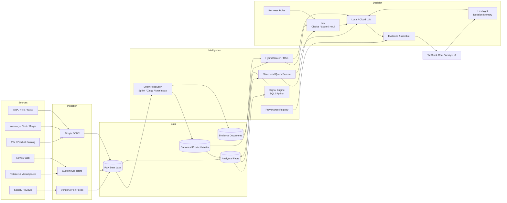
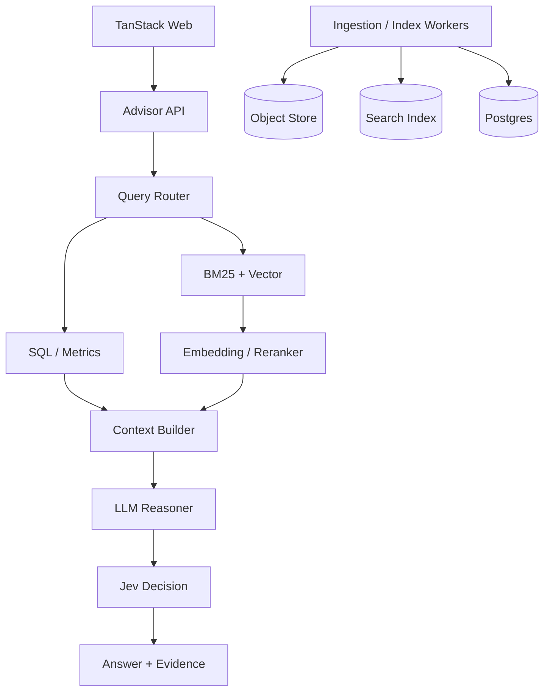
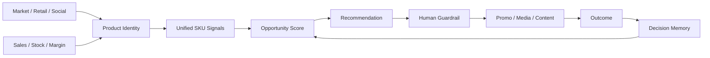
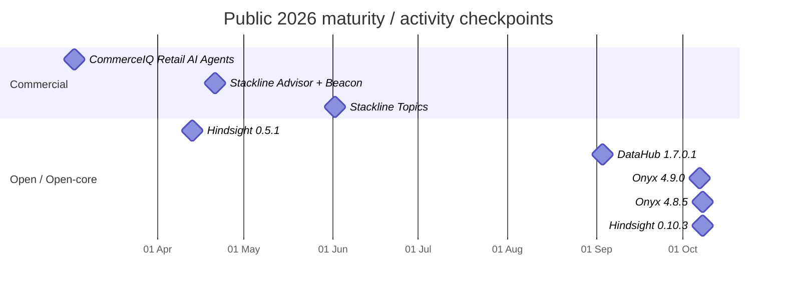

# AI Product Intelligence Advisor — Deep Research on Open-source, Open-core และ Commercial Projects

**Research date:** 9 October 2026 · Asia/Bangkok  
**Deliverable:** Markdown พร้อม Mermaid diagrams, candidate matrix, maturity timeline, Build-vs-Buy analysis และ primary-source links

**[ดาวน์โหลดรายงานฉบับเต็ม Markdown — AI_Product_Intelligence_Advisor_Deep_Research_2026-10-09.md](sandbox:/mnt/data/AI_Product_Intelligence_Advisor_Deep_Research_2026-10-09.md)**

## Executive summary

- **ยังไม่พบ project เดียวที่ทำทุกอย่างตรงกับ vision ของเรา** ตั้งแต่ Product Lake → ข่าว/market intelligence → SKU entity resolution → SQL+semantic RAG → product signals → promotion decision → long-term decision memory → evidence-first chat ครบในระบบเดียว สิ่งที่ใกล้ที่สุดแบ่งเป็นสองโลก: commercial retail intelligence เช่น **CommerceIQ, DataWeave, Stackline, Profitero+** และชุด composable OSS/open-core เช่น **Onyx + Airbyte + Zingg/Splink + Hindsight + Jev/LangChain + optional MindsDB/DataHub**. citeturn14search11turn14search0turn18search5turn20search0

- สำหรับ project ของเรา ผมแนะนำ **อย่า fork monolith ตัวใดตัวหนึ่งเป็นฐานทั้งหมด** แต่สร้าง **Product Intelligence Domain Core ของเราเอง** แล้ว reuse infrastructure เฉพาะส่วน เพราะ Product/SKU identity, signal definitions, promotion policies, outcomes และ decision history จะเป็น IP และ domain knowledge ที่สำคัญกว่าตัว RAG framework. Onyx เหมาะมากเป็น reference/backend สำหรับ chat/RAG/evidence แต่ไม่ได้มี retail SKU intelligence ในตัว. citeturn15search0turn20search0

- **Onyx คือ project ที่ควรศึกษาเป็นอันดับแรกในฐานะ AI application architecture**: Community Edition ใช้ MIT license และ public architecture ใช้ Next.js, FastAPI, background workers, Postgres, OpenSearch สำหรับ BM25+vector, Redis และ object storage พร้อมแยก indexing/query model workloads; GitHub ยังมี releases ในวันที่ 7–8 October 2026 จึงถือว่า active มากในปัจจุบัน. citeturn15search0turn20search0turn20search1

- **Entity Resolution ควรเป็น subsystem จริงจัง ไม่ใช่ให้ LLM เดาว่า mention ไหนคือ SKU ไหน**. Zingg มี active learning, blocking + similarity models และระบุรองรับ product entities รวมถึงภาษาไทย; Splink เป็น probabilistic record linkage แบบ MIT ที่รองรับ DuckDB/Spark/PostgreSQL. ฝั่ง commercial, DataWeave ใช้ product text, attributes และ images ร่วมกัน พร้อม human validation และ match confidence/transparency. citeturn16search0turn16search1turn14search0turn14search24

- **Jev เหมาะกับ Decision Layer มาก แต่ไม่ควรเป็น calculator**. Jev คืน typed decisions/probabilities/confidence และมี official LangChain `TypeSafeClassifier`; ในขณะเดียวกัน TypeSafe ระบุเองว่า Jev 1.13 มีจุดอ่อนในงาน numeric precision. ดังนั้นยอดขาย, demand growth, inventory pressure, margin และ promotion economics ควรคำนวณ deterministic ด้วย SQL/Python ก่อน แล้วให้ Jev ทำ `Score`, `Choice`, routing และ escalation ส่วน LLM ทำ reasoning/explanation. citeturn19search1turn19search2turn19search4turn19search7turn19search13

## Landscape และ candidate projects

เพื่อเปรียบเทียบระบบที่ทำหน้าที่คนละแบบ ผมใช้ capability map ดังนี้:

| Code | Capability | สิ่งที่หมายถึงในระบบเรา |
|---|---|---|
| **DL** | Product Data Layer | Product master, SKU, sales, inventory, cost, margin, history |
| **MI** | Market Intelligence | News, web, marketplace, social, review, competitor data |
| **ER** | Entity Resolution | External listing/mention → canonical product/SKU |
| **HR** | Hybrid Retrieval | SQL + keyword/BM25 + vector/semantic + RAG |
| **SG** | Product Signals | Trend, sentiment, demand, inventory, margin, opportunity |
| **DE** | Decision Engine | Score, rank, promotion/action recommendation |
| **MEM** | Decision Memory | จำบริบท การตัดสินใจ outcome และ feedback |
| **CHAT** | Chat-first | ถามตอบกับข้อมูลและ recommendation |
| **EV** | Evidence | Provenance, citation, freshness, confidence, audit |

`●` = strong/native, `◐` = partial/adjacent, `○` = ไม่ใช่ focus, `?` = public information ไม่เพียงพอ

### Open-source และ open-core ที่เกี่ยวข้องมากที่สุด

| Project | License / pricing | Capability เด่น | Architecture / Integration | ข้อสรุปสำหรับเรา |
|---|---|---|---|---|
| **[Onyx](https://github.com/onyx-dot-app/onyx)** | CE **MIT**; Enterprise edition เพิ่มความสามารถ; EE pricing ไม่ระบุใน public sources ที่ตรวจ | HR ● · CHAT ● · EV ● · AI ● | Docker, Next.js, FastAPI, workers, Postgres, OpenSearch BM25+vector, Redis, object store, Nginx. citeturn15search0turn20search0 | **Base/reference อันดับหนึ่งสำหรับ RAG/chat/evidence** แต่ Product Intelligence Domain ต้องสร้างเอง |
| **[MindsDB Engine](https://github.com/mindsdb/engine)** | **Elastic License 2.0**; บาง directory มี license ของตัวเอง | HR ● · structured+semantic query | Semantic Query Engine; Knowledge Bases; SQL-oriented access; project ปัจจุบันวางตัวเป็น query layer ข้าม data sources. citeturn17search0turn17search4 | น่าสนใจมากสำหรับ **SQL + semantic query plane**; ทำ POC เทียบ custom router |
| **[DataHub](https://github.com/datahub-project/datahub)** | OSS **Apache-2.0** + managed offering | EV ● · semantic/context ◐ | Metadata graph, lineage/governance, semantic search ผ่าน embeddings/OpenSearch; current OSS repo ระบุ 150+ integrations. citeturn15search1turn15search4turn20search5 | ดีที่สุดด้าน **provenance/lineage/governance** แต่ไม่ควรแบกเข้ามาใน MVP หากยังไม่จำเป็น |
| **[Airbyte](https://github.com/airbytehq/airbyte)** | OSS/source-available ecosystem; connector licensing มีหลายแบบ รวม ELv2 | MI ● ในแง่ ingestion | Repo ปัจจุบันระบุ 600+ connectors และมีทั้ง data movement กับ Agent SDK; connectors เชื่อม APIs, databases, lakes และ AI apps. citeturn15search2turn20search3 | **Reuse ingestion**, ไม่ต้องเขียน ERP/DB/SaaS connectors ใหม่ |
| **[Zingg](https://github.com/zinggAI/zingg)** | **AGPL-3.0**, มีช่องทาง commercial licensing | ER ● | Spark-based MDM/entity resolution; active learning, blocking model, similarity model; รองรับ product และ repo ระบุ Thai/Chinese/Japanese/Hindi ฯลฯ. citeturn16search0 | **Primary ER candidate** เมื่อ scale สูงและต้องการ ML/active learning |
| **[Splink](https://github.com/moj-analytical-services/splink)** | **MIT** | ER ● | Probabilistic record linkage; DuckDB/Spark/PostgreSQL; repo ปัจจุบันประกาศ Splink 5. citeturn16search1 | ผมจะ **เริ่ม benchmark จาก Splink ก่อน Zingg** ถ้า product attributes ของเราค่อนข้างสะอาด |
| **[Hindsight](https://github.com/vectorize-io/hindsight)** | **MIT**, มี cloud option | MEM ● | `retain`, `recall`, `reflect`, memory banks, SDK/API/MCP และ configurable LLM/embedding/reranker. citeturn21view2turn17search13 | **เหมาะมากกับ Decision Memory** และตรงกับ stack ที่เราตั้งใจใช้ |
| **[Radar Intelligence](https://github.com/Scognamiglio1969/radar-intelligence)** | **AGPL-3.0** | MI ● · SG ● | Self-hosted media/social intelligence, Next.js, AI query builder, public data sources, Anthropic/OpenAI/Grok support. citeturn21view1 | มี pattern ที่น่าศึกษามากสำหรับ market/news/social ingestion แต่ **ยัง early-stage** |
| **[laravel-ai-price-intelligence](https://github.com/padosoft/laravel-ai-price-intelligence)** | **Apache-2.0** | MI ● · ER ● · SG ● | GTIN → MPN → name → embedding → optional vision LLM; price/stock scraping, time series, anomaly, forecast, sentiment, confidence review queue. citeturn21view0 | **OSS ที่ concept ใกล้ project เราที่สุด** แต่ maturity ต่ำมาก จึงใช้เป็น case study ไม่ใช่ production foundation |
| **[Jev + LangChain TypeSafeClassifier](https://docs.langchain.com/oss/python/integrations/providers/typesafe)** | Jev เป็น hosted commercial decision model; TypeSafe แสดงราคา $42/billion input tokens ณ วันที่วิจัย | DE ● | Choice/Score/Noul + probability/confidence; LangChain exposes เป็น Runnable และ LangSmith รองรับ traces. citeturn19search2turn19search5turn19search16 | **Core Decision component** แต่ควรซ่อนหลัง `DecisionModelAdapter` ของเรา |

สิ่งที่น่าสนใจเป็นพิเศษคือ `laravel-ai-price-intelligence`: แม้ repo ยังเล็กมาก แต่ architecture มีหลายส่วนที่เกือบตรง requirement ของเรา เช่น catalog onboarding, product discovery, competitor matching, price/stock/content scraping, multi-currency normalization, historical observations, forecasting, anomaly detection, sentiment และ confidence-band human review. Repo ปัจจุบันมีเพียง 6 stars, 0 forks และ 29 commits จึงยังเร็วเกินกว่าจะถือเป็น foundation ที่ mature แต่เหมาะมากสำหรับอ่าน source/design docs. citeturn21view0

### Commercial systems ที่ concept ใกล้ที่สุด

| Product | Pricing ที่พบ | Match กับ concept | สิ่งที่ควรศึกษา |
|---|---|---|---|
| **[DataWeave](https://dataweave.com/)** | Public pricing: **unspecified / request demo** ใน sources ที่ตรวจ | MI ● · ER ● · SG ● · DE ● · EV ● | Product identity, competitor pricing, assortment, digital shelf, sentiment, promo intelligence |
| **[CommerceIQ](https://www.commerceiq.ai/)** | **unspecified / demo** | MI ● · SG ● · DE ● · AI ● | **Signals → recommendation → automated action** |
| **[Profitero+](https://www.profitero.com/)** | **unspecified** | MI ● · SG ● · DE ● | Digital shelf → retail media/promo activation |
| **[Stackline](https://www.stackline.com/)** | **unspecified** | MI ● · SG ● · DE ● · CHAT ● | Advisor over sales, forecasts, competitors, reviews, SKU data |
| **[AlphaSense](https://www.alpha-sense.com/)** | **unspecified** | MI ● · HR ● · CHAT ● · EV ● | Premium market/news intelligence + evidence-oriented research |
| **[Palantir AIP](https://www.palantir.com/platforms/aip/)** | **unspecified** | DL ● · ER ● · HR ● · DE ● · CHAT ● · EV ● | Semantic ontology + governed data/logic/action architecture |
| **[aCommerce EcommerceIQ](https://www.acommerce.asia/ecommerce-iq/)** | **unspecified** | DL ● · MI ● · SG ● · DE ● | Thailand/SEA competitor price + ecommerce operation intelligence |
| **[Wisesight Zocial Eye](https://wisesight.com/th/)** | **unspecified** | MI ● · ER ● · SG ● · CHAT ● | Thai social intelligence, sentiment, NER, prompt-to-insight |

**DataWeave** เป็น commercial reference ที่สำคัญมากสำหรับ Entity Resolution. Product Matching page ระบุการใช้ attributes, descriptions และ images ร่วมกัน รวมถึง human experts สำหรับ difficult matches และแสดง matching statistics ให้ผู้ใช้ตรวจสอบได้; ตัวเลข accuracy มากกว่า 99% ที่บริษัทระบุควรถือเป็น **vendor claim** จนกว่าเราจะทดสอบกับ catalog ไทยและ SKU ของเราเอง. citeturn14search0turn14search24

**CommerceIQ** น่าจะเป็น commercial case study ที่ใกล้ vision “ผู้ช่วยตัดสินใจ” ของเราที่สุด: public platform อธิบายการรวม sales, retail media และ digital shelf data แล้วใช้ specialized AI agents เพื่อ optimize และ automate workflows; เอกสารปี 2026 ยังกล่าวถึงการเชื่อม content, media, search, inventory และ demand signals เพื่อจัดการ SKU จำนวนมากโดยมี human guardrails. citeturn14search11turn14search5turn14search14

**Stackline** มี pattern ที่ควรดูด้าน Chat/Advisor โดยตรง: Beacon รวม sales, forecasting, advertising, content และ operations พร้อม SKU-level forecasts/recommendations ขณะที่ประกาศวันที่ 21 April 2026 ระบุการนำ Beacon data เข้าสู่ Advisor. citeturn18search5turn18search9

**Profitero+** มี case ที่ตรงกับ “signal → action”: Shelf Intelligent Media ใช้ product-level availability/pricing และ integrations สามารถปรับ media budgets ตาม competitor conditions เช่น out-of-stock หรือ discount. citeturn18search14turn18search17

**Wisesight** ควร evaluate จริงสำหรับตลาดไทย ไม่ใช่แค่ศึกษา: เอกสารภาษาไทยปี 2026 กล่าวถึง Prompt/Intelligent Insights, automated summaries, image analysis, NER, speech-to-text และการวิเคราะห์ social data; อีกหน้าระบุ NER สำหรับ brand, organization, place และ product-like entities ใน natural-language text. citeturn19search0turn19search3turn19search6

## Architecture patterns ที่ควรนำมาปรับใช้

### สถาปัตยกรรมเป้าหมายที่ผมแนะนำ

แนวทางนี้เป็น **การสังเคราะห์** จาก Onyx, Airbyte, Zingg/Splink, Hindsight, Jev และ commercial retail-intelligence patterns ไม่ใช่ architecture ของ vendor ใด vendor หนึ่ง. citeturn20search0turn15search2turn16search0turn16search1turn21view2turn19search2



จุดที่สำคัญคือ **LLM ไม่ควรเป็นเจ้าของ business truth** และ **Jev ไม่ควรคำนวณ economics**. Jev documentation ระบุชัดว่าโมเดลเหมาะกับ fast/common-sense System One tasks แต่มีข้อจำกัดด้าน numeric precision; `Score` เหมาะกับตำแหน่งบน spectrum และ `Choice` เหมาะกับ fixed alternatives. citeturn19search4turn19search7turn19search13

ดังนั้น pipeline ควรเป็น:

```text
Raw facts
   ↓
Deterministic metrics
   ↓
Business rules
   ↓
Jev scoring / classification / routing
   ↓
LLM explanation
   ↓
Evidence assembler
   ↓
User
```

ตัวอย่างเช่น:

```text
SQL/Python computes:
- sales_growth_4w = +18.4%
- weeks_of_supply = 9.2
- gross_margin = 24.8%
- competitor_price_gap = +6.1%
- positive_sentiment = 73%
- trend_velocity = +2.3σ

Jev decides:
- promotion_suitability: HIGH
- promotion_type:
    bundle         0.61
    discount       0.20
    media_only     0.13
    no_promotion   0.06

Business rules check:
- margin floor: PASS
- campaign stock: PASS
- vendor restriction: PASS

LLM explains:
"แนะนำ bundle แทน straight discount เพราะ..."
```

### Onyx pattern ที่ควรยืม แม้เราใช้ TanStack

Onyx public architecture แยก query-time inference server ออกจาก indexing server, ใช้ OpenSearch เป็นทั้ง BM25 และ vector retrieval, Postgres เก็บ system/application data, Redis เป็น cache และ object store เก็บไฟล์. นี่เป็น pattern ที่น่าลอก เพราะ ingestion workload และ live-chat workload มี resource profile ต่างกัน. citeturn20search0



ผมจึงไม่แนะนำให้ “ใช้ Onyx ทั้งก้อนแล้วแก้หน้าเว็บ” ทันที แต่ควรทดลองสองแนวทางคู่กัน:

```text
Option A
TanStack → Our API → Onyx/search backend

Option B
TanStack → Our API → Own OpenSearch + retrieval pipeline
```

จากนั้น benchmark retrieval quality, citation quality, complexity และ maintainability ก่อนเลือก.

### Commercial closed-loop pattern

จาก CommerceIQ, Profitero+, DataWeave และ Stackline สิ่งที่ชัดเจนคือ retail intelligence ที่มีประโยชน์ไม่ได้หยุดที่ dashboard แต่เชื่อม **identity → signals → decision → action → outcome**. citeturn14search0turn14search11turn18search17turn18search5



นี่เป็นสิ่งที่ project เราควรต่างจาก “RAG Chatbot ทั่วไป”: ระบบต้องสามารถตอบได้ไม่ใช่เพียงว่า **เกิดอะไรขึ้น** แต่ต้องตอบต่อว่า **แล้วควรทำอะไร เพราะอะไร มีข้อจำกัดอะไร และครั้งก่อนผลเป็นอย่างไร**

## Ranking, reuse และ Buy-vs-Build

### Base platform ที่เหมาะที่สุด

คะแนนด้านล่างเป็น **การประเมินของผมสำหรับ use case นี้** ไม่ใช่ vendor benchmark.

| Rank | Candidate | Fit | Interpretation |
|---|---|---:|---|
| **A+** | **Our Product Intelligence Core + reusable components** | **9.3/10** | Architecture ที่ควรเลือกจริง |
| **A** | **Onyx** | **8.7/10** | Study/reuse สำหรับ RAG, chat, evidence, deployment |
| **B+** | **MindsDB Engine** | **7.8/10** | POC สำหรับ SQL + semantic query federation |
| **B** | **laravel-ai-price-intelligence** | **7.4 concept / 4.5 maturity** | อ่าน architecture/source; ไม่ใช้เป็นฐาน production ตอนนี้ |
| **B-** | **DataHub** | **6.9 overall / 9 provenance** | เพิ่มเมื่อ governance/lineage complexity สูง |
| **C+** | **Radar Intelligence** | **6.3 concept / low maturity** | Study connector/social-intelligence patterns |

เหตุผลที่ Onyx ขึ้นอันดับสูงคือ license และ architecture เหมาะกับการศึกษาระบบ production และมี development activity ล่าสุดมาก; แต่เพราะไม่มี retail-domain semantics เราจึงยังควรเป็นเจ้าของ Product Intelligence Core เอง. citeturn15search0turn20search0turn20search1

### Component-by-component recommendation

| Problem | ตัวเลือกหลัก | ตัวเลือกสำรอง | Recommendation |
|---|---|---|---|
| Internal data ingestion | **Airbyte** | Custom CDC | Reuse |
| News/web ingestion | Custom collectors + feeds | Radar patterns | Build adapters |
| Thai social intelligence | **Wisesight POC** | Own collectors | Buy-vs-build |
| Product/SKU resolution | **Splink → Zingg** | Custom multimodal | Benchmark both |
| Hybrid RAG | **Onyx architecture/backend** | Own OpenSearch | POC |
| Structured + semantic federation | **MindsDB POC** | Own query router | Benchmark |
| Provenance/lineage | Lightweight internal registry | DataHub | Start small |
| Deterministic signals | **Build** | — | Core IP |
| Business rules | **Build** | — | Core IP |
| AI scoring/routing | **Jev** | rules / classifier / structured LLM | Adapter |
| Long-term decision memory | **Hindsight** | own event-memory system | Reuse |
| Explanation | Local/cloud LLM | multi-provider router | Adapter |
| Chat UI | **TanStack custom** | — | Build |
| Retail coverage/data | DataWeave / Wisesight / Profitero / aCommerce | own crawling | Buy selectively |

Hindsight เหมาะกับ memory subsystem เพราะตัว project ออกแบบมาให้ agent “learn over time” ไม่ใช่แค่เก็บ chat history และมี `retain/recall/reflect`, memory banks และ configurable model stack; release `v0.10.3` ออกวันที่ 8 October 2026 ซึ่งบ่งชี้ว่า project ยังอยู่ในช่วง active development สูง. citeturn21view2turn17search5

แต่ผมจะตั้ง boundary ชัดเจนว่า:

```text
Hindsight CAN remember:
✓ เราเคยเลือก promotion แบบไหน
✓ ทำไม analyst override AI
✓ campaign นั้น outcome เป็นอย่างไร
✓ ทีม category นี้ชอบ optimize margin หรือ revenue
✓ policy exception ที่เคยเกิด
✓ user feedback

Hindsight MUST NOT be authoritative for:
✗ current stock
✗ current selling price
✗ current cost/margin
✗ today's sales
✗ latest competitor price
✗ latest market/news state
```

### Commercial shortlist ที่ควรขอ demo

**P0 — CommerceIQ:** เพื่อศึกษา recommendation/action loop ที่ระดับ SKU และดูว่าระบบ commercial จัด human guardrails อย่างไร. CommerceIQ ระบุการรวม sales, media และ digital-shelf information และมี 2026 AI agent suite สำหรับ sales, shelf, media และ content. citeturn14search5turn14search11

**P0 — DataWeave:** เพื่อ benchmark Entity Resolution, competitor-product matching, confidence และ commerce intelligence coverage. DataWeave public materials ระบุทั้ง multimodal product matching และ transparent matching controls. citeturn14search0turn14search3

**P0 — Wisesight:** เพราะ Thai social coverage, language understanding, sentiment/NER และ data-access rights เป็นสิ่งที่อาจแพงกว่าการซื้อเมื่อพยายาม build เอง. Public 2026 material ระบุ prompt-based analysis, NER, image analysis และ speech-to-text. citeturn19search0turn19search6

**P1 — Stackline:** เพื่อศึกษาว่า Advisor layer ทำงานร่วมกับ SKU forecasting/operations อย่างไร; public product material ระบุ Beacon สำหรับ unified insights, forecasts และ growth recommendations และการ integrate เข้า Advisor. citeturn18search5turn18search9

**P1 — Profitero+:** เพื่อศึกษา signal-to-activation โดยเฉพาะ availability/price/competitive signal ที่ไปกระทบ retail media actions. citeturn18search14turn18search17

**P1 — aCommerce:** สำคัญในบริบท SEA/Thailand เพราะ EcommerceIQ ระบุ real-time competitor price intelligence และ aCommerce ระบุ ecosystem ที่รวม EcommerceIQ, Ecommerce Market Insights และ AskIQ สำหรับ AI-powered data synthesis. citeturn18search3turn18search7

**P2 — AlphaSense:** ไม่ใช่ retail engine แต่เป็น case study ชั้นดีสำหรับ premium external-information corpus และ evidence-driven research; AlphaSense ปัจจุบันระบุ content universe มากกว่า 500 ล้าน business documents รวม research, earnings calls, expert interviews, filings, news และ internal content. citeturn18search2turn18search25

**P2 — Palantir AIP:** ควรดูในฐานะ architecture study มากกว่าซื้อทันที. Ontology public docs นิยามระบบผ่านการ integrate data, logic, action และ security และ mapping data sources เป็น objects/properties/links ซึ่งใกล้กับสิ่งที่เราควรทำกับ Product/SKU/Signal/Decision domain มาก. citeturn14search1turn14search16turn14search10

## Case studies ที่มีผลต่อ design โดยตรง

### Product identity ต้องมาก่อน intelligence

DataWeave บอกตรง ๆ ว่า product matching เป็นแกนของ retail competitive intelligence และ current solution ใช้ text/image/attributes รวมกับ human validation. ฝั่ง OSS `laravel-ai-price-intelligence` ใช้ cascade จาก identifier ที่แข็งแรงที่สุดไปหา semantic/multimodal matching และมี human-review confidence bands. citeturn14search0turn14search12turn21view0

นี่ทำให้ผมแนะนำ schema สำหรับทุก external-to-internal match:

```text
external_entity_id
canonical_product_id
sku_id                  nullable
match_type              exact_gtin | mpn | fuzzy | semantic | image | manual
match_probability
features_used[]
matcher_version
evidence_ids[]
review_status
reviewer
valid_from
valid_to
```

จุดสำคัญคือ **Entity Resolution มี temporal validity ด้วย**. External listing อาจเปลี่ยน title, bundle, seller หรือ pack-size และ mapping ที่ถูกเมื่อเดือนก่อนอาจไม่ใช่ mapping ที่ถูกในวันนี้.

### Product Signal ต้องเป็น versioned fact ไม่ใช่ prompt-generated score

ผมแนะนำ data contract ประมาณนี้:

```text
ProductSignal
  signal_id
  sku_id
  signal_type
  value
  unit
  window_start
  window_end
  baseline
  calculated_at
  data_as_of
  formula_version
  source_ids[]
  quality_score
```

ตัวอย่าง signal ที่ควรสร้าง:

```text
trend_momentum_7d
trend_acceleration_7d_vs_28d
mention_velocity_zscore
positive_sentiment_share_14d

sales_growth_4w
sales_growth_yoy
demand_forecast_delta
sell_through_rate

weeks_of_supply
aged_inventory_ratio
stockout_risk

competitor_price_gap
competitor_discount_intensity
price_index
competitor_stockout_opportunity

gross_margin_pct
margin_pool
promo_funding_available
historic_promo_uplift
```

CommerceIQ's public examples reinforce ว่า retail optimization ต้องดู inventory, media, search/content และ demand พร้อมกัน ไม่ใช่ optimize signal เดี่ยว. citeturn14search14turn14search20

### Decision Engine ต้องแบ่ง deterministic กับ AI

ผมเสนอ:

```text
Decision Engine
│
├── Hard Business Constraints
│   ├── minimum margin
│   ├── available stock
│   ├── vendor constraints
│   ├── prohibited products
│   └── campaign calendar
│
├── Deterministic Analytics
│   ├── demand opportunity
│   ├── inventory urgency
│   ├── margin headroom
│   ├── promo history
│   └── competitor gap
│
├── Jev
│   ├── promotion_suitability Score
│   ├── promotion_type Choice
│   ├── escalation Choice
│   └── sufficient_evidence Noul
│
└── LLM
    ├── explanation
    ├── comparative reasoning
    ├── campaign ideas
    └── conversational follow-up
```

Jev `Choice` คืนทั้ง chosen option, full probability distribution และ confidence; `Score` ใช้กับ ordered spectrum; TypeSafe ยังระบุว่า confidence สะท้อน shape ของ probability distribution ไม่ใช่หลักประกันว่าคำตอบถูก. citeturn19search7turn19search13

ดังนั้น:

> **Jev confidence ≠ probability that the promotion will succeed**

เราควรมี confidence อย่างน้อยสี่ชนิดแยกจากกัน:

```text
entity_match_confidence
data_quality_confidence
retrieval/evidence_confidence
decision_model_confidence
```

และถ้าจะทำนาย “promotion success probability” จริง ต้องเป็นอีก model/backtest/calibrated prediction โดยเฉพาะ.

### Evidence-first ควรเป็น API contract ไม่ใช่ UI feature

คำตอบควรมีโครงสร้างคล้าย:

```json
{
  "answer": "แนะนำ bundle promotion สำหรับ TV-A55",
  "as_of": "2026-10-09T10:00:00+07:00",

  "entity": {
    "sku": "TV-A55",
    "match_confidence": 0.94
  },

  "facts": {
    "sales_growth_4w": 18.4,
    "weeks_of_supply": 9.2,
    "positive_sentiment": 0.73
  },

  "decision": {
    "promotion_type": "bundle",
    "decision_model": "jev",
    "model_confidence": 0.84,
    "policy_version": "promo-policy-2026-10"
  },

  "evidence": [
    {
      "source_id": "news-1837",
      "published_at": "...",
      "retrieved_at": "...",
      "claim_ids": ["claim-4"]
    }
  ],

  "quality": {
    "data_freshness": 0.97,
    "entity_resolution": 0.94,
    "source_coverage": 0.82
  }
}
```

Palantir's ontology/action model และ DataHub's metadata/semantic-search architecture เป็น case studies ที่ดีสำหรับทำให้ “business object + semantics + provenance” เป็น first-class system concept แทนการโยน documents ลง vector store อย่างเดียว. citeturn14search1turn14search4turn20search5

## Recommended roadmap สำหรับ architecture ปัจจุบัน

จากการวิจัยทั้งหมด ผมจะเปลี่ยนภาพของ project จาก

```text
Data Lake + RAG + Chatbot
```

เป็น

```text
Product Decision Intelligence Platform
```

โดยมี core layers ดังนี้:

```text
Experience Layer
  TanStack Chat
  Product Comparison
  Decision Cards
  Evidence Drawer
  What-if Analysis
        │
        ▼
Advisor Layer
  Query Router
  Agent Orchestrator
  Evidence Assembler
        │
        ├───────────────┐
        ▼               ▼
Knowledge            Decision
SQL/Metrics          Business Rules
Hybrid Search        Jev
RAG                  Simulation
        │               │
        └───────┬───────┘
                ▼
Product Intelligence
  Signals
  Canonical Product Graph
  Entity Resolution
  Market Events
        │
        ▼
Data Platform
  Product Master
  Sales
  Inventory
  Cost/Margin
  News
  Social
  Marketplace
  Reviews
        │
        ▼
Raw Lake + Provenance
```

### สิ่งที่ควรสร้างเอง

**Canonical Product Domain / Ontology** ควรเป็นของเราเอง:

```text
Brand
Category
ProductFamily
ProductVariant
SKU

ExternalMention
ExternalListing
MarketOffer
Review
NewsEvent

SalesObservation
InventorySnapshot
PriceObservation

ProductSignal
PromotionCandidate

Decision
DecisionEvidence
DecisionOutcome
PolicyVersion
```

นี่เป็นจุดที่ Palantir Ontology case study มีประโยชน์มาก: public docs เน้น object/link semantics และการ integrate data, logic และ actions มากกว่ามองข้อมูลเป็น tables/documents แยกกัน. citeturn14search1turn14search16

**Signal Engine** และ **Business Decision Policy** ควร build เอง เพราะเป็น domain knowledge ที่จะสร้าง competitive advantage.

**TanStack analytical chat UI** ควร build เองเช่นกัน เพราะ UX ที่เราต้องการไม่เหมือน generic enterprise search. ในอนาคต UI ควรมีทั้ง conversation และ structured widgets เช่น:

```text
Answer
├── Recommended action
├── Why
├── KPI snapshot
├── Supporting market evidence
├── Conflicting evidence
├── Confidence breakdown
├── Alternative options
├── What changed since last week?
├── Historical decisions
└── What-if controls
```

### สิ่งที่ควร POC ก่อนเขียนใหม่

ผมจะเรียงดังนี้:

**Onyx** — install แล้วศึกษาการ indexing, hybrid retrieval, permissioning, citations และ deployment. Community Edition เป็น MIT และ architecture เป็น production-oriented มาก. citeturn15search0turn20search0

**Hindsight** — ต่อเข้ากับ dummy advisor แล้วทดลองจำ decisions/outcomes/preferences. Current v0.10.3 ออก 8 October 2026 จึงควร pin version และทดสอบก่อน production. citeturn17search5turn21view2

**Splink** — ทำ SKU/linkage benchmark บน catalog จริง. Splink เป็น MIT และให้ probabilistic linkage ที่ตรวจสอบได้. citeturn16search1

**Zingg** — benchmark กับชุดเดียวกันเมื่อเราต้องการ active learning/large-scale ER และ multilingual product attributes. citeturn16search0

**laravel-ai-price-intelligence** — clone เพื่ออ่าน architecture/interfaces และ confidence-review workflow ไม่ใช่เพื่อเอาไป production ทั้งก้อน. citeturn21view0

**MindsDB** — POC แยกว่าการมี Semantic Query Engine ลด complexity ของ SQL+unstructured routing ได้มากพอจะยอมรับ ELv2/dependency หรือไม่. citeturn17search0turn17search4

### Evaluation benchmark ที่ควรสร้างก่อนเลือก stack

สำหรับ **Entity Resolution** ควรมี gold dataset ที่จงใจรวมเคสยาก:

```text
Samsung 55" QLED QA55...
Samsung QA55... / different year
55Qxx / local model alias
TV model vs matching soundbar accessory
same model / different size
same family / different storage
Thai transliteration
brand spelling typo
bundle listing
seller-created title
image-only marketplace listing
```

วัด:

```text
precision
recall
false positive rate
wrong-SKU auto-link rate
human-review rate
coverage
latency
cost per 1,000 entities
```

ผมจะให้ความสำคัญกับ **wrong-SKU auto-link rate** มากกว่าคะแนน aggregate เพราะ entity ผิดหนึ่งครั้งจะปนเปื้อน sentiment, trend, competitor prices และ recommendation ต่อเนื่องทั้งหมด.

สำหรับ **Hybrid Retrieval** ต้องมีคำถามที่ต้องใช้ทั้ง structured และ unstructured data:

> “ทีวีแบรนด์ไหนยอดขายสี่สัปดาห์โต แต่ stock cover เกินแปดสัปดาห์ และ sentiment ดีขึ้นในสองสัปดาห์ล่าสุด?”

> “ทำไม A55 ถึงควร bundle มากกว่าลด 10%?”

> “ข่าวหรือรีวิวอะไรเป็นสาเหตุหลักที่ score ของรุ่น B ลดลงจากสัปดาห์ก่อน?”

จากนั้นวัด SQL correctness, evidence correctness, freshness, completeness, latency และ unsupported-claim rate.

สำหรับ **Decision Engine** ให้ backtest:

```text
Rules only
vs
LLM structured output
vs
Jev + rules
vs
Human analyst
```

และวัด business outcome เช่น margin, revenue, inventory reduction, stockout และ recommendation acceptance ไม่ใช่แค่ model confidence.

## Maturity timeline และข้อสรุปสุดท้าย

วันที่ด้านล่างคือ **public releases/product activity checkpoints** ไม่ใช่วันก่อตั้ง project. CommerceIQ ประกาศ Retail AI Agents วันที่ 3 March 2026; Hindsight 0.5.1 วันที่ 13 April; Stackline Advisor+Beacon วันที่ 21 April และ Topics วันที่ 2 June; DataHub v1.7.0.1 วันที่ 3 September; Onyx v4.9.0 วันที่ 7 October และ v4.8.5 วันที่ 8 October; Hindsight v0.10.3 วันที่ 8 October 2026. citeturn14search5turn17search37turn18search9turn18search12turn20search9turn20search1turn17search5



ข้อสรุปจากงานวิจัยนี้คือ **ไม่ควรเริ่มด้วยคำถามว่า “จะใช้ LLM ตัวไหนหรือ vector DB ตัวไหน”** แต่ควรเริ่มด้วย:

```text
Product Identity
      +
Point-in-time Facts
      +
Versioned Signals
      +
Decision Policy
      +
Evidence
      +
Decision Outcomes
```

จากนั้น AI จึงเป็นชั้นที่เข้ามาใช้สิ่งเหล่านี้.

Architecture baseline ที่ผมเห็นว่าเหมาะที่สุด ณ **9 October 2026** คือ:

```text
TanStack UI
    ↓
Advisor / Query Orchestrator
    │
    ├── Structured Analytics Service
    ├── Onyx-style Hybrid RAG
    ├── Product Entity Resolution
    │      ├── deterministic identifiers
    │      ├── Splink
    │      ├── Zingg
    │      └── multimodal matcher
    │
    ├── Product Signal Engine
    ├── Business Rule Engine
    ├── Jev Decision Adapter
    ├── Local / Cloud LLM Adapter
    └── Hindsight Memory Adapter
             ↓
      Evidence Assembler
             ↓
 Answer / Recommendation / Comparison / What-if
```

โดย **Airbyte** อยู่ฝั่ง authorized ingestion, **vendor feeds/custom collectors** อยู่ฝั่ง market/news/social, **DataHub** เป็น optional governance plane และ **CommerceIQ/DataWeave/Stackline/Profitero/Wisesight/aCommerce** เป็น commercial benchmarks หรือ data suppliers ไม่ใช่สิ่งที่ควรให้เป็นเจ้าของ logic หลักของระบบ. ข้อสรุปนี้เป็น architectural recommendation จาก capability comparison ข้างต้น ไม่ใช่ข้อจำกัดทางเทคนิคของผลิตภัณฑ์เหล่านั้น. citeturn15search2turn15search4turn14search11turn14search0turn18search5turn18search17turn19search0turn18search7

**ห้าระบบที่ผมจะ clone/install/POC ก่อนเริ่ม architecture implementation จริงคือ `Onyx`, `Hindsight`, `Splink`, `Zingg` และ `laravel-ai-price-intelligence`; จากนั้นทำ `MindsDB` query-layer experiment แยกต่างหาก.** ฝั่ง commercial ผมจะเริ่ม demo จาก **CommerceIQ → DataWeave → Wisesight** เพราะสามตัวนี้ตอบสามความเสี่ยงใหญ่ที่สุดของเราโดยตรง: **Decision/Action Loop → Product Identity/External Commerce Data → Thai Social Intelligence**. citeturn20search0turn21view2turn16search1turn16search0turn21view0turn17search0turn14search11turn14search0turn19search0

**[ดาวน์โหลดรายงาน Markdown ฉบับเต็มพร้อม primary-source URLs และ Mermaid diagrams](sandbox:/mnt/data/AI_Product_Intelligence_Advisor_Deep_Research_2026-10-09.md)**