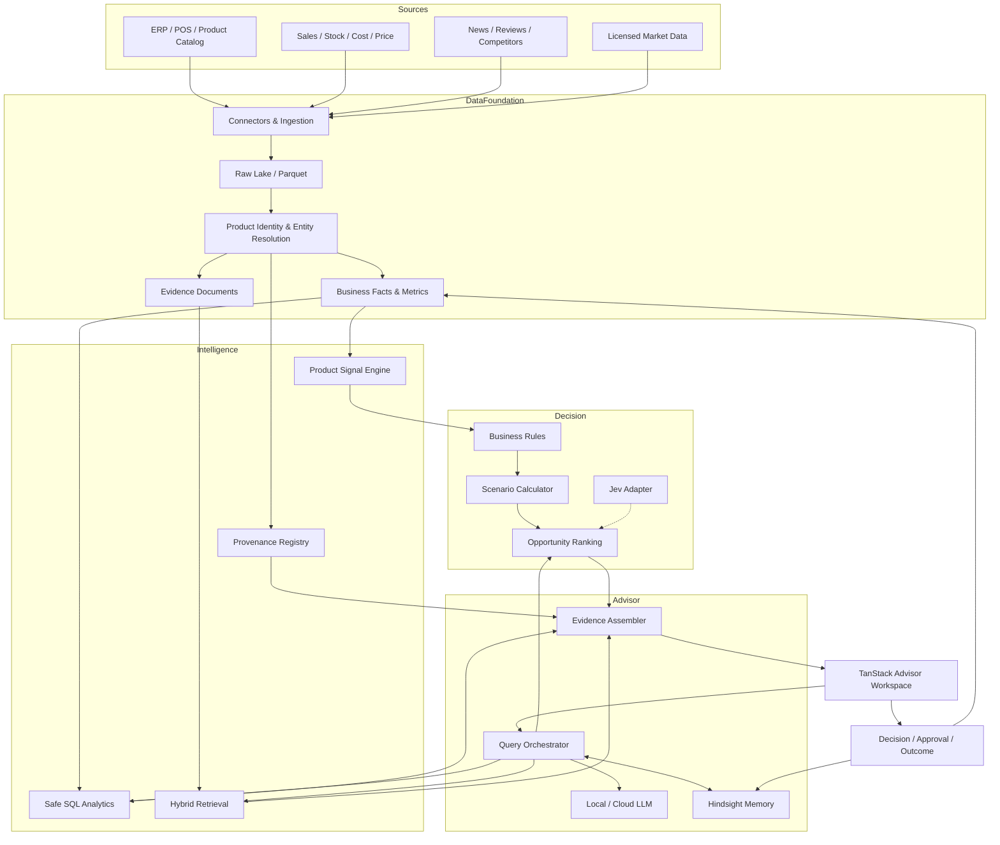

# AI Product Intelligence Advisor
## Project Blueprint, Architecture & Implementation Plan

**Version:** 0.2 Draft  
**Date:** 9 October 2026  
**Status:** Proposed Planning Baseline  
**Project Type:** AI Product Decision Intelligence Platform

---

# 1. Executive Summary

**AI Product Intelligence Advisor** คือระบบ AI สำหรับวิเคราะห์ข้อมูลสินค้าและสนับสนุนการตัดสินใจทางธุรกิจ โดยรวมข้อมูลภายในองค์กรเข้ากับข้อมูลตลาดภายนอก เพื่อค้นหาโอกาสและความเสี่ยง พร้อมเสนอแนวทางดำเนินงานที่มีหลักฐานตรวจสอบได้

ระบบไม่ได้มีเป้าหมายเป็นเพียง Chatbot หรือ BI Dashboard แต่ต้องเชื่อมกระบวนการทั้งหมดเข้าด้วยกัน:

**Product Identity → Trusted Data → Market Signals → Business Analysis → Recommendation → Human Decision → Outcome Measurement**

## 1.1 เป้าหมายหลัก

1. รวมข้อมูลสินค้า ยอดขาย ต้นทุน กำไร สต็อก และประวัติโปรโมชั่น
2. ติดตามข่าว รีวิว ราคา คู่แข่ง และแนวโน้มตลาดจากแหล่งที่ได้รับอนุญาต
3. เชื่อมข้อมูลภายนอกกับ SKU ภายในอย่างแม่นยำ
4. ให้ผู้ใช้ถามคำถามทางธุรกิจด้วยภาษาธรรมชาติ
5. คำนวณ Business Metrics ด้วยสูตรที่ตรวจสอบได้
6. เสนอสินค้าและรูปแบบโปรโมชั่นที่เหมาะสม
7. แสดงหลักฐาน ความสดของข้อมูล ความเสี่ยง และทางเลือกอื่น
8. บันทึกการตัดสินใจและผลลัพธ์จริงเพื่อปรับปรุงระบบในอนาคต

## 1.2 Product Vision

> Build an evidence-first AI advisor that understands products, connects internal business performance with external market intelligence, and recommends measurable business actions.

## 1.3 หลักการออกแบบ

- **Data-first:** ข้อมูลจริงมาก่อน AI reasoning
- **Evidence-first:** ข้อสรุปสำคัญต้องมีหลักฐาน
- **Decision-first:** ผลลัพธ์ต้องช่วยตัดสินใจ ไม่ใช่เพียงสรุปข้อมูล
- **Human-controlled:** การเปลี่ยนแปลงที่กระทบธุรกิจต้องผ่านการอนุมัติ
- **Measurable:** วัดผลลัพธ์จริง ไม่ใช้ Model Confidence แทนผลสำเร็จ
- **Modular:** เปลี่ยน AI Provider, Data Source และ Framework ได้
- **Build the Core, Reuse Infrastructure:** สร้าง Domain Intelligence เอง และใช้ Open Source เฉพาะส่วนที่เหมาะสม

---

# 2. Scope & Product Requirements

## 2.1 MVP Scope

เริ่มจากหนึ่งองค์กรและหนึ่งหมวดสินค้านำร่อง เช่น TV/Electronics

**ความสามารถที่ต้องมี**

- Product Catalog Import
- Sales / Inventory / Cost / Price Import
- Canonical Product Identity
- Product Matching และ Human Review
- Internal Business Analytics
- News / Market Data Ingestion จากแหล่งที่มีสิทธิ์ใช้งาน
- Hybrid Search และ Evidence Retrieval
- Conversational AI
- Business Rules และ Opportunity Ranking
- Recommendation พร้อม Evidence
- Decision History
- Evaluation และ Monitoring ขั้นพื้นฐาน

## 2.2 Phase ถัดไป

- Promotion What-if Simulation
- Campaign Approval Workflow
- Campaign Outcome Tracking
- Competitor Monitoring แบบต่อเนื่อง
- Proactive Opportunity Alerts
- Advanced Entity Resolution
- Forecasting และ Promotion Optimization
- Multi-tenant SaaS
- Integration กับ Campaign Execution Tools

## 2.3 สิ่งที่ยังไม่ทำใน MVP

- AI เปลี่ยนราคาสินค้าจริงโดยอัตโนมัติ
- AI ซื้อโฆษณาหรือเปิดแคมเปญโดยไม่ผ่านคน
- สร้าง ERP หรือ E-commerce Platform ใหม่ทั้งระบบ
- ใช้ Microservices จำนวนมากตั้งแต่เริ่มต้น
- พัฒนา Foundation Model เอง
- อ้างว่า Forecast เท่ากับ Causal Promotion Lift

---

# 3. Reference Architecture

## 3.1 Architecture Overview



## 3.2 Architectural Boundaries

| Component | Responsibility | Must Not Do |
|---|---|---|
| PostgreSQL / Analytics | เก็บและคำนวณข้อเท็จจริงทางธุรกิจ | ใช้ข้อความจาก AI เป็นแหล่งความจริง |
| Product Identity | จับคู่และควบคุมตัวตนสินค้า | Auto-link สินค้าที่ไม่มั่นใจ |
| Signal Engine | คำนวณสัญญาณตามสูตรและช่วงเวลา | สร้างคะแนนที่ตรวจสอบสูตรไม่ได้ |
| Business Rules | ตรวจ Margin, Stock, Budget และ Policy | ปล่อยให้ LLM ข้าม Hard Constraints |
| Jev | ทดลอง Classification, Choice, Score, Routing | คำนวณตัวเลขการเงินแทน Code |
| Hindsight | เก็บ Preferences, Rationale และ Lessons | เป็นแหล่งข้อมูลสดของราคาและสต็อก |
| LLM | เข้าใจคำถาม วิเคราะห์และอธิบาย | สร้างยอดขาย ต้นทุน หรือกำไรขึ้นเอง |
| Evidence Assembler | เชื่อมข้ออ้างกับแหล่งข้อมูล | แสดงข้ออ้างที่ตรวจย้อนกลับไม่ได้ |

---

# 4. Technology Stack

## 4.1 Baseline Stack

| Layer | Technology | Decision |
|---|---|---|
| Frontend | TanStack Start, React, Tailwind CSS | Preferred |
| API | Fastify, TypeScript | Preferred |
| Validation | Zod หรือเทียบเท่า | Preferred |
| Database | PostgreSQL | Preferred |
| Vector Search | pgvector | Preferred |
| Keyword Search | PostgreSQL Full-text Search | Preferred |
| Raw Storage | MinIO / S3-compatible | Preferred |
| Historical Analytics | Parquet + DuckDB | Preferred |
| Queue / Scheduler | Redis + BullMQ | Preferred |
| AI Gateway | LiteLLM หรือ Provider Adapter | Evaluate |
| Data / ML Workers | Python เมื่อจำเป็น | Conditional |
| Long-term Memory | Hindsight | Planned Integration |
| Decision Model | Jev ผ่าน Adapter | Benchmark First |
| Agent Workflow | Explicit Orchestration | Start Here |
| Advanced Workflow | LangGraph | Conditional |
| Observability | OpenTelemetry + LLM Tracing | Planned |
| Deployment | Docker Compose | MVP |

## 4.2 Open Source ที่ควรศึกษา

| Project | สิ่งที่นำมาเรียนรู้ | วิธีใช้งาน |
|---|---|---|
| Onyx | Hybrid RAG, Citations, Indexing Architecture | Reference + POC |
| Splink | Probabilistic Entity Resolution | Matching Benchmark |
| Zingg | Active Learning, Human-in-the-loop Matching | Advanced POC |
| Airbyte | Data Connectors | Reuse Selectively |
| Hindsight | Long-term Agent Memory | Integration |
| MindsDB | SQL + Semantic Query Layer | Optional POC |
| DataHub | Data Lineage และ Governance | Future Reference |
| Medusa / Saleor | Product, Pricing, Inventory, Promotion Domain | Domain Design Reference |
| PromotionLens | What-if UX และ Scenario Analysis | Design Reference |

## 4.3 Commercial Benchmarks

| Product | สิ่งที่ควรศึกษา |
|---|---|
| CommerceIQ | Signals → Recommendations → Actions |
| DataWeave | Product Matching และ Competitor Intelligence |
| Stackline | Unified SKU-level Intelligence |
| Hello Retail | Product Ranking API |
| Circana / NIQ | Promotion Effectiveness และ Scenario Modeling |
| Profitero+ | Digital Shelf → Marketing Activation |
| Wisesight | Thai Social Intelligence |
| Similarweb | External Shopper / Market Signals |
| aCommerce | Thailand / SEA E-commerce Intelligence |

**ข้อกำหนด:** ทุก Vendor ต้องผ่านการตรวจ Coverage, Data Rights, Pricing, API, Freshness และ Exportability ก่อนเลือกใช้งานจริง

---

# 5. Core Domain Model

## 5.1 Product Domain

- Brand
- Category
- ProductFamily
- ProductVariant
- SKU
- ProductAlias
- ExternalListing
- ExternalMention
- ProductMatch

**ProductMatch ต้องมี**

- External Entity ID
- Canonical Product ID
- SKU ID (ถ้ามี)
- Match Method
- Match Confidence
- Matcher Version
- Review Status
- Evidence IDs
- Valid From / Valid To

## 5.2 Business Domain

- SalesFact
- InventorySnapshot
- CostFact
- PriceObservation
- PromotionCampaign
- PromotionResult

ทุก Fact ต้องระบุ Source, Currency, Unit, Effective Time, Observation Time และ Ingestion Time ตามความเหมาะสม

## 5.3 Market Intelligence Domain

- DataSource
- IngestionRun
- NewsEvent
- Review
- MarketOffer
- CompetitorPriceObservation
- EvidenceDocument

## 5.4 Intelligence Domain

- ProductSignal
- SignalDefinition
- SignalCalculationRun
- MetricDefinition
- EvidenceRecord
- SourceReference

**ProductSignal ต้องมี**

- Signal ID และ SKU ID
- Signal Type, Value, Unit
- Observation Window
- Baseline
- Data As-of
- Formula Version
- Source IDs
- Quality Score

## 5.5 Decision Domain

- PromotionCandidate
- Recommendation
- RecommendationEvidence
- Scenario
- BusinessPolicy
- PolicyVersion
- Approval
- DecisionFeedback
- DecisionOutcome

Recommendation ต้องบันทึก Model Version, Policy Version, Evidence Snapshot และ Assumptions เพื่อให้สามารถตรวจสอบย้อนหลังได้

---

# 6. Functional Modules

## MOD-01 — Product Catalog & Identity

**หน้าที่:** สร้าง Canonical Product Master และเชื่อม SKU จากหลายแหล่ง

**งานหลัก**
- Catalog Import
- Product Normalization
- Identifier / Alias Matching
- Probabilistic Matching
- Human Review Queue
- Temporal Match Validity

**Acceptance Criteria**
- แยก Product Family, Variant และ SKU ได้
- ตรวจสอบแหล่งที่มาของ Mapping ได้
- ไม่ Auto-link กรณีที่ Confidence ต่ำกว่าเกณฑ์ที่กำหนด
- รองรับชื่อไทย/อังกฤษและรุ่นที่คล้ายกัน

## MOD-02 — Data Ingestion

**หน้าที่:** รับข้อมูลภายในและภายนอกอย่างน่าเชื่อถือ

**งานหลัก**
- CSV / Database / API Connectors
- Scheduled Jobs
- Retry / Dead-letter Queue
- Incremental Sync
- Deduplication
- Raw Data Preservation
- Data Rights Registry

**Acceptance Criteria**
- Import ซ้ำแล้วไม่เกิดข้อมูลซ้ำโดยไม่ตั้งใจ
- ติดตามสถานะ Job และ Error ได้
- เก็บ Timestamp และ Source Reference
- แยกข้อมูลที่หมดอายุหรือไม่มีสิทธิ์ใช้ได้

## MOD-03 — Business Metrics & Analytics

**หน้าที่:** เป็นแหล่งคำนวณตัวเลขทางธุรกิจที่เชื่อถือได้

**Metrics เริ่มต้น**
- Gross / Net Revenue
- Gross Margin
- Sales Growth
- Sell-through Rate
- Stock Cover
- Aged Inventory
- Competitor Price Gap
- Promotion Performance

**Acceptance Criteria**
- ทุก Metric มี Formula Version
- ผลคำนวณตรงกับ SQL Ground Truth
- รองรับ Timezone, Currency และ Filter
- AI ใช้ Read-only Query Interface

## MOD-04 — Market Intelligence

**หน้าที่:** ตรวจจับเหตุการณ์และสัญญาณภายนอกที่เกี่ยวข้องกับสินค้า

**งานหลัก**
- News / Review / Competitor Data Collection
- Text Normalization
- Entity Extraction
- Source Deduplication
- Product Linking
- Sentiment / Topic Extraction
- Freshness Scoring

**Acceptance Criteria**
- ข่าวเก่าเพิ่งถูก Ingest ไม่ถูกตีความเป็นข่าวใหม่
- ข่าวซ้ำไม่ถูกนับเป็นหลักฐานอิสระหลายครั้ง
- External Mentions เชื่อมกับ SKU อย่างตรวจสอบได้
- แสดง Source และเวลาของข้อมูลได้

## MOD-05 — Hybrid Retrieval

**หน้าที่:** รวม Structured Analytics และ Unstructured Knowledge

**งานหลัก**
- Safe SQL Query Service
- Full-text Search
- Vector Search
- Retrieval Ranking
- Context Assembly
- Citation Generation

**Acceptance Criteria**
- ตอบคำถามที่ใช้ SQL และเอกสารร่วมกันได้
- ไม่อ้างอิงหลักฐานที่ไม่เกี่ยวข้อง
- จำกัดสิทธิ์ SQL, Query Timeout และ Result Size
- มี Benchmark Retrieval Quality

## MOD-06 — Product Signal Engine

**หน้าที่:** สร้างสัญญาณเชิงธุรกิจแบบ Versioned

**Signals เริ่มต้น**
- Sales Growth
- Inventory Pressure
- Margin Headroom
- Competitor Price Gap
- Trend Momentum
- Sentiment Change

**Acceptance Criteria**
- ทุก Signal ย้อนกลับไปยังสูตรและ Input ได้
- แสดงช่วงเวลาและ Data Freshness
- Recalculate ด้วย Formula Version เดิมได้
- ไม่ใช้ LLM เป็นเครื่องคำนวณหลัก

## MOD-07 — Recommendation Engine

**หน้าที่:** จัดอันดับสินค้าและแนะนำแนวทางโปรโมชั่น

**งานหลัก**
- Objective Selection
- Hard Constraint Filtering
- Candidate Ranking
- Promotion Strategy Comparison
- Reason Codes
- Evidence-backed Explanation
- Abstention เมื่อข้อมูลไม่พอ

**Acceptance Criteria**
- ไม่มี Candidate ที่ละเมิด Hard Constraints
- มีเหตุผลว่าทำไมจึงเลือกหรือไม่เลือก SKU
- แสดงทางเลือกและ Trade-offs
- ไม่อ้างว่า Scenario Forecast คือผลจริง

## MOD-08 — AI Advisor

**หน้าที่:** เป็น Conversational Interface สำหรับทุกโมดูล

**งานหลัก**
- Intent Understanding
- Query Routing
- Tool Orchestration
- Multi-turn Context
- LLM Provider Routing
- Evidence Assembly
- Structured Response Validation

**Acceptance Criteria**
- คำตอบเชิงตัวเลขอ้างอิงจาก Trusted Analytics
- คำตอบสำคัญมี Evidence
- แสดงเมื่อข้อมูลไม่เพียงพอ
- ไม่ให้ External Content ควบคุม Tool Execution

## MOD-09 — Decision Memory & Outcomes

**หน้าที่:** จัดเก็บการตัดสินใจและบทเรียน

**งานหลัก**
- Recommendation History
- User Feedback
- Approval / Rejection
- Campaign Tracking
- Actual Outcome
- Hindsight Memory Integration

**Acceptance Criteria**
- ทุกการตัดสินใจมี Audit Trail
- Outcome เชื่อมกลับไปยัง Recommendation
- Memory ไม่แทนข้อมูล Transaction จริง
- รองรับการวิเคราะห์ผลเทียบ Baseline / Control

## MOD-10 — Evaluation & Observability

**หน้าที่:** ตรวจสอบคุณภาพและต้นทุนของระบบ

**งานหลัก**
- Golden Question Dataset
- Matching Gold Dataset
- SQL Correctness Tests
- Recommendation Constraint Tests
- LLM / Jev Benchmark
- Tracing, Cost, Latency, Error Monitoring

**Acceptance Criteria**
- มีชุดทดสอบก่อนเปลี่ยน Model หรือ Prompt
- ตรวจจับ Regression ได้
- Trace คำตอบกลับไปยัง Tools และ Evidence ได้
- มีรายงานคุณภาพก่อน Release

---

# 7. Repository Structure

```text
ai-product-intelligence-advisor/
│
├── apps/
│   ├── web/
│   └── api/
│
├── packages/
│   ├── domain/
│   ├── contracts/
│   ├── metrics/
│   ├── business-rules/
│   ├── evidence/
│   ├── ai-adapters/
│   └── shared/
│
├── workers/
│   ├── ingestion/
│   ├── enrichment/
│   ├── matching/
│   └── signals/
│
├── modules/
│   ├── catalog/
│   ├── identity/
│   ├── analytics/
│   ├── market-intelligence/
│   ├── retrieval/
│   ├── recommendations/
│   ├── decisions/
│   └── evaluation/
│
├── experiments/
│   ├── product-matching/
│   ├── retrieval/
│   ├── jev-benchmark/
│   └── market-data-providers/
│
├── infrastructure/
│   ├── docker/
│   ├── database/
│   ├── migrations/
│   └── observability/
│
├── tests/
│   ├── fixtures/
│   ├── golden-questions/
│   ├── entity-matching/
│   ├── recommendations/
│   └── security/
│
├── docs/
│   ├── architecture/
│   ├── research/
│   ├── adr/
│   ├── api-contracts/
│   ├── runbooks/
│   └── roadmap/
│
└── README.md
```

**Deployment Strategy:** เริ่มจาก Modular Monolith พร้อม Background Workers แล้วค่อยแยก Service ตามความจำเป็นจริง

---

# 8. Development Backlog

Priority Definitions:

- **P0:** จำเป็นสำหรับ Foundation และ MVP
- **P1:** จำเป็นสำหรับ Advisor ที่ให้คำแนะนำได้จริง
- **P2:** ความสามารถขยายหลัง MVP

| ID | Priority | Work Item | Dependencies | Deliverable |
|---|---|---|---|---|
| FND-01 | P0 | Initialize Monorepo | — | Repo, Lint, Tests, CI |
| FND-02 | P0 | Docker Development Stack | FND-01 | Postgres, Redis, MinIO |
| FND-03 | P0 | Auth & Access Control | FND-01 | API Security Baseline |
| DATA-01 | P0 | Product Catalog Import | FND-02 | Canonical Catalog |
| DATA-02 | P0 | Sales/Stock/Cost Import | FND-02 | Trusted Business Facts |
| DATA-03 | P0 | Source & Data Quality Registry | DATA-01 | Provenance Metadata |
| ID-01 | P0 | Product Identity Schema | DATA-01 | Canonical Product Model |
| ID-02 | P0 | Exact Matching + Aliases | ID-01 | Deterministic Matcher |
| ID-03 | P0 | Human Review Queue | ID-02 | Match Review Workflow |
| MET-01 | P0 | Metric Definitions | DATA-02 | Versioned Metrics |
| MET-02 | P0 | Safe SQL Analytics | MET-01, FND-03 | Read-only Analytics API |
| EXT-01 | P1 | Approved Market Sources | DATA-03 | Source Inventory |
| EXT-02 | P1 | News/Review Ingestion | EXT-01, ID-02 | Linked Market Evidence |
| RET-01 | P0 | FTS + pgvector Retrieval | FND-02, DATA-03 | Hybrid Search |
| AI-01 | P0 | Query Orchestrator | MET-02, RET-01 | Advisor Workflow |
| AI-02 | P0 | Evidence Assembler | AI-01, DATA-03 | Cited Answers |
| UI-01 | P0 | Chat & Evidence Workspace | AI-02 | Working Analyst UI |
| SIG-01 | P1 | Product Signal Engine | MET-01, EXT-02 | Versioned Signals |
| DEC-01 | P1 | Business Rules | MET-01 | Constraint Validator |
| DEC-02 | P1 | Opportunity Ranking | SIG-01, DEC-01 | Ranked Candidates |
| DEC-03 | P1 | Decision History | DEC-02 | Auditable Decisions |
| MEM-01 | P1 | Hindsight Integration | DEC-03 | Decision Memory |
| JEV-01 | P1 | Jev Benchmark & Adapter | DEC-02 | Evaluation Report |
| DEC-04 | P2 | What-if Scenarios | DEC-02 | Scenario Workspace |
| DEC-05 | P2 | Campaign Outcome Tracking | DEC-03 | Outcome Dataset |
| EVAL-01 | P0 | Golden Questions | MET-01 | Test Dataset |
| EVAL-02 | P0 | Matching Benchmark | ID-02 | Matching Evaluation |
| EVAL-03 | P1 | Recommendation Evaluation | DEC-02 | Quality Report |
| OPS-01 | P0 | Logs, Traces, Monitoring | FND-01 | Observability Baseline |

---

# 9. Implementation Milestones

## M0 — Engineering Foundation

**Deliverables**
- Repository และ CI
- Local Development Environment
- Database Migrations
- Authentication Baseline
- Initial Data Contracts

**Exit Criteria**
- Developer สามารถเริ่มระบบในเครื่องได้
- Tests และ Migrations ทำงานได้
- มีตัวอย่างข้อมูลสำหรับพัฒนาระบบ

## M1 — Trusted Product Data

**Deliverables**
- Product Catalog
- Sales / Stock / Cost Facts
- Product Matching
- Data Quality
- Governed Metrics

**Exit Criteria**
- ตัวเลขตรวจสอบกับ Source ได้
- Product Mapping ตรวจสอบย้อนหลังได้
- ข้อมูลผิดหรือไม่ครบถูกระบุชัด

## M2 — Evidence-first AI Analyst

**Deliverables**
- Chat UI
- SQL Analytics
- Hybrid Retrieval
- Evidence Panel
- Evaluation Harness

**Exit Criteria**
- ผ่าน Golden Questions ตามเกณฑ์ที่กำหนด
- ไม่สร้างตัวเลขขึ้นเอง
- มี Citation และ As-of Time สำหรับข้ออ้างสำคัญ

## M3 — Product Opportunity Advisor

**Deliverables**
- Market Signals
- Product Signals
- Business Constraints
- Opportunity Ranking
- Recommendation Cards
- Jev Benchmark

**Exit Criteria**
- Recommendation ไม่ละเมิด Hard Constraints
- เหตุผลและ Evidence ตรวจสอบได้
- ระบบปฏิเสธการให้คำแนะนำเมื่อข้อมูลไม่พอได้

## M4 — Decision & Outcome Loop

**Deliverables**
- Decision History
- Human Approval
- Hindsight Memory
- Campaign Outcomes
- Scenario Comparison
- Pilot Evaluation

**Exit Criteria**
- ติดตามจาก Recommendation ไปยังผลจริงได้
- มีวิธีวัดผลเทียบ Baseline หรือ Control
- ประเมินคุณค่าทางธุรกิจของระบบได้

**หมายเหตุ:** ยังไม่ล็อกระยะเวลาของแต่ละ Milestone จนกว่าจะทราบจำนวน Developer, Data Readiness และ Integration Complexity

---

# 10. Proof-of-Concept Experiments

## EXP-01 — Entity Resolution

**Compare**
- Exact Identifier + Alias Rules
- Splink
- Zingg

**Metrics**
- Precision
- Recall / Coverage
- Wrong-SKU Auto-link Rate
- Human Review Rate
- Latency
- Cost per 1,000 Records

**Decision:** เลือกวิธีที่ลด False Match ได้โดยมีต้นทุนดูแลเหมาะสม ไม่เลือกจาก Aggregate Accuracy เพียงตัวเดียว

## EXP-02 — Hybrid Retrieval

**Compare**
- PostgreSQL FTS + pgvector
- Onyx-style Retrieval

**Metrics**
- Retrieval Accuracy
- Citation Accuracy
- Freshness
- Latency
- Operational Complexity

**Decision:** เพิ่ม Search Infrastructure ใหม่เฉพาะเมื่อ Benchmark แสดงประโยชน์ชัดเจน

## EXP-03 — Decision Model

**Compare**
- Rules-only
- Rules + Jev
- Rules + LLM Structured Output

**Metrics**
- Constraint Violation
- Ranking Quality
- Abstention
- Calibration
- Latency
- Cost

**Decision:** ใช้ Jev ใน Production เฉพาะ Task ที่ให้ผลดีกว่า Baseline อย่างวัดได้

## EXP-04 — Market Data Providers

**Candidates**
- DataWeave
- Wisesight
- Similarweb
- aCommerce
- Other authorized sources

**Metrics**
- Thailand Coverage
- Target Category Coverage
- SKU Matchability
- Freshness
- Historical Data
- Licensing / Data Rights
- Cost

**Decision:** Buy หรือ Partner เมื่อคุณภาพและ Coverage คุ้มกว่าการพัฒนา Collector เอง

---

# 11. First End-to-End Vertical Slice

## Business Question

> “ทีวีรุ่นไหนในสต็อกที่ควรทำโปรโมชั่นในเดือนนี้ และควรใช้โปรโมชั่นแบบใด?”

## Required Workflow

1. ระบุหมวดสินค้า ช่วงเวลา และ Objective
2. ดึง SKU ที่มีอยู่จริง
3. คำนวณ Sales, Stock, Cost และ Margin
4. ตรวจสอบ Market Signals และ Competitor Evidence ที่มี
5. ตรวจสอบ Data Freshness
6. ใช้ Business Rules คัด Candidate
7. จัดอันดับ Opportunity
8. เปรียบเทียบ Discount, Bundle, Advertising-only และ Hold
9. สร้าง Recommendation พร้อม Evidence และ Assumptions
10. บันทึกการยอมรับหรือปฏิเสธ
11. เชื่อม Outcome ภายหลังเมื่อมีการดำเนินการจริง

## Expected Output

```text
Recommended Product
  SKU / Model
  Business Objective
  Recommended Promotion Type

Business Facts
  Sales Trend
  Stock Cover
  Margin
  Competitor Price Gap

Reasoning
  Why This Product
  Why This Strategy
  Alternative Options
  Risks / Missing Data

Evidence
  Internal Fact References
  External Source References
  Data As-of Timestamps

Decision
  Approve / Reject / Request More Data
  Policy Version
  Recommendation ID
```

**หมายเหตุ:** หากยังไม่มีข้อมูลภายนอกที่มีสิทธิ์ใช้ ระบบต้องสามารถตอบจากข้อมูลภายในพร้อมระบุข้อจำกัด ไม่แต่ง Market Signals ขึ้นมาเอง

---

# 12. Quality, Security & Governance

## 12.1 Security Requirements

- Read-only SQL สำหรับ AI Analytics
- RBAC สำหรับข้อมูลต้นทุน กำไร และข้อมูลลับ
- Data Classification ก่อนส่งข้อมูลไป Hosted Models
- Prompt Injection Protection
- Input / Output Schema Validation
- Audit Logging
- Human Approval ก่อนการดำเนินการจริง
- Secret Management
- Tenant Isolation หากรองรับหลายองค์กรในอนาคต

## 12.2 Evidence Requirements

ทุกข้อสรุปสำคัญควรมี:

- Source ID
- Source Type
- Source URL หรือ Internal Record Reference
- Published / Observed / Fetched Time ตามประเภทข้อมูล
- Data As-of
- Product Match Reference
- Metric / Formula Version
- Model / Policy Version ตามความเกี่ยวข้อง

## 12.3 Quality Metrics

| Metric | MVP Target |
|---|---|
| Golden Question Correctness | กำหนดหลังสร้าง Gold Dataset |
| Matching Precision / Coverage | กำหนดแยกตามความเสี่ยง |
| Wrong-SKU Auto-link Rate | ต่ำที่สุดเท่าที่ทดสอบและกำกับได้ |
| Hard Constraint Violations | 0 |
| Unsupported Critical Business Claims | 0 |
| Evidence Traceability | ทุกข้ออ้างสำคัญตรวจสอบได้ |
| Data Freshness | กำหนดตามแต่ละ Source |
| Recommendation Usefulness | ประเมินโดย Domain Experts |
| Business Outcome | วัดเมื่อมี Pilot และ Baseline |

**ข้อควรระวัง:** ตัวเลข Confidence ของ Jev หรือ LLM ไม่ใช่ความน่าจะเป็นที่โปรโมชั่นจะสร้างกำไร

---

# 13. Definition of Done

งานพัฒนาแต่ละรายการจะถือว่าเสร็จเมื่อ:

- [ ] มี Implementation ตาม Acceptance Criteria
- [ ] มี Automated Tests ในระดับที่เหมาะสม
- [ ] มี Data / API Contract ที่ชัดเจน
- [ ] มี Error Handling และ Logging
- [ ] มี Security Review สำหรับข้อมูลหรือสิทธิ์ที่เกี่ยวข้อง
- [ ] มี Documentation
- [ ] มี Evidence / Source Traceability หากเกี่ยวข้องกับข้อมูลธุรกิจ
- [ ] ผ่าน Code Review
- [ ] ผ่าน Integration Tests
- [ ] ไม่มี Known Critical Regression

สำหรับงาน AI ต้องเพิ่ม:

- [ ] ผ่าน Evaluation Dataset
- [ ] มี Baseline Comparison
- [ ] บันทึก Model / Prompt Version
- [ ] ตรวจ Failure Cases และ Abstention
- [ ] ตรวจ Latency และ Cost

---

# 14. Architecture Decision Records (ADR)

ต้องจัดทำ ADR ก่อนล็อกเทคโนโลยีหรือเปลี่ยน Architecture สำคัญ

| ADR | Decision Topic | Status |
|---|---|---|
| ADR-001 | Modular Monolith vs Microservices | Proposed |
| ADR-002 | TanStack Start + Fastify | Proposed |
| ADR-003 | PostgreSQL + pgvector + DuckDB | Proposed |
| ADR-004 | Product Identity Architecture | Open |
| ADR-005 | Splink vs Zingg | POC Required |
| ADR-006 | PostgreSQL Retrieval vs Onyx-style Search | POC Required |
| ADR-007 | Explicit Workflow vs LangGraph | Open |
| ADR-008 | Jev Integration Strategy | Benchmark Required |
| ADR-009 | Hindsight Memory Policy | Proposed |
| ADR-010 | External Market Data Buy vs Build | Vendor POC Required |
| ADR-011 | Multi-tenant Data Isolation | Open |
| ADR-012 | Promotion Outcome Measurement | Open |

---

# 15. Risk Register

| Risk | Impact | Mitigation |
|---|---|---|
| Product Matching ผิด | สูงมาก | Gold Dataset, Confidence, Human Review |
| Business Metrics ผิด | สูงมาก | Central Definitions, SQL Tests |
| External Data ไม่ครอบคลุมตลาดไทย | สูง | Vendor Sample POC |
| External Data Rights ไม่ชัด | สูง | License / ToS Review |
| AI Hallucination | สูง | Deterministic Facts, Evidence Validation |
| Prompt Injection | สูง | Untrusted Content Isolation |
| Recommendation ละเมิด Business Rules | สูงมาก | Hard Constraints, Approval |
| Framework Complexity สูงเกิน | กลาง/สูง | Modular Monolith, POC First |
| Vendor Lock-in | กลาง/สูง | Adapters, Exportable Data Contracts |
| Model Confidence ถูกตีความผิด | สูง | Separate Confidence Dimensions |
| Forecast ถูกตีความเป็น Causal Lift | สูง | Baseline / Control Measurement |
| ไม่มีข้อมูลโปรโมชั่นย้อนหลัง | กลาง/สูง | เริ่ม Rules และเก็บ Outcome ใหม่ |

---

# 16. Open Questions

ต้องตัดสินใจก่อนเริ่ม Implementation เต็มรูปแบบ:

1. หมวดสินค้านำร่องคืออะไร?
2. ระบบเริ่มจาก Single Organization หรือ Multi-tenant?
3. แหล่งข้อมูลภายในที่เข้าถึงได้จริงมีอะไรบ้าง?
4. มีข้อมูลต้นทุนและ Margin ที่อนุญาตให้ AI ใช้หรือไม่?
5. มีประวัติโปรโมชั่นและผลลัพธ์ย้อนหลังเพียงใด?
6. ตลาดเป้าหมายเป็นประเทศไทยอย่างเดียวหรือหลายประเทศ?
7. แหล่ง Market Data ใดมี API หรือสิทธิ์ใช้งาน?
8. งบประมาณสำหรับ Hosted AI และ Data Vendors เท่าไร?
9. Jev และ Hindsight จะใช้ Cloud หรือ Self-host ตามความเหมาะสม?
10. KPI ธุรกิจหลักคือ Revenue, Margin, Inventory Reduction หรือ Analyst Productivity?
11. ทีมพัฒนามีกี่คนและมีความถนัดด้านใด?
12. ต้องการ SLA, Data Refresh Frequency และ Security Level ระดับใด?

---

# 17. Recommended First Sprint

## Sprint Goal

**ทำให้ระบบมี Trusted Product Data Foundation ที่รันและทดสอบได้จริง**

### Engineering Tasks

- [ ] FND-01 — สร้าง Monorepo
- [ ] FND-02 — สร้าง Docker Compose Development Stack
- [ ] DATA-01 — สร้าง Catalog Import จาก Sample CSV
- [ ] DATA-02 — สร้าง Sales / Stock / Cost Import
- [ ] ID-01 — ออกแบบ Canonical Product Schema
- [ ] ID-02 — ทำ Exact Identifier + Alias Matching
- [ ] MET-01 — นิยาม Metrics เริ่มต้น
- [ ] EVAL-01 — สร้าง Golden Questions ชุดแรก
- [ ] OPS-01 — เพิ่ม Structured Logging ขั้นพื้นฐาน

### Sprint Deliverables

1. Repository ที่ Developer เริ่มระบบได้
2. Database Schema และ Migrations
3. Product Catalog ที่ Import ได้
4. Business Facts ตัวอย่าง
5. Product Identity Matching ขั้นพื้นฐาน
6. Metrics ที่ตรวจด้วย SQL ได้
7. Tests และ Development Documentation

### Sprint Review Questions

- Catalog มีข้อมูลเพียงพอสำหรับเชื่อม SKU หรือไม่?
- Data Quality ปัญหาหลักคืออะไร?
- Metric Definitions ตรงกับธุรกิจจริงหรือไม่?
- Matching Errors ประเภทใดพบมากที่สุด?
- มีข้อมูลและสิทธิ์เพียงพอสำหรับเริ่ม Market Intelligence หรือไม่?

---

# 18. Final Architecture Recommendation

## What We Should Own

- Canonical Product Identity
- Business Metric Definitions
- Product Signals
- Promotion Rules
- Opportunity Ranking Logic
- Recommendation & Evidence Contracts
- Decision History
- Outcome Measurement

## What We Should Reuse

- Database และ Storage
- Data Connectors
- Search / Retrieval Components
- Agent Workflow Frameworks เมื่อจำเป็น
- LLM Infrastructure
- Hindsight Memory
- Observability Tools

## What We Should Benchmark Before Adopting

- Splink / Zingg
- Onyx-style Retrieval
- MindsDB
- Jev
- Commercial Market Data Providers

## What We Should Defer

- Autonomous Campaign Execution
- Large-scale Distributed Architecture
- Complex Forecasting ก่อนมีข้อมูลรองรับ
- Advanced Governance Platform ก่อนจำเป็น
- Multi-agent Systems ที่ไม่มี Use Case ชัดเจน

---

# 19. Project Success Definition

โปรเจกต์นี้จะประสบความสำเร็จเมื่อผู้ใช้สามารถ:

1. ถามคำถามเกี่ยวกับสินค้าและธุรกิจได้ด้วยภาษาธรรมชาติ
2. ได้คำตอบที่ถูกต้องและตรวจสอบแหล่งข้อมูลได้
3. เห็นความสัมพันธ์ระหว่างผลการขายกับสถานการณ์ตลาด
4. ได้ข้อเสนอที่ไม่ละเมิดข้อจำกัดทางธุรกิจ
5. เข้าใจเหตุผล ความเสี่ยง และทางเลือก
6. ตัดสินใจและติดตามผลลัพธ์ได้
7. ประเมินได้ว่าระบบช่วยให้ธุรกิจตัดสินใจดีขึ้นจริง

**Core Principle:**

> Reuse infrastructure. Own product intelligence. Ground every recommendation in evidence. Measure decisions by real outcomes.

---

# 20. Research References

## Original Project Documents

- `AI_Product_Intelligence_Advisor_Architecture.md`
- `AI_Product_Intelligence_Competitive_Research.md`
- `AI Product Intelligence Advisor — Deep Research on Open-source, Open-core และ Commercial Projects`

## Open Source References

- Onyx — https://github.com/onyx-dot-app/onyx
- Splink — https://github.com/moj-analytical-services/splink
- Zingg — https://github.com/zinggAI/zingg
- Airbyte — https://github.com/airbytehq/airbyte
- Hindsight — https://github.com/vectorize-io/hindsight
- MindsDB — https://github.com/mindsdb/engine
- LangGraph — https://github.com/langchain-ai/langgraph
- DataHub — https://github.com/datahub-project/datahub
- Medusa — https://github.com/medusajs/medusa
- Saleor — https://github.com/saleor/saleor

## Commercial References

- CommerceIQ — https://www.commerceiq.ai/
- DataWeave — https://dataweave.com/
- Stackline — https://www.stackline.com/
- Hello Retail — https://developer.helloretail.com/api/graphQL/product-intelligence/
- Circana — https://www.circana.com/
- NIQ — https://nielseniq.com/
- Profitero — https://www.profitero.com/
- Wisesight — https://wisesight.com/th/
- Similarweb — https://www.similarweb.com/corp/retail/
- aCommerce — https://www.acommerce.asia/

---

**Document Status:** Draft for architecture review and project planning.

**Next Action:** Review Open Questions, approve Architecture Baseline, assign Work Item Owners, prepare sample datasets, and begin Sprint 1.